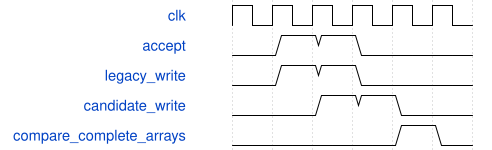

# tb_load_commit_pipeline 模块规范

> RTL: `tb_load_commit_pipeline.v`

## 1. 模块目的

延迟一拍写入的独立记分板；接收元数据与原源锁步，复位取消允许旧存储有意不同。

## 2. 参数

| 参数 | 默认值 | 说明 |
| --- | --- | --- |
| — | — | 本模块没有可配置参数。 |

## 3. 时钟与复位

- 时钟：`{"name": "clk", "frequency_hz": 100000000, "edge": "posedge", "internal": true}`
- 复位：`{"name": "rstn", "active": "low", "synchronous": false, "internal": true}`

## 4. 接口信号规范

| 信号 | 方向 | 位宽 | 时钟域 | 语义角色 | 描述 |
| --- | --- | --- | --- | --- | --- |
| `o_test_done` | output | 1 | clk | test_complete | 全部断言通过后置1并结束仿真。 |

## 5. 周期行为与延迟

- 接受/ready/fault/cursor/loaded按原源逐沿比较。
- 每个合法接受登记一项，下一沿更新期望存储；仅比较已初始化字节。
- 复位清待提交模型，保留已提交字节；旧源取消前已写入的字节可与候选有意不同。
- 432权重连续432拍、1296halo连续1296拍；末提交与单拍start同沿，首个MAC读数据完整。

## 6. WaveDrom 时序图

### 记分板验证一拍提交

接收A/B连续两拍，候选存储晚一拍；元数据同沿，末项提交后完整数组一致。

- WaveJSON：[tb_load_commit_pipeline_queued-write.json5](waveforms/tb_load_commit_pipeline_queued-write.json5)

## 7. 边界、反压与错误

- 63/64、127/128、639/640、703/704、431/432、1295/1296及地址0重启。

## 8. CDC 与综合约束

- 测试专用，不综合，不属于数值精度或完整CNN FPS证据。

## 9. 验证与验收

- TB_PASS_LOAD_COMMIT checks=1728；精确连续耗时断言；完整首读和旧8组数值回归另记。

## 10. 可追溯性

- 规格模块：`tb_load_commit_pipeline`
- RTL 路径：`tb_load_commit_pipeline.v`
- 交付要求：本文档、WaveJSON 和 SVG 必须与同一版本规格一同发布。
