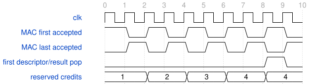

# road_mac_probe 模块规范

> RTL: `road_mac_probe.v`

## 1. 模块目的

Four-credit PW task stream; frozen A0-A5 arithmetic, separate result descriptors.

## 2. 参数

| 参数 | 默认值 | 说明 |
| --- | --- | --- |
| — | — | 本模块没有可配置参数。 |

## 3. 时钟与复位

- 时钟：`{"name": "i_clk", "edge": "posedge", "frequency_hz": 100000000}`
- 复位：`{"name": "i_rstn", "active": "low", "synchronous": false, "values": "Asynchronous cancellation of credits, pipeline and descriptors; ready low during reset. Reload1024 table entries and parameters before runner start."}`

## 4. 接口信号规范

| 信号 | 方向 | 位宽 | 时钟域 | 语义角色 | 描述 |
| --- | --- | --- | --- | --- | --- |
| `i_clk` | input | 1 | i_clk | i_clk | 百兆工作时钟 |
| `i_rstn` | input | 1 | i_clk | i_rstn | 异步低有效复位 |
| `i_input_valid` | input | 1 | i_clk | i_input_valid | 输入负载保持有效标志 |
| `i_first` | input | 1 | i_clk | i_first | 当前组以偏置替代历史累加值 |
| `i_last` | input | 1 | i_clk | i_last | 当前组结束本次归约序列 |
| `i_lane_mask` | input | 8 | i_clk | i_lane_mask | 八条输入通道共享使能掩码 |
| `i_activation_data` | input | 64 | i_clk | i_activation_data | 八个低字节优先有符号激活值 |
| `i_weight_data` | input | 192 | i_clk | i_weight_data | 三组八通道低字节优先权重 |
| `i_bias_data` | input | 96 | i_clk | i_bias_data | 三个低字优先有符号偏置 |
| `i_result_ready` | input | 1 | i_clk | i_result_ready | 下游允许接受保持型终态 |
| `o_input_ready` | output | 1 | i_clk | o_input_ready | 当前序列允许接受输入组 |
| `o_result_valid` | output | 1 | i_clk | o_result_valid | 结果负载保持有效标志 |
| `o_result_data` | output | 96 | i_clk | o_result_data | 三个低字优先INT32结果 |
| `o_fault` | output | 1 | i_clk | o_fault | 任一路末组INT32越界标志 |

## 5. 周期行为与延迟

- Keep signed33 reduction, max24 groups/192 products per lane, final INT32 atomic zero fault, bias once and reduction II1.
- MAC first reserves one of four results until actual result pop, including time in A0-A5. Active reduction always accepts continuation.
- Legal tasks are contiguous, first exactly once and last within24 accepted groups. No interleaving or malformed-protocol tolerance is added.
- Result/fault stable until pop. Four slots are capacity-safe for any legal task; one-group tasks are not promised sustained II1.
- A0-A5 source unchanged; output ring stores fault bit96 and data bits95:0. Reset invalidates pointers/counts without relying on RAM initialization.

## 6. WaveDrom 时序图

### PW tasks overlap before prior result

First0/2/4/6, last1/3/5/7. First result pop8 can reuse credit. Sustained output depends on postprocess backpressure.

- WaveJSON：[road_mac_probe_pw-task-stream.json5](waveforms/road_mac_probe_pw-task-stream.json5)

## 7. 边界、反压与错误

- Full credit with active reduction, simultaneous result pop and new first, random bubbles/backpressure.
- Positive/negative intermediate INT32 excursions recover within signed33; final overflow zeros all three lanes.
- Common asynchronous reset cancels all pipeline and queue ownership; ready low while reset asserted.

## 8. CDC 与综合约束

- No production edits, training, bitgen, board, Flash or additional timing exceptions.
- Diagnostic input/output delays are not a real external-device timing contract.

## 9. 验证与验收

- Same40 layer scenarios per revision, all640 values at each arithmetic stage and384 exports.
- Random phase relative to core start; MAC/commit stability, four PW reset positions, full queue and final-lane overflow.

## 10. 可追溯性

- 规格模块：`road_mac_probe`
- RTL 路径：`road_mac_probe.v`
- 交付要求：本文档、WaveJSON 和 SVG 必须与同一版本规格一同发布。
