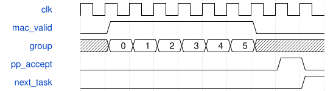

# road_pw_tile_scheduler 模块规范

> RTL: `road_pw_tile_scheduler.v`

## 1. 模块目的

固定48→48 PW，8激活bank/24权重bank；六组预取，已有PP接受任务后继续计算。

## 2. 参数

| 参数 | 默认值 | 说明 |
| --- | --- | --- |
| — | — | 本模块没有可配置参数。 |

## 3. 时钟与复位

- 时钟：`{"name": "i_clk", "edge": "posedge", "frequency_hz": 100000000}`
- 复位：`{"name": "i_rstn", "active": "low", "synchronous": false, "values": "立即取消旧事务；同步释放后重新完整装载1024项表及全部参数/halo。"}`

## 4. 接口信号规范

| 信号 | 方向 | 位宽 | 时钟域 | 语义角色 | 描述 |
| --- | --- | --- | --- | --- | --- |
| `i_clk` | input | 1 | i_clk | i_clk | 沿用冻结PW48接口；valid保持到ready，复位立即取消。 |
| `i_rstn` | input | 1 | i_clk | i_rstn | 沿用冻结PW48接口；valid保持到ready，复位立即取消。 |
| `i_table_loaded` | input | 1 | i_clk | i_table_loaded | 沿用冻结PW48接口；valid保持到ready，复位立即取消。 |
| `i_load_valid` | input | 1 | i_clk | i_load_valid | 沿用冻结PW48接口；valid保持到ready，复位立即取消。 |
| `i_load_kind` | input | 3 | i_clk | i_load_kind | 沿用冻结PW48接口；valid保持到ready，复位立即取消。 |
| `i_load_addr` | input | 12 | i_clk | i_load_addr | 沿用冻结PW48接口；valid保持到ready，复位立即取消。 |
| `i_load_data` | input | 32 | i_clk | i_load_data | 沿用冻结PW48接口；valid保持到ready，复位立即取消。 |
| `o_load_ready` | output | 1 | i_clk | o_load_ready | 沿用冻结PW48接口；valid保持到ready，复位立即取消。 |
| `i_start` | input | 1 | i_clk | i_start | 沿用冻结PW48接口；valid保持到ready，复位立即取消。 |
| `o_busy` | output | 1 | i_clk | o_busy | 沿用冻结PW48接口；valid保持到ready，复位立即取消。 |
| `o_done` | output | 1 | i_clk | o_done | 沿用冻结PW48接口；valid保持到ready，复位立即取消。 |
| `o_fault` | output | 1 | i_clk | o_fault | 沿用冻结PW48接口；valid保持到ready，复位立即取消。 |
| `o_core_cycles` | output | 32 | i_clk | o_core_cycles | 沿用冻结PW48接口；valid保持到ready，复位立即取消。 |
| `o_mac_valid` | output | 1 | i_clk | o_mac_valid | 沿用冻结PW48接口；valid保持到ready，复位立即取消。 |
| `i_mac_ready` | input | 1 | i_clk | i_mac_ready | 沿用冻结PW48接口；valid保持到ready，复位立即取消。 |
| `o_mac_first` | output | 1 | i_clk | o_mac_first | 沿用冻结PW48接口；valid保持到ready，复位立即取消。 |
| `o_mac_last` | output | 1 | i_clk | o_mac_last | 沿用冻结PW48接口；valid保持到ready，复位立即取消。 |
| `o_mac_mask` | output | 8 | i_clk | o_mac_mask | 沿用冻结PW48接口；valid保持到ready，复位立即取消。 |
| `o_mac_activation` | output | 64 | i_clk | o_mac_activation | 沿用冻结PW48接口；valid保持到ready，复位立即取消。 |
| `o_mac_weight` | output | 192 | i_clk | o_mac_weight | 沿用冻结PW48接口；valid保持到ready，复位立即取消。 |
| `o_mac_bias` | output | 96 | i_clk | o_mac_bias | 沿用冻结PW48接口；valid保持到ready，复位立即取消。 |
| `i_mac_result_valid` | input | 1 | i_clk | i_mac_result_valid | 沿用冻结PW48接口；valid保持到ready，复位立即取消。 |
| `o_mac_result_ready` | output | 1 | i_clk | o_mac_result_ready | 沿用冻结PW48接口；valid保持到ready，复位立即取消。 |
| `i_mac_result` | input | 96 | i_clk | i_mac_result | 沿用冻结PW48接口；valid保持到ready，复位立即取消。 |
| `i_mac_fault` | input | 1 | i_clk | i_mac_fault | 沿用冻结PW48接口；valid保持到ready，复位立即取消。 |
| `o_pp_valid` | output | 1 | i_clk | o_pp_valid | 沿用冻结PW48接口；valid保持到ready，复位立即取消。 |
| `i_pp_ready` | input | 1 | i_clk | i_pp_ready | 沿用冻结PW48接口；valid保持到ready，复位立即取消。 |
| `o_pp_acc` | output | 96 | i_clk | o_pp_acc | 沿用冻结PW48接口；valid保持到ready，复位立即取消。 |
| `o_pp_multipliers` | output | 96 | i_clk | o_pp_multipliers | 沿用冻结PW48接口；valid保持到ready，复位立即取消。 |
| `o_pp_shifts` | output | 18 | i_clk | o_pp_shifts | 沿用冻结PW48接口；valid保持到ready，复位立即取消。 |
| `o_pp_post_multiplier` | output | 32 | i_clk | o_pp_post_multiplier | 沿用冻结PW48接口；valid保持到ready，复位立即取消。 |
| `o_pp_post_shift` | output | 6 | i_clk | o_pp_post_shift | 沿用冻结PW48接口；valid保持到ready，复位立即取消。 |
| `o_pp_mask` | output | 3 | i_clk | o_pp_mask | 沿用冻结PW48接口；valid保持到ready，复位立即取消。 |
| `o_pp_tags` | output | 48 | i_clk | o_pp_tags | 沿用冻结PW48接口；valid保持到ready，复位立即取消。 |
| `i_pp_valid` | input | 1 | i_clk | i_pp_valid | 沿用冻结PW48接口；valid保持到ready，复位立即取消。 |
| `o_pp_ready` | output | 1 | i_clk | o_pp_ready | 沿用冻结PW48接口；valid保持到ready，复位立即取消。 |
| `i_pp_data` | input | 16 | i_clk | i_pp_data | 沿用冻结PW48接口；valid保持到ready，复位立即取消。 |
| `i_pp_tag` | input | 16 | i_clk | i_pp_tag | 沿用冻结PW48接口；valid保持到ready，复位立即取消。 |
| `i_pp_int16` | input | 1 | i_clk | i_pp_int16 | 沿用冻结PW48接口；valid保持到ready，复位立即取消。 |
| `i_pp_fault` | input | 1 | i_clk | i_pp_fault | 沿用冻结PW48接口；valid保持到ready，复位立即取消。 |
| `i_commit_ready` | input | 1 | i_clk | i_commit_ready | 沿用冻结PW48接口；valid保持到ready，复位立即取消。 |
| `i_export_start` | input | 1 | i_clk | i_export_start | 沿用冻结PW48接口；valid保持到ready，复位立即取消。 |
| `o_output_valid` | output | 1 | i_clk | o_output_valid | 沿用冻结PW48接口；valid保持到ready，复位立即取消。 |
| `i_output_ready` | input | 1 | i_clk | i_output_ready | 沿用冻结PW48接口；valid保持到ready，复位立即取消。 |
| `o_output_data` | output | 8 | i_clk | o_output_data | 沿用冻结PW48接口；valid保持到ready，复位立即取消。 |
| `o_output_index` | output | 10 | i_clk | o_output_index | 沿用冻结PW48接口；valid保持到ready，复位立即取消。 |
| `o_export_done` | output | 1 | i_clk | o_export_done | 沿用冻结PW48接口；valid保持到ready，复位立即取消。 |

## 5. 周期行为与延迟

- 16位置×16输出组，256任务，各6组/48项，MAC first只加一次bias，内部signed33末组检查INT32。
- 输入HWC768字节，权重OIHW2304字节；装载游标只做bank重排，不改变包；每bank96项。
- 类别0 signed激活、2权重、3bias、4premul、5shift、6post；完整六类及1024表后才能启动。
- 首组PREPARE；SEND接受g同沿保管g+1，反压保持当前组；MAC与PP端口、数值和II不变。
- 已有PP接受结果后推进下一任务；按独立tag0..767提交，768项齐全才done，真实缓存导出完才可复用。
- reset立即取消事务和装载完整性；非法记录、溢出及错误返回禁止发布。

## 6. WaveDrom 时序图

### 六组归约与后处理重叠

只在接受沿保管下一组；末组结果被PP接受后推进下一任务，不等待旧PP全部输出。

- WaveJSON：[road_pw_tile_scheduler_prefetch.json5](waveforms/road_pw_tile_scheduler_prefetch.json5)

## 7. 边界、反压与错误

- 7/8、47/48、767/768、2303/2304、地址零重装、INT32边界、末组故障、反压及复位。

## 8. CDC 与综合约束

- TEST_ONLY量化参数；仅前三个卷积验证；不含DDR/生产/位流。
- 调度FSM及全部算术源码冻结，非合法通道状态不扩展契约。

## 9. 验证与验收

- 四组黄金向量全阶段对拍、连续六组、随机/长反压、满队列、复位取消和窄口实际导出。

## 10. 可追溯性

- 规格模块：`road_pw_tile_scheduler`
- RTL 路径：`road_pw_tile_scheduler.v`
- 交付要求：本文档、WaveJSON 和 SVG 必须与同一版本规格一同发布。
