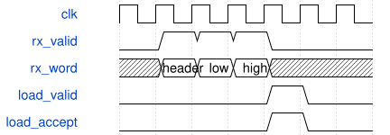

# road_pw_validation_top 模块规范

> RTL: `road_pw_validation_top.v`

## 1. 模块目的

42位诊断窄口；动态装载全部操作数及表，不含ROM/视频。

## 2. 参数

| 参数 | 默认值 | 说明 |
| --- | --- | --- |
| — | — | 本模块没有可配置参数。 |

## 3. 时钟与复位

- 时钟：`{"name": "i_clk", "edge": "posedge", "frequency_hz": 100000000}`
- 复位：`{"name": "i_rstn", "active": "low", "synchronous": false, "values": "立即取消旧事务；同步释放后重新完整装载1024项表及全部参数/halo。"}`

## 4. 接口信号规范

| 信号 | 方向 | 位宽 | 时钟域 | 语义角色 | 描述 |
| --- | --- | --- | --- | --- | --- |
| `i_clk` | input | 1 | i_clk | diagnostic | 窄口同步诊断信号；语义见执行契约。 |
| `i_rstn` | input | 1 | i_clk | diagnostic | 窄口同步诊断信号；语义见执行契约。 |
| `i_rx_valid` | input | 1 | i_clk | diagnostic | 窄口同步诊断信号；语义见执行契约。 |
| `i_rx_data` | input | 16 | i_clk | diagnostic | 窄口同步诊断信号；语义见执行契约。 |
| `o_rx_ready` | output | 1 | i_clk | diagnostic | 窄口同步诊断信号；语义见执行契约。 |
| `o_tx_valid` | output | 1 | i_clk | diagnostic | 窄口同步诊断信号；语义见执行契约。 |
| `o_tx_data` | output | 16 | i_clk | diagnostic | 窄口同步诊断信号；语义见执行契约。 |
| `i_tx_ready` | input | 1 | i_clk | diagnostic | 窄口同步诊断信号；语义见执行契约。 |
| `o_busy` | output | 1 | i_clk | diagnostic | 窄口同步诊断信号；语义见执行契约。 |
| `o_done` | output | 1 | i_clk | diagnostic | 窄口同步诊断信号；语义见执行契约。 |
| `o_fault` | output | 1 | i_clk | diagnostic | 窄口同步诊断信号；语义见执行契约。 |
| `o_parameters_ready` | output | 1 | i_clk | diagnostic | 窄口同步诊断信号；语义见执行契约。 |

## 5. 周期行为与延迟

- 16位header/low/high组成完整装载；部分包内的控制字是数据，不能启动。
- 8000后接1024表项；8001启动；8002逐项导出index/data及F000；8003快照core低/高16；8004/8005控制commit。
- 异步断言两级同步释放，最早第三上升沿接受。复位后全部重装，未导出缓存不能被装载覆盖。
- TX等待ready保持字，实际缓存只在数据字接受后推进；无checksum替代逐项值。

## 6. WaveDrom 时序图

### 完整窄口装载后提交

header/low/high先缓存，下一拍向调度器提出完整32位记录，等待ready时保持。

- WaveJSON：[road_pw_validation_top_packet.json5](waveforms/road_pw_validation_top_packet.json5)

## 7. 边界、反压与错误

- 7/8、47/48、767/768、2303/2304、地址零重装、INT32边界、末组故障、反压及复位。

## 8. CDC 与综合约束

- TEST_ONLY量化参数；仅前三个卷积验证；不含DDR/生产/位流。
- 调度FSM及全部算术源码冻结，非合法通道状态不扩展契约。

## 9. 验证与验收

- 四组黄金向量全阶段对拍、连续六组、随机/长反压、满队列、复位取消和窄口实际导出。

## 10. 可追溯性

- 规格模块：`road_pw_validation_top`
- RTL 路径：`road_pw_validation_top.v`
- 交付要求：本文档、WaveJSON 和 SVG 必须与同一版本规格一同发布。
