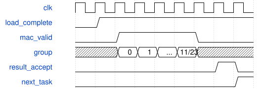

# road_pw_validation_top 模块规范

> RTL: `road_pw_validation_top.v`

## 1. 模块目的

冻结三种形状：PROFILE0=48→48兼容，1=96→24，2=192→12输出分片；同一算术核和窄口协议。

## 2. 参数

| 参数 | 默认值 | 说明 |
| --- | --- | --- |
| PROFILE | 2 | 只支持0/1/2三个冻结编译形状；不是运行时任意卷积配置。 |

## 3. 时钟与复位

- 时钟：`{"name": "i_clk", "edge": "posedge", "frequency_hz": 100000000}`
- 复位：`{"name": "i_rstn", "active": "low", "synchronous": false, "values": "立即取消旧事务；同步释放后重新完整装载1024项表及全部参数/halo。"}`

## 4. 接口信号规范

| 信号 | 方向 | 位宽 | 时钟域 | 语义角色 | 描述 |
| --- | --- | --- | --- | --- | --- |
| `i_clk` | input | 1 | i_clk | diagnostic | 窄口同步诊断信号；语义见执行契约。 |
| `i_rstn` | input | 1 | i_clk | diagnostic | 窄口同步诊断信号；语义见执行契约。 |
| `i_rx_valid` | input | 1 | i_clk | diagnostic | 窄口同步诊断信号；语义见执行契约。 |
| `i_rx_data` | input | 16 | i_clk | diagnostic | 窄口同步诊断信号；语义见执行契约。 |
| `o_rx_ready` | output | 1 | i_clk | diagnostic | 窄口同步诊断信号；语义见执行契约。 |
| `o_tx_valid` | output | 1 | i_clk | diagnostic | 窄口同步诊断信号；语义见执行契约。 |
| `o_tx_data` | output | 16 | i_clk | diagnostic | 窄口同步诊断信号；语义见执行契约。 |
| `i_tx_ready` | input | 1 | i_clk | diagnostic | 窄口同步诊断信号；语义见执行契约。 |
| `o_busy` | output | 1 | i_clk | diagnostic | 窄口同步诊断信号；语义见执行契约。 |
| `o_done` | output | 1 | i_clk | diagnostic | 窄口同步诊断信号；语义见执行契约。 |
| `o_fault` | output | 1 | i_clk | diagnostic | 窄口同步诊断信号；语义见执行契约。 |
| `o_parameters_ready` | output | 1 | i_clk | diagnostic | 窄口同步诊断信号；语义见执行契约。 |

## 5. 周期行为与延迟

- PROFILE0保留原回归；PROFILE1/2分别12/24组×8输入，未超过192有效乘积。
- 输入bank=ic%8,row=position*(Cin/8)+ic//8；权重bank=(local_oc%3)*8+ic%8,row=(local_oc//3)*(Cin/8)+ic//8。
- bias/pre三浅bank不变；装载地址0重启，完整性与合法性检查按冻结片形状展开。
- 每片输出local tag=position*Cout+local_oc；局部输出真实缓存逐项导出。全局OC合并由参考检查，不声称图执行器已实现。
- 表1024项重装、first/last、长反压、故障禁止发布、复位即时取消与既有接口保持。

## 6. WaveDrom 时序图

### 输出分片逐段归约

装载→PREPARE→12或24组接受→MAC等待→下一任务，所有输出提交才done，再导出。

- WaveJSON：[road_pw_validation_top_slab.json5](waveforms/road_pw_validation_top_slab.json5)

## 7. 边界、反压与错误

- 输入1535/1536、3071/3072，权重2303/2304，24/12参数边界，末24组及输出分片拼接。

## 8. CDC 与综合约束

- 12位逻辑装载地址不变；每片权重2304，输入768/1536/3072，输出768/384/192。
- 192→96按8个12输出通道分片；当前外部图级遍历和全局写址尚未实现。
- 算术核signed33末组INT32、RNE、SiLU、II、反压和复位行为不变。

## 9. 验证与验收

- PROFILE0同CSV回归；96及192八片真实参数逐级黄金值、随机/长反压、复位取消。

## 10. 可追溯性

- 规格模块：`road_pw_validation_top`
- RTL 路径：`road_pw_validation_top.v`
- 交付要求：本文档、WaveJSON 和 SVG 必须与同一版本规格一同发布。
