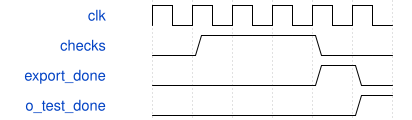

# tb_pw_tile 模块规范

> RTL: `tb_pw_tile.v`

## 1. 模块目的

PW固定形状逐级对拍与独立周期窗口；o_test_done只在完整自检通过时置位。

## 2. 参数

| 参数 | 默认值 | 说明 |
| --- | --- | --- |
| — | — | 本模块没有可配置参数。 |

## 3. 时钟与复位

- 时钟：`{"name": "clk", "frequency_hz": 100000000, "edge": "posedge", "internal": true}`
- 复位：`{"name": "rstn", "active": "low", "synchronous": false, "internal": true}`

## 4. 接口信号规范

| 信号 | 方向 | 位宽 | 时钟域 | 语义角色 | 描述 |
| --- | --- | --- | --- | --- | --- |
| `o_test_done` | output | 1 | clk | test_complete | 全部断言通过后置1并结束仿真。 |

## 5. 周期行为与延迟

- 旧PROFILE0沿冻结四套向量；新96/192先正常窗口，再压力、故障和复位。
- acc/pre/SiLU/post/提交/真实导出逐项比较；192八片重组不代替图级全局地址执行。
- prepare/send/mac_wait/drain/advance互斥周期和等于core；raw PP busy有重叠，不相加。

## 6. WaveDrom 时序图

### 对拍与完整提交

测试结束前逐项比较；输出完成之前不得通过。

- WaveJSON：[tb_pw_tile_check.json5](waveforms/tb_pw_tile_check.json5)

## 7. 边界、反压与错误

- 16位置、48通道、768写回、六组归约、部分包/部分表与复位。

## 8. CDC 与综合约束

- 测试专用，不综合，不属于数值精度或完整CNN FPS证据。

## 9. 验证与验收

- ModelSim实际日志PASS且0 errors；源码/参数快照另存。

## 10. 可追溯性

- 规格模块：`tb_pw_tile`
- RTL 路径：`tb_pw_tile.v`
- 交付要求：本文档、WaveJSON 和 SVG 必须与同一版本规格一同发布。
