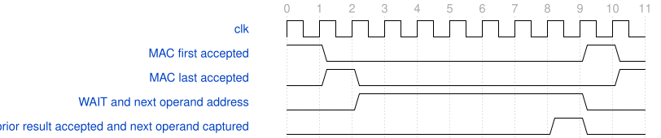

# RoadYOLO PW 周转优化对比报告

2026年10月9日。本轮已完成独立候选的功能回归、真实顶层综合布局布线及综合网表逐项读回。只修改 down2 调度器，不修改算术核、数值、核接口、II、生产工程或约束；没有训练、生成位流、上板或写 Flash。工程仍非 Git 仓库。

## 当前结论与未通过项

候选去掉了127个 PW 任务切换准备拍，完整 DW→PW 小块3331→3204拍，减少3.81%；内部适用 setup、hold、recovery、removal 未发现负裕量。代价是实际顶层 Slice 增加61，DSP和ERAM不变。可以保留此候选作为后续独立验证基线，不能称为生产交付或整网通过。

仍未通过的是外部窄口时序、严格交付门、完整模型参数及整网闭环。更重要的是：当前单归约上下文的 MAC 任务关闭协议，使原网计算部分的条件下界仍超过每帧2000万拍；继续消除一两拍外围调度不足以达到5 FPS。

| 项目 | 冻结运行时参数基线 | 本轮 PW 预取候选 |
|---|---:|---:|
| 无停顿完整小块 | 3331拍 | 3204拍 |
| DW阶段 | 2015拍 | 2015拍 |
| PW阶段 | 1316拍 | 1189拍 |
| PW连续任务首组间隔 | 10拍 | 9拍 |
| 相同随机反压计划 | 3490拍 | 3429拍 |
| PW阶段256拍禁止提交 | 3509拍 | 3390拍 |
| Slice，含验证壳 | 7943 | 8004 |
| DSP / ERAM / I/O，含验证壳 | 30 / 1 / 38 | 30 / 1 / 38 |
| 内部setup最低裕量 | +0.095 ns | +0.581 ns |
| 内部hold最低裕量 | +0.054 ns | +0.021 ns |
| 内部recovery / removal | +3.699 / +0.076 ns | +1.717 / +0.063 ns |

基线资源与时序来自冻结 `runtime_layer_integration_20261009/physical_attempt2`；本轮资源与时序来自 `physical`，不是复用旧壳数字。两个实现的摆放和布线不同，裕量变化不能全部归因为一处逻辑修改。hold仍为正，但仅剩0.021 ns，不代表余量宽裕。

## 修改位置与握手规则

实际修改文件：[down2_dynamic_tile_runner.v](rtl/down2_dynamic_tile_runner.v)。差异保存在 [runner.patch](runner.patch)，接口与周期图见同目录的 [规格](rtl/down2_dynamic_tile_runner_spec.md)。没有新增 FIFO、通用调度框架或跨任务累加上下文。

原调度在旧结果被接收后进入 STORAGE，再装入下一任务首组。候选在 WAIT 期间用独立地址线选择下一位置和输出通道组，在旧结果**成功握手的边沿**直接写入原有操作数寄存器；下一拍才可发出 first。第一任务仍保留一次 STORAGE，最后任务及故障不装入后继。

`cnt_position/cnt_output`仍指向当前结果，量化参数和标签也沿当前任务选择；只有操作数准备地址指向下一任务。原结果握手与计数器更新发生在同一边沿，非阻塞更新不会把下一任务系数混到当前结果。队列满时仍服从原 reservation 和 ready；MAC未接收前操作数、first/last保持稳定。三路原子故障、偏置只在first加入、异步取消及重装1024项SiLU表保持不变。

## 周期损失具体来自哪里

无停顿 PW 共128任务，每个任务2组MAC输入。以下是互斥的状态占用，和恰为PW端点周期，不能再加上重叠的pre/SiLU/post busy计数。

| PW状态 | 原周期 | 新周期 | 说明 |
|---|---:|---:|---|
| STORAGE | 128 | 1 | 去掉127次后继任务准备 |
| MAC_SEND | 256 | 256 | 每任务两组，不改归约II |
| MAC_WAIT | 896 | 896 | 768拍等结果，128拍接收结果 |
| PW_DRAIN | 35 | 35 | 等后处理与提交排空 |
| DONE | 1 | 1 | 完成发布 |
| 合计 | 1316 | 1189 | 尚未改算术核任务关闭等待 |

完整3204拍的互斥分类为：提交640、MAC发射分类581、输入等待385、任务关闭1546、排空51、其他1。实际MAC组握手仍为640，其中DW384、PW256；同拍提交优先归入提交分类，所以581不是MAC总组数。

pre/SiLU/post活动分别2756、1984、2756拍，至少两级同时活动2932拍，这些活动计数禁止相加当总周期。SiLU装表1024次、张量权重偏置与参数预装载1948次、无停顿导出384拍，均与原基线相同，不能用核心节省掩盖预装载开销。

随机反压改为相对核心启动窗口、固定LFSR种子；基线与候选使用同一测试台和时间序列。不再沿用全局ticks受预装载长度影响的旧随机相位。随机等待与提交重叠会变化，3490→3429不能解释为固定节省127拍；无停顿比较才准确隔离这127拍。

## 功能和实际实现证据

基线与候选各40个完整小块通过：四套冻结配置（固定/动态 × 原始/极值偏置）、三个tile位置、随机反压、恢复后完整重装，以及PW专用长反压。每个小块逐项检查640个MAC结果、pre、SiLU、post和提交，再检查384个输出地址与字节。候选每个中间阶段累计25,600项，最终导出15,360项，均无不一致。

新增检查包括：MAC及提交负载在握手前保持；PW first、last、结果有效、满队列等待四处即时复位；满结果银行后恢复；最后通道INT32溢出导致三路原子零结果且不发布半tile。指定复位状态在当前边沿立即断言，避免测试任务多等一拍而错过目标位置。

真实38位壳的RTL与本轮实际综合网表分别完成6个tile、2304项逐值导出，数值与索引全部一致。网表仿真无SDF，只证明该综合网表的功能，不替代STA或板测。厂商库警告未隐藏：网表两次日志分别有101462与622项警告，Errors均为0，主要为厂商端口类型兼容提示。

实际顶层包括原窄口壳、新PW调度器、动态适配器、24MAC、动态pre/post乘积、RNE、SiLU及张量缓存。PH1P35MDG324/−3、100MHz，使用原SDC/ADC，完整布局布线完成，Slow/Fast Max/Min均检查。

| 路径范围 | setup | hold | recovery | removal |
|---|---:|---:|---:|---:|
| 内部寄存器 | +0.581 | +0.021 | +1.717 | +0.063 |
| 功能复位分发 | +0.581 | +0.124 | +1.717 | +0.063 |
| 释放同步器级间 | +8.072 | +0.124 | 不适用 | 不适用 |
| DSP输出起点 | +3.079 | +0.324 | 无报告对象 | 无报告对象 |
| ERAM输出起点 | +4.765 | +1.039 | 无报告对象 | 无报告对象 |

单位ns。完整违例报告没有内部负路径；外部保留16条setup、33条hold、4条removal负记录，不是53个唯一端点。全局setup −1.409 ns、min −1.266 ns，不宣称整机时序通过。自动引脚、零诊断I/O延迟不是板级外设契约，也没有新增时序例外。

最差内部setup从 `reg_release_done_reg_syn_5` 到 runner `cnt_output_reg[0]_syn_72.ima`，经过复位/故障与计数控制：数据路径9.160 ns，其中逻辑1.749、布线7.411 ns，最大扇出693。当前主要物理余量风险仍是控制分发，而不是本轮已经消除的STORAGE空拍。

TD报告覆盖率100%仅针对当前诊断约束。`check_timing_verbose.rpt`仍保留与冻结基线相同的clock-definition类别和DSP dummy节点提示；clock summary显示单一probe_clk组、5439个时钟端点且nonclock=0。不能把报告百分比解释为外部时序或全部工具提示已签核。

SYN-5025继续保留。新runner单定义展开检查有412个无驱动对象，全部PIN_COUNT=0、DRIVER_COUNT=0，没有带负载的无驱动网。其余七个未修改定义沿冻结报告；本轮没有取得厂商逐pin置零事件追踪，不能宣布告警全部豁免。

## 严格门禁及失败原因

九文件同范围原始严格门禁5230→5249 errors，strict warnings仍24；新增19项为声明/注释4+4、显式常量宽度4、组合复杂度2、注释位置4和空行1。保留原诊断；不改全局检查器、不为变绿而批量格式重写。compile通过、parse_errors=0；ast/readability/comment/naming/profile未通过，静态testbench/toolchain状态不替代实际ModelSim/TD证据。独立两个测试台的原始严格门禁906项未闭合，包含合法无端口模块头的解析级联问题。

新runner使用规范入口生成同名规格和WaveDrom。规范入口拒绝无端口TB，保留拒绝日志及人工同名伴随规格，不添加伪端口。专用Python和脚本可读性技能当前不可用，不宣称这些脚本通过其严格门禁。本轮文档沿本地报告格式保存；Ponytail原则使修改仅复用原寄存器与验证工具。

本轮失败均保留，具体原因和最小修正如下：

| 失败记录 | 原因 | 后续处理 |
|---|---|---|
| `baseline/vlib.command.json` | 受限环境启动ModelSim发生WinError623，尚未运行RTL | 按授权在独立目录运行本地工具，后续通过 |
| `s/spec.log` | 规格工具路径解析被受限环境拒绝 | 独立目录重试，保留拒绝记录 |
| `s_attempt2/tb_spec.log` | TB源码不在该工具的临时工作根内 | 将TB快照放到临时工作根，再得到真实“非空端口”拒绝 |
| `shell_rtl/fixed_stress.log` | 冻结TB仍硬编码3331拍，而新runner已实测3204拍 | 仅独立TB更新精确周期期望；黄金字节和旧文件不改；RTL和综合网表均通过 |
| 汇总首次执行 | 中文JSON按Windows默认GBK读取而非UTF8 | 显式UTF8；不修改任何测量数据 |

## 整网预算和下一项决定

[逐层预算](layer_budget.json)按冻结67卷积图计算。当前单上下文核必须等末组终态握手后才重开输入；连续归约组II1，首组至下一首组最少G+7拍，本轮G2实测为9。假设全部操作数预先就绪、无反压、DW按每行三空间点打包，省略DDR、后处理、非卷积及起停开销，得到以下**结构条件下界，不是整网实测FPS**：

| 部分 | 未扣最后任务边界的周期 |
|---|---:|
| Stem | 2,433,024 |
| 43个PW | 17,258,688 |
| 23个DW | 6,796,512 |
| 合计，逐层最后任务保守扣1拍后 | 26,488,157 |

仍比20,000,000拍多6,488,157。仅PW+Stem已19,691,712拍，几乎吃完整个预算。因此不能承诺当前原网加DDR后会达到5 FPS，也不应无期限继续同类外围省拍。

下一步先作**一个有明确收益门槛的核级任务周转决定**：是否允许在独立候选中研究前一末组在途时接纳下一first，保留signed33、末组原子故障、偏置一次、元数据和取消行为。该行为改变当前last关闭接收协议，本轮没有擅自实施。先用周期参考核实能否实质减少以上648万拍差距；若不批准或预期不足，就只比较已冻结的H24备选，不扫描其他网络或自动训练。

ROM/DDR闭环仍按已批准主线推进，可与该性能决定分离。实际容量/地址单位、PAXI顺序与写可见性未证明前，不启用真实CNN DMA。真实量化参数仍未接入，本轮全部是TEST参数，不代表模型识别精度。

## 复现和冻结

`run.py`复用冻结构建助手，只把cwd及输出指向本新目录；baseline/candidate/spec/gates/physical/shell_rtl/shell_gate/zeroing均用新attempt保留记录。`budget.py`、`collect.py`分别生成预算和实测汇总。实际源码闭包与工具哈希、TD数据库、约束、失败日志和向量路径均保留。

299项冻结旧文件前后校验无变化。算术核、适配器和壳仍从冻结目录只读引用，实际物理清单在 `physical/input_manifest.json`。新调度器是独立候选，不覆盖旧核或任何生产文件。

总结：这次不是只保存计划；PW省拍、数值、复位、反压和实际实现证据已得到。优化有效但不够解决整网5 FPS，下一项应直接处理任务关闭瓶颈或作唯一缩网决定，不再重复微调SiLU。
