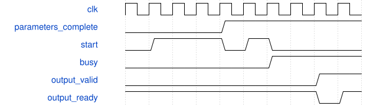
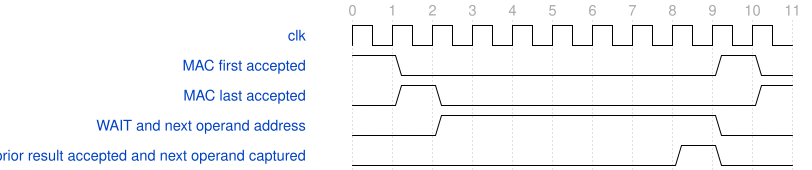

# down2_dynamic_tile_runner 模块规范

> RTL: `down2_dynamic_tile_runner.v`

## 1. 模块目的

PW next-first preparation in existing registers; frozen arithmetic and interfaces.

## 2. 参数

| 参数 | 默认值 | 说明 |
| --- | --- | --- |
| — | — | 本模块没有可配置参数。 |

## 3. 时钟与复位

- 时钟：`{"name": "i_clk", "edge": "posedge", "frequency_hz": 100000000}`
- 复位：`{"name": "i_rstn", "active": "low", "synchronous": false, "values": "Cancel all old work; invalidate parameters and reload 1024 SiLU entries. Shell releases after two clock edges."}`

## 4. 接口信号规范

| 信号 | 方向 | 位宽 | 时钟域 | 语义角色 | 描述 |
| --- | --- | --- | --- | --- | --- |
| `i_clk` | input | 1 | i_clk | i_clk | i_clk |
| `i_rstn` | input | 1 | i_clk | i_rstn | i_rstn |
| `i_table_valid` | input | 1 | i_clk | i_table_valid | i_table_valid |
| `i_table_addr` | input | 10 | i_clk | i_table_addr | i_table_addr |
| `i_table_data` | input | 16 | i_clk | i_table_data | i_table_data |
| `o_table_ready` | output | 1 | i_clk | o_table_ready | o_table_ready |
| `o_table_loaded` | output | 1 | i_clk | o_table_loaded | o_table_loaded |
| `o_table_fault` | output | 1 | i_clk | o_table_fault | o_table_fault |
| `i_load_valid` | input | 1 | i_clk | i_load_valid | i_load_valid |
| `i_load_kind` | input | 3 | i_clk | i_load_kind | i_load_kind |
| `i_load_addr` | input | 11 | i_clk | i_load_addr | i_load_addr |
| `i_load_data` | input | 32 | i_clk | i_load_data | i_load_data |
| `o_load_ready` | output | 1 | i_clk | o_load_ready | o_load_ready |
| `i_start` | input | 1 | i_clk | i_start | i_start |
| `i_pw_only` | input | 1 | i_clk | i_pw_only | i_pw_only |
| `i_commit_ready` | input | 1 | i_clk | i_commit_ready | i_commit_ready |
| `o_busy` | output | 1 | i_clk | o_busy | o_busy |
| `o_done` | output | 1 | i_clk | o_done | o_done |
| `o_fault` | output | 1 | i_clk | o_fault | o_fault |
| `i_export_start` | input | 1 | i_clk | i_export_start | i_export_start |
| `i_output_ready` | input | 1 | i_clk | i_output_ready | i_output_ready |
| `o_output_valid` | output | 1 | i_clk | o_output_valid | o_output_valid |
| `o_output_data` | output | 8 | i_clk | o_output_data | o_output_data |
| `o_output_index` | output | 9 | i_clk | o_output_index | o_output_index |
| `o_export_done` | output | 1 | i_clk | o_export_done | o_export_done |
| `o_debug_valid` | output | 1 | i_clk | o_debug_valid | o_debug_valid |
| `o_debug_phase` | output | 2 | i_clk | o_debug_phase | o_debug_phase |
| `o_debug_layer` | output | 1 | i_clk | o_debug_layer | o_debug_layer |
| `o_debug_position` | output | 4 | i_clk | o_debug_position | o_debug_position |
| `o_debug_channel` | output | 5 | i_clk | o_debug_channel | o_debug_channel |
| `o_debug_value` | output | 32 | i_clk | o_debug_value | o_debug_value |
| `o_preload_writes` | output | 32 | i_clk | o_preload_writes | o_preload_writes |
| `o_core_cycles` | output | 32 | i_clk | o_core_cycles | o_core_cycles |
| `o_mac_cycles` | output | 32 | i_clk | o_mac_cycles | o_mac_cycles |
| `o_pre_cycles` | output | 32 | i_clk | o_pre_cycles | o_pre_cycles |
| `o_silu_cycles` | output | 32 | i_clk | o_silu_cycles | o_silu_cycles |
| `o_post_cycles` | output | 32 | i_clk | o_post_cycles | o_post_cycles |
| `o_writeback_cycles` | output | 32 | i_clk | o_writeback_cycles | o_writeback_cycles |
| `o_storage_wait_cycles` | output | 32 | i_clk | o_storage_wait_cycles | o_storage_wait_cycles |
| `o_scheduler_idle_cycles` | output | 32 | i_clk | o_scheduler_idle_cycles | o_scheduler_idle_cycles |
| `o_export_cycles` | output | 32 | i_clk | o_export_cycles | o_export_cycles |
| `o_result_queue_count` | output | 2 | i_clk | o_result_queue_count | o_result_queue_count |
| `o_result_reserved` | output | 1 | i_clk | o_result_reserved | o_result_reserved |
| `o_meta_count` | output | 4 | i_clk | o_meta_count | o_meta_count |
| `o_mac_result_count` | output | 32 | i_clk | o_mac_result_count | o_mac_result_count |
| `o_pre_accept_count` | output | 32 | i_clk | o_pre_accept_count | o_pre_accept_count |
| `o_silu_accept_count` | output | 32 | i_clk | o_silu_accept_count | o_silu_accept_count |
| `o_post_accept_count` | output | 32 | i_clk | o_post_accept_count | o_post_accept_count |
| `o_writeback_count` | output | 32 | i_clk | o_writeback_count | o_writeback_count |

## 5. 周期行为与延迟

- Reuse frozen MAC, RNE and SiLU. Kernel interfaces, arithmetic and II are unchanged.
- Load kind6 addresses0..39: positive INT32 pre multipliers; DW0..15 then PW16..39.
- Load kind7 addresses0..39: shifts0..62; 40/41: DW/PW post multiplier; 42/43: DW/PW post shift.
- Sequential writes or address-zero restart only. Both complete banks required before runner start.
- Parameters writable only while idle; accepted postprocess batches capture coefficients with metadata.
- Real 9x9x16 halo feeds DW3x3/s2 then 4x4x16 PW16to24. Export384 INT8 items.
- Shell keeps38 external bits; existing16-bit load descriptor accepts kinds6/7 only in this candidate.
- During PW WAIT address the next task first group; current result metadata remain unchanged.
- Capture next operands only on successful prior result acceptance; next first still obeys MAC ready and reservation.
- Skip127 PW STORAGE cycles; first task still uses STORAGE. Final task and fault never capture a successor.

## 6. WaveDrom 时序图

### Incomplete load cannot start

Protocol schematic only; busy duration is compressed, not literal measured latency.

- WaveJSON：[down2_dynamic_tile_runner_load-then-start.json5](waveforms/down2_dynamic_tile_runner_load-then-start.json5)

### PW task turnover without STORAGE

No backpressure: first atE0, last atE1, prior result acceptedE8, next firstE9. II within task remains1.

- WaveJSON：[down2_dynamic_tile_runner_pw-next-first.json5](waveforms/down2_dynamic_tile_runner_pw-next-first.json5)

## 7. 边界、反压与错误

- No partial parameter publication; negative multiplier and shift63 are rejected.
- Output ownership under backpressure; reset cancels data and invalidates parameter banks.

## 8. CDC 与综合约束

- No production edits, training, bitgen, board, Flash or additional timing exceptions.
- Diagnostic input/output delays are not a real external-device timing contract.

## 9. 验证与验收

- Same40 layer scenarios per revision, all640 values at each arithmetic stage and384 exports.
- Random phase relative to core start; MAC/commit stability, four PW reset positions, full queue and final-lane overflow.

## 10. 可追溯性

- 规格模块：`down2_dynamic_tile_runner`
- RTL 路径：`down2_dynamic_tile_runner.v`
- 交付要求：本文档、WaveJSON 和 SVG 必须与同一版本规格一同发布。
