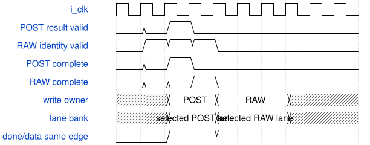

# road_dynamic_postprocess 模块规范

> RTL: `road_dynamic_postprocess.v`

## 1. 模块目的

动态后处理退休数据三lane独立16位bank候选；完整外部端口、容量、仲裁、数值和可见周期保持不变。

## 2. 参数

| 参数 | 默认值 | 说明 |
| --- | --- | --- |
| — | — | 本模块没有可配置参数。 |

## 3. 时钟与复位

- 时钟：`{"name": "i_clk", "edge": "posedge", "frequency_hz": 100000000}`
- 复位：`{"name": "i_rstn", "active": "low", "synchronous": false, "values": "Cancel batch and all child valid immediately; clear fatal and require all 1024 table entries again. Caller synchronizes release."}`

## 4. 接口信号规范

| 信号 | 方向 | 位宽 | 时钟域 | 语义角色 | 描述 |
| --- | --- | --- | --- | --- | --- |
| `i_clk` | input | 1 | i_clk | i_clk | i_clk |
| `i_rstn` | input | 1 | i_clk | i_rstn | i_rstn |
| `i_table_valid` | input | 1 | i_clk | i_table_valid | i_table_valid |
| `i_table_addr` | input | 10 | i_clk | i_table_addr | i_table_addr |
| `i_table_data` | input | 16 | i_clk | i_table_data | i_table_data |
| `o_table_ready` | output | 1 | i_clk | o_table_ready | o_table_ready |
| `o_table_loaded` | output | 1 | i_clk | o_table_loaded | o_table_loaded |
| `i_input_valid` | input | 1 | i_clk | i_input_valid | i_input_valid |
| `i_accumulators` | input | 96 | i_clk | i_accumulators | i_accumulators |
| `i_pre_multipliers` | input | 96 | i_clk | i_pre_multipliers | i_pre_multipliers |
| `i_pre_shifts` | input | 18 | i_clk | i_pre_shifts | i_pre_shifts |
| `i_post_multiplier` | input | 32 | i_clk | i_post_multiplier | i_post_multiplier |
| `i_post_shift` | input | 6 | i_clk | i_post_shift | i_post_shift |
| `i_activate` | input | 1 | i_clk | i_activate | i_activate |
| `i_lane_mask` | input | 3 | i_clk | i_lane_mask | i_lane_mask |
| `i_tags` | input | 48 | i_clk | i_tags | i_tags |
| `i_input_fault` | input | 1 | i_clk | i_input_fault | i_input_fault |
| `o_input_ready` | output | 1 | i_clk | o_input_ready | o_input_ready |
| `i_output_ready` | input | 1 | i_clk | i_output_ready | i_output_ready |
| `o_output_valid` | output | 1 | i_clk | o_output_valid | o_output_valid |
| `o_output_data` | output | 16 | i_clk | o_output_data | o_output_data |
| `o_output_tag` | output | 16 | i_clk | o_output_tag | o_output_tag |
| `o_output_int16` | output | 1 | i_clk | o_output_int16 | o_output_int16 |
| `o_fault` | output | 1 | i_clk | o_fault | o_fault |
| `o_queue_count` | output | 2 | i_clk | diagnostic | retire queue occupancy |
| `o_pending_count` | output | 4 | i_clk | diagnostic | pending input metadata occupancy |
| `o_meta_count` | output | 4 | i_clk | diagnostic | accepted batch metadata occupancy |
| `o_pre_busy` | output | 1 | i_clk | diagnostic | dynamic pre-requant stage active |
| `o_silu_busy` | output | 1 | i_clk | diagnostic | shared SiLU or identity stage active |
| `o_post_busy` | output | 1 | i_clk | diagnostic | dynamic post-requant stage active |
| `o_pre_accept` | output | 1 | i_clk | diagnostic | pre stage transfer pulse |
| `o_silu_accept` | output | 1 | i_clk | diagnostic | SiLU or identity stage transfer pulse |
| `o_post_accept` | output | 1 | i_clk | diagnostic | post stage transfer pulse |

## 5. 周期行为与延迟

- A batch transfers only on valid and ready; capture all three coefficients, shifts, accumulators and opaque tags together.
- Input ready remains zero until sequential table addresses 0..1023 have transferred.
- Retirement ownership, mask, done, emit, seen, ordered head selection and eight-entry capacity remain unchanged.
- Store retirement result data as alpha, beta and gamma arrays of eight complete signed16 elements instead of one eight-by-48 packed array; the POST and RAW paths each use a static if/else-if chain to select exactly one complete bank element.
- Keep one result-write transaction per clock. POST completion has priority; when POST and RAW identity completion coincide, the existing ready gate and POST-first branch defer RAW rather than dual-writing, even for different slots or lanes.
- Set the selected lane done bit and its complete signed16 bank element on the same accepted completion edge.
- Output selects the head entry emit lane from the corresponding bank and holds valid, tag, data and int16 mode under backpressure.
- Reset cancellation, sticky fault behavior, arithmetic, interface II, acceptance sequence and visible cycle behavior remain unchanged.

## 6. WaveDrom 时序图

### POST优先的单lane-bank写入

压缩事件图；POST与RAW同时待完成时仅POST写一个完整16位bank元素，RAW由现有ready约束延后一拍。图不声明新的固定批延迟。

- WaveJSON：[road_dynamic_postprocess_post1.json5](waveforms/road_dynamic_postprocess_post1.json5)

## 7. 边界、反压与错误

- POST and RAW identity completion target the same or different slot/lane on the same cycle: POST completes first and RAW remains pending.
- Sparse lane masks, ring wrap, simultaneous queue push/pop, long output backpressure, sticky fault and reset with every bank occupied.
- Output valid data and tags must remain known and stable while ready is low.

## 8. CDC 与综合约束

- Bounded structural candidate only; it is not a new FIFO and does not increase retirement capacity beyond eight entries or 384 result bits.
- All module ports, ready-valid ownership, POST-over-RAW priority, arithmetic source, numeric behavior and reset semantics are immutable.
- No same-cycle dual retirement-data write is permitted; performance claims require the unchanged regression and actual implementation evidence.
- No ROM parameter loader, DDR, model weights, production integration, bitstream or board validation is introduced.

## 9. 验证与验收

- Run the frozen 330-batch core regression with sparse masks, retire wrap, RAW/POST collision, faults and eight reset positions.
- Compare every output datum, tag, order, mode, acceptance count, queue high-water mark and visible cycle count with the packed baseline.
- Check no X or Z reaches valid output; classify synthesis drive warnings by exact baseline differential.
- Re-run the actual runtime and layer physical tops plus the strict eight-gate matrix without suppressing prior failures.

## 10. 可追溯性

- 规格模块：`road_dynamic_postprocess`
- RTL 路径：`road_dynamic_postprocess.v`
- 交付要求：本文档、WaveJSON 和 SVG 必须与同一版本规格一同发布。
