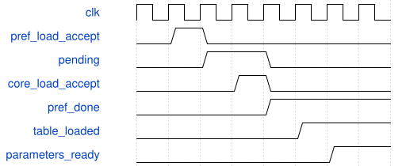

# road_rom_current_down2_top 模块规范

> RTL: `road_rom_current_down2_top.v`

## 1. 模块目的

完整56ERAM数值ROM，经既有预取器与单项参数保持，接冻结共享前端的down2。

## 2. 参数

| 参数 | 默认值 | 说明 |
| --- | --- | --- |
| — | — | 本模块没有可配置参数。 |

## 3. 时钟与复位

- 时钟：`{"name": "i_clk", "edge": "posedge", "frequency_hz": 100000000}`
- 复位：`{"name": "i_rstn", "active": "low", "synchronous": false, "values": "异步断言，两级同步释放；最早第三沿接受；重新选down2并装满参数及1024表项。"}`

## 4. 接口信号规范

| 信号 | 方向 | 位宽 | 时钟域 | 语义角色 | 描述 |
| --- | --- | --- | --- | --- | --- |
| `i_clk` | input | 1 | i_clk | i_clk | 固定单时钟验证接口，握手前保持负载；复位立即取消。 |
| `i_rstn` | input | 1 | i_clk | i_rstn | 固定单时钟验证接口，握手前保持负载；复位立即取消。 |
| `i_load_valid` | input | 1 | i_clk | i_load_valid | 固定单时钟验证接口，握手前保持负载；复位立即取消。 |
| `i_load_addr` | input | 11 | i_clk | i_load_addr | 固定单时钟验证接口，握手前保持负载；复位立即取消。 |
| `i_load_data` | input | 8 | i_clk | i_load_data | 固定单时钟验证接口，握手前保持负载；复位立即取消。 |
| `o_load_ready` | output | 1 | i_clk | o_load_ready | 固定单时钟验证接口，握手前保持负载；复位立即取消。 |
| `i_start` | input | 1 | i_clk | i_start | 固定单时钟验证接口，握手前保持负载；复位立即取消。 |
| `i_commit_ready` | input | 1 | i_clk | i_commit_ready | 固定单时钟验证接口，握手前保持负载；复位立即取消。 |
| `i_export_start` | input | 1 | i_clk | i_export_start | 固定单时钟验证接口，握手前保持负载；复位立即取消。 |
| `i_output_ready` | input | 1 | i_clk | i_output_ready | 固定单时钟验证接口，握手前保持负载；复位立即取消。 |
| `o_parameters_ready` | output | 1 | i_clk | o_parameters_ready | 固定单时钟验证接口，握手前保持负载；复位立即取消。 |
| `o_busy` | output | 1 | i_clk | o_busy | 固定单时钟验证接口，握手前保持负载；复位立即取消。 |
| `o_done` | output | 1 | i_clk | o_done | 固定单时钟验证接口，握手前保持负载；复位立即取消。 |
| `o_fault` | output | 1 | i_clk | o_fault | 固定单时钟验证接口，握手前保持负载；复位立即取消。 |
| `o_output_valid` | output | 1 | i_clk | o_output_valid | 固定单时钟验证接口，握手前保持负载；复位立即取消。 |
| `o_output_data` | output | 8 | i_clk | o_output_data | 固定单时钟验证接口，握手前保持负载；复位立即取消。 |
| `o_output_index` | output | 9 | i_clk | o_output_index | 固定单时钟验证接口，握手前保持负载；复位立即取消。 |
| `o_export_done` | output | 1 | i_clk | o_export_done | 固定单时钟验证接口，握手前保持负载；复位立即取消。 |

## 5. 周期行为与延迟

- 先在共享前端空闲时选择down2，之后释放预取器；ROM请求地址保持到接受，响应保持到消费。
- 652笔参数经单项缓存保管后提交；满时不接收新参数，valid/kind/address/data在反压时保持。
- 1024表项走共享前端既有装表缓冲；pref_done、参数缓存空、table_loaded后注册开放外部halo。
- halo1296字节完整后才接受start；现有DW/PW调度、量化、元数据、II不变；导出384个PW结果。
- 故障屏蔽新提交/启动/输出，复位取消缓存、ROM响应与所有旧计算；只可复位恢复。

## 6. WaveDrom 时序图

### 参数保管与整表完成后开放图像输入

省略ROM读取间隔；pending最后提交后，完整表实际装满才开放halo。

- WaveJSON：[road_rom_current_down2_top_parameter-handoff.json5](waveforms/road_rom_current_down2_top_parameter-handoff.json5)

## 7. 边界、反压与错误

- 表未满、末参数未提交、参数反压、边界tile、长反压、装载/运行中复位、非法halo地址。

## 8. CDC 与综合约束

- SCHEMA2 TEST权重；无真实QAT、DDR、完整67层或板级接口签核。
- 低IO诊断壳，无UART/AXI；含Stem共享前端保留，不重复造算术链。

## 9. 验证与验收

- 13字段1676笔对拍、7个DW/PW场景逐阶段及读口对拍、ROM跨组/复位单测、实际TD资源及时序。

## 10. 可追溯性

- 规格模块：`road_rom_current_down2_top`
- RTL 路径：`road_rom_current_down2_top.v`
- 交付要求：本文档、WaveJSON 和 SVG 必须与同一版本规格一同发布。
