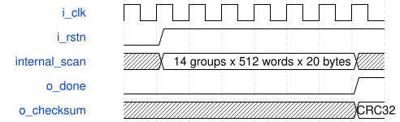

# road_yolo_numeric_rom_probe 模块规范

> RTL: `road_yolo_numeric_rom_probe.v`

## 1. 模块目的

Narrow-I/O self-starting CRC32 probe that observes all 143360 bytes in fourteen ROM groups.

## 2. 参数

| 参数 | 默认值 | 说明 |
| --- | --- | --- |
| — | — | 本模块没有可配置参数。 |

## 3. 时钟与复位

- 时钟：`{"name": "i_clk", "edge": "posedge"}`
- 复位：`{"name": "i_rstn", "active": "low", "synchronous": false}`

## 4. 接口信号规范

| 信号 | 方向 | 位宽 | 时钟域 | 语义角色 | 描述 |
| --- | --- | --- | --- | --- | --- |
| `i_clk` | input | 1 | i_clk | clock | Probe clock |
| `i_rstn` | input | 1 | i_clk | reset | Asynchronous active-low reset |
| `o_done` | output | 1 | i_clk | status | Latched completion flag |
| `o_checksum` | output | 32 | i_clk | result | Final reflected IEEE CRC32 of the padded package |

## 5. 周期行为与延迟

- The first clock after reset release starts at group zero, word zero, bit zero without a start pin.
- Each selected 160-bit word is captured after the primitive, two-stage group assembly, and four-stage registered group mux latency.
- Each package bit uses one fetch cycle and one reflected IEEE CRC32 update cycle; this keeps the selected bit and feedback logic in separate registered cones.
- After group thirteen word 511 bit 159, o_checksum receives the final XOR value and o_done remains asserted until reset.

## 6. WaveDrom 时序图

### Autonomous full-package checksum scan

The probe issues reads, folds twenty bytes per word, advances all groups, then latches done and checksum.

- WaveJSON：[road_yolo_numeric_rom_probe_reset-release-through-completion.json5](waveforms/road_yolo_numeric_rom_probe_reset-release-through-completion.json5)

## 7. 边界、反压与错误

- Reset during scanning restarts from the first byte and clears done.
- The final 2838 zero-padding bytes are included in the checksum.
- Completion is sticky and the checksum is stable until reset.

## 8. CDC 与综合约束

- Instantiate exactly fourteen road_yolo_numeric_rom_group modules and select each group during the runtime scan.
- Only clock, reset, done, and checksum cross the top-level boundary to stay well below the device I/O budget.
- Every address and every bit must influence the externally visible checksum to prevent content trimming.
- The registered group selection tree merges at most two data sources per stage.
- A fifteen-state one-hot controller separates read latency, capture, bit processing, address advance, and completion tasks.

## 9. 验证与验收

- Compare every captured 160-bit word, including group and word boundaries, with the padded golden package.
- Check the final checksum against a testbench computation over all 143360 bytes.
- Run long enough to prove all fourteen times 512 words are scanned.

## 10. 可追溯性

- 规格模块：`road_yolo_numeric_rom_probe`
- RTL 路径：`road_yolo_numeric_rom_probe.v`
- 交付要求：本文档、WaveJSON 和 SVG 必须与同一版本规格一同发布。
