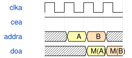

# PH1P_LOGIC_ERAM 模块规范

> RTL: `tb_ph1p_logic_eram_sim.v`

## 1. 模块目的

Icarus-only behavioral stand-in for the vendor logical ERAM wrapper.

## 2. 参数

| 参数 | 默认值 | 说明 |
| --- | --- | --- |
| — | — | 本模块没有可配置参数。 |

## 3. 时钟与复位

- 时钟：`{"name": "clka", "edge": "posedge"}`
- 复位：`{}`

## 4. 接口信号规范

| 信号 | 方向 | 位宽 | 时钟域 | 语义角色 | 描述 |
| --- | --- | --- | --- | --- | --- |
| `clka` | input | 1 | clka | clock | Port-A clock |
| `addra` | input | 9 | clka | address | Port-A read address |
| `doa` | output | 40 | clka | data | Port-A synchronous read data |

## 5. 周期行为与延迟

- Load INIT_FILE with readmemh and model the enabled port-A synchronous read used by the probe.

## 6. WaveDrom 时序图

### Behavioral stub read

An enabled rising edge updates doa from the selected memory address.

- WaveJSON：[PH1P_LOGIC_ERAM_enabled-port-A.json5](waveforms/PH1P_LOGIC_ERAM_enabled-port-A.json5)

## 7. 边界、反压与错误

- Unused vendor-compatible port-B and ECC signals remain deterministic.

## 8. CDC 与综合约束

- This file is testbench-only and is not vendor synthesis evidence.

## 9. 验证与验收

- Compile the production RTL under Icarus without the encrypted vendor model.

## 10. 可追溯性

- 规格模块：`PH1P_LOGIC_ERAM`
- RTL 路径：`tb_ph1p_logic_eram_sim.v`
- 交付要求：本文档、WaveJSON 和 SVG 必须与同一版本规格一同发布。
