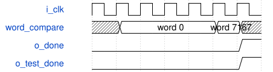

# tb_road_yolo_numeric_rom_probe 模块规范

> RTL: `tb_road_yolo_numeric_rom_probe.v`

## 1. 模块目的

Self-checking full-package Icarus testbench.

## 2. 参数

| 参数 | 默认值 | 说明 |
| --- | --- | --- |
| — | — | 本模块没有可配置参数。 |

## 3. 时钟与复位

- 时钟：`{"name": "i_clk", "edge": "posedge"}`
- 复位：`{"name": "i_rstn", "active": "low", "synchronous": false}`

## 4. 接口信号规范

| 信号 | 方向 | 位宽 | 时钟域 | 语义角色 | 描述 |
| --- | --- | --- | --- | --- | --- |
| `o_test_done` | output | 1 | i_clk | status | Testbench completion mirror |

## 5. 周期行为与延迟

- Load the 7168-word golden image, compare every captured word, and independently calculate the final CRC32.

## 6. WaveDrom 时序图

### Full-package self-check

The testbench observes internal captured words while the public interface remains narrow.

- WaveJSON：[tb_road_yolo_numeric_rom_probe_all-words-and-final-CRC.json5](waveforms/tb_road_yolo_numeric_rom_probe_all-words-and-final-CRC.json5)

## 7. 边界、反压与错误

- Explicitly record checks at words zero, 511, 512, 7025, 7026, and 7167 to cover group boundaries and the payload-to-padding transition.

## 8. CDC 与综合约束

- Use a watchdog and fail on the first address, data, count, done, or checksum mismatch.

## 9. 验证与验收

- Require exactly 7168 full-word comparisons and a matching final checksum.

## 10. 可追溯性

- 规格模块：`tb_road_yolo_numeric_rom_probe`
- RTL 路径：`tb_road_yolo_numeric_rom_probe.v`
- 交付要求：本文档、WaveJSON 和 SVG 必须与同一版本规格一同发布。
