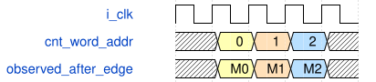

# tb_mapped_rom_readback 模块规范

> RTL: `tests/tb_mapped_rom_readback.v`

## 1. 模块目的

直接验证TD导出的56个物理ERAM参数与全地址内容；不是完整综合网表控制链回归。

## 2. 参数

| 参数 | 默认值 | 说明 |
| --- | --- | --- |
| — | — | 本模块没有可配置参数。 |

## 3. 时钟与复位

- 时钟：`{"name": "i_clk", "edge": "posedge"}`
- 复位：`{}`

## 4. 接口信号规范

| 信号 | 方向 | 位宽 | 时钟域 | 语义角色 | 描述 |
| --- | --- | --- | --- | --- | --- |
| `o_test_done` | output | 1 | i_clk | status | 56乘512地址完成比较后置一 |

## 5. 周期行为与延迟

- 启动等待200ns；负边沿送地址，下一正边沿后1ns逐项比较56路40位数据。
- 80个INIT及INITP参数逐字从真实TD网表复制；只把输出线重命名接到测试观察总线。
- 原始实例参数、端口连接与提取映射全部保存在extraction.json；不进入综合源码清单。

## 6. WaveDrom 时序图

### 物理ERAM直接读回

地址在负边沿改变；正边沿后1ns比较真实模型的输出。

- WaveJSON：[tb_mapped_rom_readback_address-sample-and-compare.json5](waveforms/tb_mapped_rom_readback_address-sample-and-compare.json5)

## 7. 边界、反压与错误

- 所有组交界、lane、未对齐字段和2838个padding字节均在全量比较范围内。

## 8. CDC 与综合约束

- 只读，512个地址；不能代替CRC状态机、复位、选择树或SDF验证。

## 9. 验证与验收

- 要求56乘512条无重复读回记录，重构物理包143360字节完全一致。

## 10. 可追溯性

- 规格模块：`tb_mapped_rom_readback`
- RTL 路径：`tests/tb_mapped_rom_readback.v`
- 交付要求：本文档、WaveJSON 和 SVG 必须与同一版本规格一同发布。
