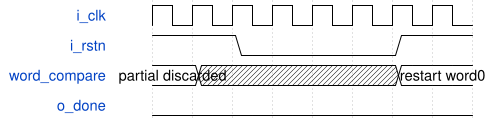

# tb_road_yolo_numeric_rom_probe 模块规范

> RTL: `tests/tb_road_yolo_numeric_rom_probe.v`

## 1. 模块目的

ModelSim 厂商模型整链读回，非 Icarus stand-in。

## 2. 参数

| 参数 | 默认值 | 说明 |
| --- | --- | --- |
| — | — | 本模块没有可配置参数。 |

## 3. 时钟与复位

- 时钟：`{"name": "i_clk", "edge": "posedge"}`
- 复位：`{"name": "i_rstn", "active": "low", "synchronous": false}`

## 4. 接口信号规范

| 信号 | 方向 | 位宽 | 时钟域 | 语义角色 | 描述 |
| --- | --- | --- | --- | --- | --- |
| `o_test_done` | output | 1 | i_clk | status | 完成全部比较后置一 |

## 5. 周期行为与延迟

- 10003 个负边沿后再次复位；保持四个负边沿后释放，丢弃旧部分读回文件，从 word0 重新比较7168词。
- 黄金数据来自 schema2 words.dath；CRC期望值1bbd0dce由Python zlib在仿真前计算，TB只比较，不声称独立重算CRC。

## 6. WaveDrom 时序图

### 复位取消与重新扫描

缩略事件图，长扫描段被压缩，不把每格当作一个完整扫描周期。

- WaveJSON：[tb_road_yolo_numeric_rom_probe_compressed-reset-and-restart.json5](waveforms/tb_road_yolo_numeric_rom_probe_compressed-reset-and-restart.json5)

## 7. 边界、反压与错误

- 覆盖0/511/512/7025/7026/7167词；复位后done和checksum立即清零。

## 8. CDC 与综合约束

- 时钟100MHz。只改测试时钟的等效写法；DUT接口、控制和数值不变。
- 先全词逐项比较，再核对CRC，不能以CRC代替逐项比较。

## 9. 验证与验收

- 全部143360字节和393字段一致；任何次序、数据、计数、CRC不符立即失败。

## 10. 可追溯性

- 规格模块：`tb_road_yolo_numeric_rom_probe`
- RTL 路径：`tests/tb_road_yolo_numeric_rom_probe.v`
- 交付要求：本文档、WaveJSON 和 SVG 必须与同一版本规格一同发布。
