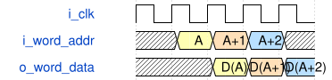

# road_yolo_numeric_rom_group 模块规范

> RTL: `road_yolo_numeric_rom_group.v`

## 1. 模块目的

Four 40-bit PH1P_LOGIC_ERAM lanes form one 160-bit by 512-word physical ROM group.

## 2. 参数

| 参数 | 默认值 | 说明 |
| --- | --- | --- |
| C_LANE_ALPHA_FILE | NONE | Lowest five bytes per word |
| C_LANE_BETA_FILE | NONE | Bytes five through nine |
| C_LANE_GAMMA_FILE | NONE | Bytes ten through fourteen |
| C_LANE_DELTA_FILE | NONE | Highest five bytes per word |

## 3. 时钟与复位

- 时钟：`{"name": "i_clk", "edge": "posedge"}`
- 复位：`{}`

## 4. 接口信号规范

| 信号 | 方向 | 位宽 | 时钟域 | 语义角色 | 描述 |
| --- | --- | --- | --- | --- | --- |
| `i_clk` | input | 1 | i_clk | clock | ROM read clock |
| `i_rstn` | input | 1 | i_clk | reset | Active-low assembly pipeline reset |
| `i_word_addr` | input | 9 | i_clk | address | Common word address for all four lanes |
| `o_word_data` | output | 160 | i_clk | data | Twenty package bytes in increasing byte order |

## 5. 周期行为与延迟

- All four single-port logical ERAM instances read the same address on i_clk.
- Two 80-bit pair registers followed by one 160-bit register limit every data merge to two sources.
- The output order is delta, gamma, beta, alpha so package byte zero is o_word_data[7:0].

## 6. WaveDrom 时序图

### Synchronous physical group read

The primitive samples a common word address and returns the corresponding four-lane word.

- WaveJSON：[road_yolo_numeric_rom_group_sequential-read.json5](waveforms/road_yolo_numeric_rom_group_sequential-read.json5)

## 7. 边界、反压与错误

- Address zero and address 511 must be readable without aliasing.

## 8. CDC 与综合约束

- Use the documented PH1P_LOGIC_ERAM logical wrapper in SP mode with width 40, depth 512, and IMPLEMENT 20K.
- Do not name PDP20K as the logical MODE; the vendor wrapper performs the internal physical mapping.

## 9. 验证与验收

- Compare all 512 output words against the four lane initialization files.

## 10. 可追溯性

- 规格模块：`road_yolo_numeric_rom_group`
- RTL 路径：`road_yolo_numeric_rom_group.v`
- 交付要求：本文档、WaveJSON 和 SVG 必须与同一版本规格一同发布。
