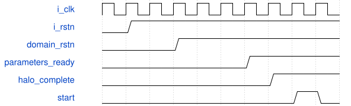

# road_down2_parameter_prefetch 模块规范

> RTL: `rtl/road_down2_parameter_prefetch.v`

## 1. 模块目的

独立schema2 TEST参数接入，不是训练模型部署或整网性能证明。

## 2. 参数

| 参数 | 默认值 | 说明 |
| --- | --- | --- |
| — | — | 本模块没有可配置参数。 |

## 3. 时钟与复位

- 时钟：`{"name": "i_clk", "edge": "posedge", "frequency_hz": 100000000}`
- 复位：`{"name": "i_rstn", "active": "low", "synchronous": false, "values": "取消全部旧事务和装载有效状态；top同步释放后重装1024表项。"}`

## 4. 接口信号规范

| 信号 | 方向 | 位宽 | 时钟域 | 语义角色 | 描述 |
| --- | --- | --- | --- | --- | --- |
| `i_clk` | input | 1 | i_clk | i_clk | i_clk |
| `i_rstn` | input | 1 | i_clk | i_rstn | i_rstn |
| `o_rom_valid` | output | 1 | i_clk | o_rom_valid | o_rom_valid |
| `o_rom_addr` | output | 13 | i_clk | o_rom_addr | o_rom_addr |
| `i_rom_ready` | input | 1 | i_clk | i_rom_ready | i_rom_ready |
| `i_rom_valid` | input | 1 | i_clk | i_rom_valid | i_rom_valid |
| `i_rom_data` | input | 160 | i_clk | i_rom_data | i_rom_data |
| `o_rom_ready` | output | 1 | i_clk | o_rom_ready | o_rom_ready |
| `o_load_valid` | output | 1 | i_clk | o_load_valid | o_load_valid |
| `o_load_kind` | output | 3 | i_clk | o_load_kind | o_load_kind |
| `o_load_addr` | output | 11 | i_clk | o_load_addr | o_load_addr |
| `o_load_data` | output | 32 | i_clk | o_load_data | o_load_data |
| `i_load_ready` | input | 1 | i_clk | i_load_ready | i_load_ready |
| `o_table_valid` | output | 1 | i_clk | o_table_valid | o_table_valid |
| `o_table_addr` | output | 10 | i_clk | o_table_addr | o_table_addr |
| `o_table_data` | output | 16 | i_clk | o_table_data | o_table_data |
| `i_table_ready` | input | 1 | i_clk | i_table_ready | i_table_ready |
| `o_done` | output | 1 | i_clk | o_done | o_done |
| `o_fault` | output | 1 | i_clk | o_fault | o_fault |
| `o_cycles` | output | 32 | i_clk | o_cycles | o_cycles |

## 5. 周期行为与延迟

- 固定13个manifest字段，共652笔runner load和1024项SiLU表，2946字节。
- 单个160bit缓存，按字节组装1/2/4字节；未对齐字段和跨词尾不丢字节。数值符号/shift0..62校验后才发布。
- field/request/wait/byte/emit/advance状态计时；反压期间不改变kind/address/data。复位从字段零重新完整装载。

## 6. WaveDrom 时序图

### 装载屏障与运行

事件示意，长预取与运行压缩，不按每格推算周期。

- WaveJSON：[road_down2_parameter_prefetch_boot.json5](waveforms/road_down2_parameter_prefetch_boot.json5)

## 7. 边界、反压与错误

- 跨20字节词、物理bank边界、未对齐层尾、非法地址。
- 装载和计算受阻时复位，不泄漏旧输出。

## 8. CDC 与综合约束

- 不改原核接口、II、数值、复位合同；不增时序例外。
- 不训练、不改生产、不生成位流、不上板。

## 9. 验证与验收

- 厂商PH1P模型、1676笔字段逐项比较、MAC/pre/SiLU/post/写回/导出对拍。
- 原64项同向量回归；TD资源和时序单列。

## 10. 可追溯性

- 规格模块：`road_down2_parameter_prefetch`
- RTL 路径：`rtl/road_down2_parameter_prefetch.v`
- 交付要求：本文档、WaveJSON 和 SVG 必须与同一版本规格一同发布。
