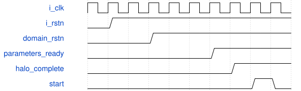

# road_numeric_rom_reader 模块规范

> RTL: `rtl/road_numeric_rom_reader.v`

## 1. 模块目的

独立schema2 TEST参数接入，不是训练模型部署或整网性能证明。

## 2. 参数

| 参数 | 默认值 | 说明 |
| --- | --- | --- |
| — | — | 本模块没有可配置参数。 |

## 3. 时钟与复位

- 时钟：`{"name": "i_clk", "edge": "posedge", "frequency_hz": 100000000}`
- 复位：`{"name": "i_rstn", "active": "low", "synchronous": false, "values": "取消全部旧事务和装载有效状态；top同步释放后重装1024表项。"}`

## 4. 接口信号规范

| 信号 | 方向 | 位宽 | 时钟域 | 语义角色 | 描述 |
| --- | --- | --- | --- | --- | --- |
| `i_clk` | input | 1 | i_clk | i_clk | i_clk |
| `i_rstn` | input | 1 | i_clk | i_rstn | i_rstn |
| `i_request_valid` | input | 1 | i_clk | i_request_valid | i_request_valid |
| `i_request_addr` | input | 13 | i_clk | i_request_addr | i_request_addr |
| `o_request_ready` | output | 1 | i_clk | o_request_ready | o_request_ready |
| `o_response_valid` | output | 1 | i_clk | o_response_valid | o_response_valid |
| `o_response_data` | output | 160 | i_clk | o_response_data | o_response_data |
| `i_response_ready` | input | 1 | i_clk | i_response_ready | i_response_ready |
| `o_fault` | output | 1 | i_clk | o_fault | o_fault |

## 5. 周期行为与延迟

- 一个在途请求；13位word地址0..7167，四路40bit拼接、14组，20字节小端。
- 接受请求后8个上升沿形成response；下一沿可被消费者接收。response等待ready时保持；不接第二个请求。越界锁故障直到复位。

## 6. WaveDrom 时序图

### 装载屏障与运行

事件示意，长预取与运行压缩，不按每格推算周期。

- WaveJSON：[road_numeric_rom_reader_boot.json5](waveforms/road_numeric_rom_reader_boot.json5)

## 7. 边界、反压与错误

- 跨20字节词、物理bank边界、未对齐层尾、非法地址。
- 装载和计算受阻时复位，不泄漏旧输出。

## 8. CDC 与综合约束

- 不改原核接口、II、数值、复位合同；不增时序例外。
- 不训练、不改生产、不生成位流、不上板。

## 9. 验证与验收

- 厂商PH1P模型、1676笔字段逐项比较、MAC/pre/SiLU/post/写回/导出对拍。
- 原64项同向量回归；TD资源和时序单列。

## 10. 可追溯性

- 规格模块：`road_numeric_rom_reader`
- RTL 路径：`rtl/road_numeric_rom_reader.v`
- 交付要求：本文档、WaveJSON 和 SVG 必须与同一版本规格一同发布。
