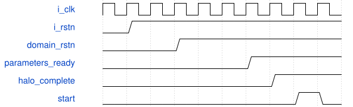

# road_rom_down2_top 模块规范

> RTL: `rtl/road_rom_down2_top.v`

## 1. 模块目的

独立schema2 TEST参数接入，不是训练模型部署或整网性能证明。

## 2. 参数

| 参数 | 默认值 | 说明 |
| --- | --- | --- |
| — | — | 本模块没有可配置参数。 |

## 3. 时钟与复位

- 时钟：`{"name": "i_clk", "edge": "posedge", "frequency_hz": 100000000}`
- 复位：`{"name": "i_rstn", "active": "low", "synchronous": false, "values": "取消全部旧事务和装载有效状态；top同步释放后重装1024表项。"}`

## 4. 接口信号规范

| 信号 | 方向 | 位宽 | 时钟域 | 语义角色 | 描述 |
| --- | --- | --- | --- | --- | --- |
| `i_clk` | input | 1 | i_clk | i_clk | i_clk |
| `i_rstn` | input | 1 | i_clk | i_rstn | i_rstn |
| `i_load_valid` | input | 1 | i_clk | i_load_valid | i_load_valid |
| `i_load_addr` | input | 11 | i_clk | i_load_addr | i_load_addr |
| `i_load_data` | input | 8 | i_clk | i_load_data | i_load_data |
| `o_load_ready` | output | 1 | i_clk | o_load_ready | o_load_ready |
| `i_start` | input | 1 | i_clk | i_start | i_start |
| `i_commit_ready` | input | 1 | i_clk | i_commit_ready | i_commit_ready |
| `i_export_start` | input | 1 | i_clk | i_export_start | i_export_start |
| `i_output_ready` | input | 1 | i_clk | i_output_ready | i_output_ready |
| `o_parameters_ready` | output | 1 | i_clk | o_parameters_ready | o_parameters_ready |
| `o_busy` | output | 1 | i_clk | o_busy | o_busy |
| `o_done` | output | 1 | i_clk | o_done | o_done |
| `o_fault` | output | 1 | i_clk | o_fault | o_fault |
| `o_output_valid` | output | 1 | i_clk | o_output_valid | o_output_valid |
| `o_output_data` | output | 8 | i_clk | o_output_data | o_output_data |
| `o_output_index` | output | 9 | i_clk | o_output_index | o_output_index |
| `o_export_done` | output | 1 | i_clk | o_export_done | o_export_done |

## 5. 周期行为与延迟

- 顶层50个I/O位：2个全局+24个控制/输入负载+24个输出，精确统计以io_bits.json为准。
- 外部异步断言、两级同步释放；最早第三个上升沿开始ROM预取。所有内部模块共享domain_rstn。
- pref_done、SiLU table_loaded且无故障前，外部ready/busy/output_valid为零；提前start忽略。
- 只通过窄并口装9x9x16 halo，1296笔顺序。最后一笔握手后的下一拍方可start，不同拍抢跑。
- 原样实例化down2 runner/MAC/RNE/SiLU/动态乘积。运行参数驻留原runner，不新增全量参数RAM。
- 故障阻止start/commit/export，输出取消；复位取消旧事务、重新装满1024项SiLU表。

## 6. WaveDrom 时序图

### 装载屏障与运行

事件示意，长预取与运行压缩，不按每格推算周期。

- WaveJSON：[road_rom_down2_top_boot.json5](waveforms/road_rom_down2_top_boot.json5)

## 7. 边界、反压与错误

- 跨20字节词、物理bank边界、未对齐层尾、非法地址。
- 装载和计算受阻时复位，不泄漏旧输出。

## 8. CDC 与综合约束

- 不改原核接口、II、数值、复位合同；不增时序例外。
- 不训练、不改生产、不生成位流、不上板。

## 9. 验证与验收

- 厂商PH1P模型、1676笔字段逐项比较、MAC/pre/SiLU/post/写回/导出对拍。
- 原64项同向量回归；TD资源和时序单列。

## 10. 可追溯性

- 规格模块：`road_rom_down2_top`
- RTL 路径：`rtl/road_rom_down2_top.v`
- 交付要求：本文档、WaveJSON 和 SVG 必须与同一版本规格一同发布。
