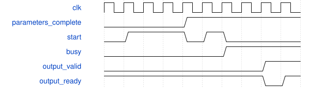

# road_dynamic_overlap_low_io_top 模块规范

> RTL: `road_dynamic_overlap_low_io_top.v`

## 1. 模块目的

Independent down2 runtime coefficient candidate; TEST scales, not deployed QAT.

## 2. 参数

| 参数 | 默认值 | 说明 |
| --- | --- | --- |
| — | — | 本模块没有可配置参数。 |

## 3. 时钟与复位

- 时钟：`{"name": "i_clk", "edge": "posedge", "frequency_hz": 100000000}`
- 复位：`{"name": "i_rstn", "active": "low", "synchronous": false, "values": "Cancel all old work; invalidate parameters and reload 1024 SiLU entries. Shell releases after two clock edges."}`

## 4. 接口信号规范

| 信号 | 方向 | 位宽 | 时钟域 | 语义角色 | 描述 |
| --- | --- | --- | --- | --- | --- |
| `i_clk` | input | 1 | i_clk | i_clk | 一百兆诊断时钟 |
| `i_rstn` | input | 1 | i_clk | i_rstn | 异步低有效外部复位 |
| `i_rx_valid` | input | 1 | i_clk | i_rx_valid | 十六位接收有效 |
| `i_rx_data` | input | 16 | i_clk | i_rx_data | 命令或动态负载字 |
| `o_rx_ready` | output | 1 | i_clk | o_rx_ready | 接收许可 |
| `o_tx_valid` | output | 1 | i_clk | o_tx_valid | 结果响应有效 |
| `o_tx_data` | output | 16 | i_clk | o_tx_data | 索引结果或完成字 |
| `i_tx_ready` | input | 1 | i_clk | i_tx_ready | 结果响应接收许可 |

## 5. 周期行为与延迟

- Reuse frozen MAC, RNE and SiLU. Kernel interfaces, arithmetic and II are unchanged.
- Load kind6 addresses0..39: nonnegative INT32 pre multipliers; DW0..15 then PW16..39.
- Load kind7 addresses0..39: shifts0..62; 40/41: DW/PW post multiplier; 42/43: DW/PW post shift.
- Sequential writes or address-zero restart only. Both complete banks required before runner start.
- Parameters writable only while idle; accepted postprocess batches capture coefficients with metadata.
- Real 9x9x16 halo feeds DW3x3/s2 then 4x4x16 PW16to24. Export384 INT8 items.
- Shell keeps38 external bits; existing16-bit load descriptor accepts kinds6/7 only in this candidate.

## 6. WaveDrom 时序图

### Incomplete load cannot start

Protocol schematic only; busy duration is compressed, not literal measured latency.

- WaveJSON：[road_dynamic_overlap_low_io_top_load-then-start.json5](waveforms/road_dynamic_overlap_low_io_top_load-then-start.json5)

## 7. 边界、反压与错误

- No partial parameter publication; negative multiplier and shift63 are rejected.
- Output ownership under backpressure; reset cancels data and invalidates parameter banks.

## 8. CDC 与综合约束

- No production edits, training, bitgen, board, Flash or additional timing exceptions.
- Diagnostic input/output delays are not a real external-device timing contract.

## 9. 验证与验收

- Fixed-profile byte equivalence and28 layer scenarios using actual PH1P/common models.
- Runtime nonpower-of-two scales and three tile locations; all intermediate values checked.
- Real narrow-port exports and gate netlist comparison; static and physical failures remain separate.

## 10. 可追溯性

- 规格模块：`road_dynamic_overlap_low_io_top`
- RTL 路径：`road_dynamic_overlap_low_io_top.v`
- 交付要求：本文档、WaveJSON 和 SVG 必须与同一版本规格一同发布。
