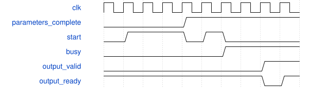

# road_down2_dynamic_adapter 模块规范

> RTL: `rtl/road_down2_dynamic_adapter.v`

## 1. 模块目的

Independent down2 runtime coefficient candidate; TEST scales, not deployed QAT.

## 2. 参数

| 参数 | 默认值 | 说明 |
| --- | --- | --- |
| — | — | 本模块没有可配置参数。 |

## 3. 时钟与复位

- 时钟：`{"name": "i_clk", "edge": "posedge", "frequency_hz": 100000000}`
- 复位：`{"name": "i_rstn", "active": "low", "synchronous": false, "values": "Cancel all old work; invalidate parameters and reload 1024 SiLU entries. Shell releases after two clock edges."}`

## 4. 接口信号规范

| 信号 | 方向 | 位宽 | 时钟域 | 语义角色 | 描述 |
| --- | --- | --- | --- | --- | --- |
| `i_clk` | input | 1 | i_clk | i_clk | i_clk |
| `i_rstn` | input | 1 | i_clk | i_rstn | i_rstn |
| `i_table_valid` | input | 1 | i_clk | i_table_valid | i_table_valid |
| `i_table_addr` | input | 10 | i_clk | i_table_addr | i_table_addr |
| `i_table_data` | input | 16 | i_clk | i_table_data | i_table_data |
| `o_table_ready` | output | 1 | i_clk | o_table_ready | o_table_ready |
| `o_table_loaded` | output | 1 | i_clk | o_table_loaded | o_table_loaded |
| `o_table_fault` | output | 1 | i_clk | o_table_fault | o_table_fault |
| `i_input_valid` | input | 1 | i_clk | i_input_valid | i_input_valid |
| `i_result_data` | input | 96 | i_clk | i_result_data | i_result_data |
| `i_result_fault` | input | 1 | i_clk | i_result_fault | i_result_fault |
| `i_layer` | input | 1 | i_clk | i_layer | i_layer |
| `i_position` | input | 4 | i_clk | i_position | i_position |
| `i_channel_base` | input | 5 | i_clk | i_channel_base | i_channel_base |
| `i_lane_mask` | input | 3 | i_clk | i_lane_mask | i_lane_mask |
| `i_pre_multipliers` | input | 96 | i_clk | i_pre_multipliers | i_pre_multipliers |
| `i_pre_shifts` | input | 18 | i_clk | i_pre_shifts | i_pre_shifts |
| `i_post_multiplier` | input | 32 | i_clk | i_post_multiplier | i_post_multiplier |
| `i_post_shift` | input | 6 | i_clk | i_post_shift | i_post_shift |
| `o_input_ready` | output | 1 | i_clk | o_input_ready | o_input_ready |
| `i_output_ready` | input | 1 | i_clk | i_output_ready | i_output_ready |
| `o_output_valid` | output | 1 | i_clk | o_output_valid | o_output_valid |
| `o_output_data` | output | 8 | i_clk | o_output_data | o_output_data |
| `o_output_tag` | output | 16 | i_clk | o_output_tag | o_output_tag |
| `o_fault` | output | 1 | i_clk | o_fault | o_fault |
| `o_result_queue_count` | output | 2 | i_clk | o_result_queue_count | o_result_queue_count |
| `o_meta_count` | output | 4 | i_clk | o_meta_count | o_meta_count |
| `o_pre_busy` | output | 1 | i_clk | o_pre_busy | o_pre_busy |
| `o_silu_busy` | output | 1 | i_clk | o_silu_busy | o_silu_busy |
| `o_post_busy` | output | 1 | i_clk | o_post_busy | o_post_busy |
| `o_pre_accept` | output | 1 | i_clk | o_pre_accept | o_pre_accept |
| `o_silu_accept` | output | 1 | i_clk | o_silu_accept | o_silu_accept |
| `o_post_accept` | output | 1 | i_clk | o_post_accept | o_post_accept |

## 5. 周期行为与延迟

- Reuse frozen MAC, RNE and SiLU. Kernel interfaces, arithmetic and II are unchanged.
- Load kind6 addresses0..39: positive INT32 pre multipliers; DW0..15 then PW16..39.
- Load kind7 addresses0..39: shifts0..62; 40/41: DW/PW post multiplier; 42/43: DW/PW post shift.
- Sequential writes or address-zero restart only. Both complete banks required before runner start.
- Parameters writable only while idle; accepted postprocess batches capture coefficients with metadata.
- Real 9x9x16 halo feeds DW3x3/s2 then 4x4x16 PW16to24. Export384 INT8 items.
- Shell keeps38 external bits; existing16-bit load descriptor accepts kinds6/7 only in this candidate.

## 6. WaveDrom 时序图

### Incomplete load cannot start

Protocol schematic only; busy duration is compressed, not literal measured latency.

- WaveJSON：[road_down2_dynamic_adapter_load-then-start.json5](waveforms/road_down2_dynamic_adapter_load-then-start.json5)

## 7. 边界、反压与错误

- No partial parameter publication; negative multiplier and shift63 are rejected.
- Output ownership under backpressure; reset cancels data and invalidates parameter banks.

## 8. CDC 与综合约束

- No production edits, training, bitgen, board, Flash or additional timing exceptions.
- Diagnostic input/output delays are not a real external-device timing contract.

## 9. 验证与验收

- Fixed-profile byte equivalence and28 layer scenarios using actual PH1P/common models.
- Runtime nonpower-of-two scales and three tile locations; all intermediate values checked.
- Real narrow-port exports and gate netlist comparison; static and physical failures remain separate.

## 10. 可追溯性

- 规格模块：`road_down2_dynamic_adapter`
- RTL 路径：`rtl/road_down2_dynamic_adapter.v`
- 交付要求：本文档、WaveJSON 和 SVG 必须与同一版本规格一同发布。
