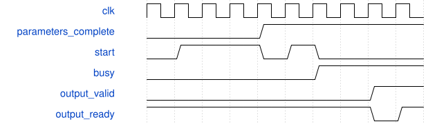

# Down2动态参数逐级对拍

这是无外部端口的仿真模块。canonical write-spec 对无端口TB要求非空ports，因此本说明为人工伴随规格，不标记为canonical通过，也不增加虚假端口。

测试使用100 MHz仿真时钟、低有效异步复位和真实PH1P/common厂商模型。输入为9×9×16 halo、DW 3×3/stride2参数、PW 16→24参数、1024项SiLU表及84个量化参数字；参数只在idle装载。每个tile对比640个INT32 MAC值，以及640个pre、SiLU、post和commit值，并导出384个INT8结果。

每套向量运行7项：三个tile位置无停顿、三个位置随机气泡和长反压、反压中复位并全量重装。检查计数守恒、元数据身份、停顿载荷保持、复位取消、done时队列排空。额外检查缺参数及半套参数不能启动，负乘数、shift63和顺序错误置故障。固定/动态参数各跑original/stress两族，共28个完整tile。

无停顿端点3331拍，DW2015、PW1316。互斥分类的优先级为外部写回停顿、容量等待、提交、MAC发出、输入/存储等待、任务收尾、排空、其他。忙周期允许重叠，不用于相加推算端点。

图为压缩的协议示意，不是3331拍的实测波形。失败条件包括任何数值、标签、地址、计数、停顿保持或复位取消不一致。
