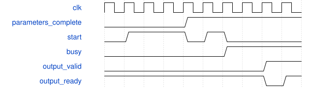

# 动态参数窄口壳逐项导出验证

这是无外部端口的仿真模块。canonical write-spec 对无端口TB要求非空ports，因此本说明为人工伴随规格，不标记为canonical通过，也不增加虚假端口。

顶层实际端口共38位，时钟100 MHz。外部复位异步断言，内部经两拍同步释放；表和参数必须重装。TB经16位RX ready-valid装入全部数据：命令1000装表，2000装一个descriptor和32位值，3000启动DW/PW，6001允许提交，5000读取31字状态，4000逐项导出。

descriptor高3位为kind，bits12:11必须为0，低11位为地址；候选增加kind6/7量化参数，不改已有传输格式。部分参数装载后发送启动，状态不得busy或done。满装后核心必须3331拍，分别导出索引8000|index、数值9000|byte和完成c000。

固定/动态两套压力参数，各验证三个tile位置；每套1152项，两套2304项。RTL与真实综合网表使用同一个TB、同一套向量，逐项比较，不用checksum代替结果。TX停顿插入0至4拍气泡，期间valid和data必须保持。

图为协议示意，busy区间压缩。综合网表回归不带SDF，不能当作延迟或板测证据；物理时序由同源TD报告单独判断。
