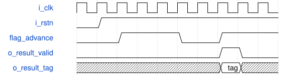

# road_round_internal_probe_core 模块规范

> RTL: `rtl/road_round_internal_probe_core.v`

## 1. 模块目的

Functional deterministic source, production nearest-even rounding core, registered sink and observable checksum behind an input reset boundary.

## 2. 参数

| 参数 | 默认值 | 说明 |
| --- | --- | --- |
| — | — | 本模块没有可配置参数。 |

## 3. 时钟与复位

- 时钟：`{"name": "i_clk", "edge": "posedge", "frequency_hz": 100000000}`
- 复位：`{"name": "i_rstn", "active": "low", "synchronous": false, "values": "Every source, RNE, sink and summary register clears; the dedicated generator guarantees synchronous release."}`

## 4. 接口信号规范

| 信号 | 方向 | 位宽 | 时钟域 | 语义角色 | 描述 |
| --- | --- | --- | --- | --- | --- |
| `i_clk` | input | 1 | i_clk | clock | Functional probe clock |
| `i_rstn` | input | 1 | i_clk | reset | Stable active-low reset from the dedicated generator |
| `o_result_valid` | output | 1 | i_clk | output_valid | Registered result capture pulse |
| `o_result_data` | output | 16 | i_clk | result_payload | Registered signed int16 result bit pattern |
| `o_result_tag` | output | 16 | i_clk | output_tag | Registered source identity |
| `o_result_fault` | output | 1 | i_clk | fault | Registered unsupported-shift result flag |
| `o_checksum` | output | 64 | i_clk | checksum | XOR of normalized registered result tokens |
| `o_error` | output | 1 | i_clk | error | Sticky fault-pattern mismatch |
| `o_result_count` | output | 16 | i_clk | result_count | Results incorporated into checksum |

## 5. 周期行为与延迟

- The registered PRBS source produces 192 tagged slots, with every eighth slot invalid.
- Tag low six bits provide shifts zero through sixty-three and shift sixty-three deliberately faults.
- A registered common advance freezes the source and all road_round_shift stages one clock in four.
- The result boundary exposes each accepted result and a later boundary updates checksum, count and sticky error.

## 6. WaveDrom 时序图

### Registered source and common stall

The registered advance freezes source and RNE state before results resume.

- WaveJSON：[road_round_internal_probe_core_source-stall-result.json5](waveforms/road_round_internal_probe_core_source-stall-result.json5)

## 7. 边界、反压与错误

- Shift zero is exact.
- Shift sixty-three returns a tagged fault.
- Common stalls hold both source and core state.
- Reset cancels all in-flight tokens.

## 8. CDC 与综合约束

- i_rstn is a module input from road_round_reset_gen and is not generated in this functional module.
- All combinational cones remain at most three operations and three sources.
- The staged road_round_shift remains byte-identical to production.

## 9. 验证与验收

- Check all 192 registered source slots.
- Check all 168 returned tokens and three faults.
- Check each common stall hold and reset cancellation.
- Check the final checksum and result count.

## 10. 可追溯性

- 规格模块：`road_round_internal_probe_core`
- RTL 路径：`rtl/road_round_internal_probe_core.v`
- 交付要求：本文档、WaveJSON 和 SVG 必须与同一版本规格一同发布。
