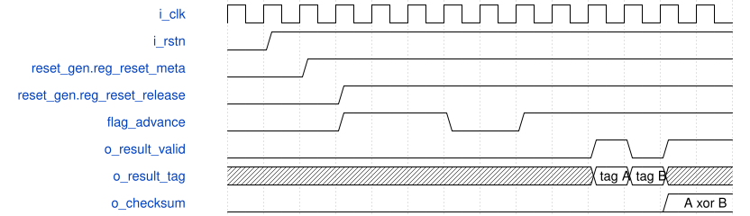

# road_round_internal_probe 模块规范

> RTL: `rtl/road_round_internal_probe.v`

## 1. 模块目的

Registered deterministic source, production nearest-even rounding core, registered sink and observable checksum for an internal integration boundary.

## 2. 参数

| 参数 | 默认值 | 说明 |
| --- | --- | --- |
| — | — | 本模块没有可配置参数。 |

## 3. 时钟与复位

- 时钟：`{"name": "i_clk", "edge": "posedge", "frequency_hz": 100000000}`
- 复位：`{"name": "i_rstn", "active": "low", "synchronous": false, "values": "road_round_reset_gen_Inst_release.reg_reset_meta and reg_reset_release assert asynchronously; wire_core_rstn deasserts after two rising edges and resets every source, RNE, sink and summary register.", "trusted_external_sources": [{"module": "road_round_reset_gen", "output_port": "o_rstn"}]}`

## 4. 接口信号规范

| 信号 | 方向 | 位宽 | 时钟域 | 语义角色 | 描述 |
| --- | --- | --- | --- | --- | --- |
| `i_clk` | input | 1 | i_clk | clock | Probe and rounding pipeline clock |
| `i_rstn` | input | 1 | i_clk | reset | External asynchronous active-low assertion into the two-register release synchronizer only |
| `o_result_valid` | output | 1 | i_clk | output_valid | One-cycle pulse for each result captured by the sink register boundary |
| `o_result_data` | output | 16 | i_clk | result_payload | Registered signed int16 result bit pattern; ignored on fault |
| `o_result_tag` | output | 16 | i_clk | output_tag | Registered source identity returned by the rounding core |
| `o_result_fault` | output | 1 | i_clk | fault | Registered unsupported-shift result flag |
| `o_checksum` | output | 64 | i_clk | checksum | XOR of normalized registered result tokens |
| `o_error` | output | 1 | i_clk | error | Sticky mismatch between fault and the deterministic shift pattern |
| `o_result_count` | output | 16 | i_clk | result_count | Number of result tokens incorporated into checksum |

## 5. 周期行为与延迟

- A registered 64-bit deterministic feedback source forms products by repeating its sign bit, restricting products to the signed 62-bit magnitude range and excluding INT64_MIN.
- Registered tag low six bits provide shifts zero through sixty-three; shift sixty-three is the deliberate fault case, and every eighth source slot is an invalid bubble.
- flag_advance is low for one clock in every four and freezes the source boundary and every road_round_shift stage; the stall phase itself remains free-running.
- The staged road_round_shift keeps its canonical nine enabled-edge input-to-output behavior and II one on enabled clocks.
- A sink register boundary captures data, tag and fault only on a common advance and exposes a one-cycle valid pulse.
- Fault data is normalized to zero before the separate checksum-token register; checksum, count and sticky error update only for qualified tokens.
- Reset cancels all in-flight source, core, sink and checksum tokens; the deterministic batch restarts from tag zero.

## 6. WaveDrom 时序图

### Two-stage reset release and a common stall

Internal reset releases after two clock edges; flag_advance then inserts a real common stall while registered results remain individually visible.

- WaveJSON：[road_round_internal_probe_reset-release-stall-result.json5](waveforms/road_round_internal_probe_reset-release-stall-result.json5)

## 7. 边界、反压与错误

- Shift zero passes an integer product without fractional rounding.
- Shift sixty-three returns a tagged fault and its unspecified data is zeroed only for checksum construction.
- A common stall freezes source and core state without duplicating a sink transfer.
- Asserting i_rstn during active tokens cancels them before the next clock; release takes two rising edges.
- The final eighteen-row CNN tile issue is outside this arithmetic-only probe.

## 8. CDC 与综合约束

- Verilog-2001 only and one i_clk domain; no gated clock.
- Only paths from top-level i_rstn to asynchronous reset controls of road_round_reset_gen_Inst_release.reg_reset_meta and reg_reset_release may receive the external asynchronous-reset exception.
- Paths from road_round_reset_gen_Inst_release.reg_reset_release through wire_core_rstn to the core and all source, sink and summary reset endpoints remain timed and must not be false-pathed.
- The production road_round_shift source must remain byte-identical to its staged copy.
- This fixture is not whole-CNN, synthesis timing, board, throughput or accuracy evidence.

## 9. 验证与验收

- Python generates 192 deterministic source slots using production/round/reference.py::expected.
- The testbench checks each registered source product, shift, tag and valid value.
- The testbench checks all 168 returned result tags, faults and nonfault data values.
- The testbench observes common stalls and proves representative source and core registers hold.
- The testbench asserts reset with live tokens, checks immediate cancellation, two-edge release and clean sequence restart.
- Final checksum, result count, fault count and sticky error match the Python report.

## 10. 可追溯性

- 规格模块：`road_round_internal_probe`
- RTL 路径：`rtl/road_round_internal_probe.v`
- 交付要求：本文档、WaveJSON 和 SVG 必须与同一版本规格一同发布。
