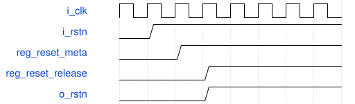

# road_round_reset_gen 模块规范

> RTL: `rtl/road_round_reset_gen.v`

## 1. 模块目的

Dedicated asynchronous-assert two-register synchronous-release reset generator for the internal probe.

## 2. 参数

| 参数 | 默认值 | 说明 |
| --- | --- | --- |
| — | — | 本模块没有可配置参数。 |

## 3. 时钟与复位

- 时钟：`{"name": "i_clk", "edge": "posedge", "frequency_hz": 100000000}`
- 复位：`{"name": "i_rstn", "active": "low", "synchronous": false, "values": "reg_reset_meta and reg_reset_release assert low asynchronously; o_rstn releases only after both rising-edge stages."}`

## 4. 接口信号规范

| 信号 | 方向 | 位宽 | 时钟域 | 语义角色 | 描述 |
| --- | --- | --- | --- | --- | --- |
| `i_clk` | input | 1 | i_clk | clock | Reset release synchronization clock |
| `i_rstn` | input | 1 | i_clk | reset | External asynchronous active-low reset |
| `o_rstn` | output | 1 | i_clk | reset | Active-low reset released after two rising edges |

## 5. 周期行为与延迟

- External reset asynchronously clears exactly reg_reset_meta and reg_reset_release.
- After i_rstn rises, reg_reset_meta rises on the first clock and reg_reset_release rises on the second clock.
- o_rstn is the direct published value of reg_reset_release.

## 6. WaveDrom 时序图

### Asynchronous assertion and two-edge release

Assertion is immediate while release crosses two clocked stages.

- WaveJSON：[road_round_reset_gen_reset-release.json5](waveforms/road_round_reset_gen_reset-release.json5)

## 7. 边界、反压与错误

- A short low pulse immediately clears both stages.
- A reset reassertion during release cancels the release immediately.

## 8. CDC 与综合约束

- Only the external i_rstn paths to these two asynchronous controls may receive an asynchronous reset timing exception.
- The reg_reset_release to functional reset path remains timed.
- Verilog-2001 and one clock domain only.

## 9. 验证与验收

- Testbench observes the first and second release stages separately.
- Reset reassertion with live functional tokens clears both stages immediately.

## 10. 可追溯性

- 规格模块：`road_round_reset_gen`
- RTL 路径：`rtl/road_round_reset_gen.v`
- 交付要求：本文档、WaveJSON 和 SVG 必须与同一版本规格一同发布。
