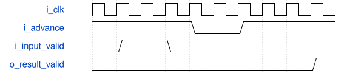

# road_round_shift 模块规范

> RTL: `rtl/road_round_shift.v`

## 1. 模块目的

Staged byte-identical production nine-stage globally enabled exact signed rounding and int16 saturation primitive.

## 2. 参数

| 参数 | 默认值 | 说明 |
| --- | --- | --- |
| — | — | 本模块没有可配置参数。 |

## 3. 时钟与复位

- 时钟：`{"name": "i_clk", "edge": "posedge", "frequency_hz": 100000000}`
- 复位：`{"name": "i_rstn", "active": "low", "synchronous": false, "values": "Every pipeline register and valid bit clears to zero."}`

## 4. 接口信号规范

| 信号 | 方向 | 位宽 | 时钟域 | 语义角色 | 描述 |
| --- | --- | --- | --- | --- | --- |
| `i_clk` | input | 1 | i_clk | clock | Enclosing pipeline clock |
| `i_rstn` | input | 1 | i_clk | reset | Active-low token cancellation |
| `i_advance` | input | 1 | i_clk | clock_enable | Common pipeline advance |
| `i_input_valid` | input | 1 | i_clk | input_valid | Input token valid |
| `i_product` | input | 64 | i_clk | signed_product | Exact signed product excluding INT64_MIN |
| `i_shift` | input | 6 | i_clk | shift | Right shift zero through sixty-two; sixty-three faults |
| `i_tag` | input | 16 | i_clk | tag | Opaque payload identity |
| `o_result_valid` | output | 1 | i_clk | output_valid | Qualifies data, tag and fault |
| `o_result_data` | output | 16 | i_clk | result_payload | Signed saturated int16 |
| `o_result_tag` | output | 16 | i_clk | output_tag | Accepted input identity |
| `o_fault` | output | 1 | i_clk | fault | Unsupported shift or minimum int64 |

## 5. 周期行为与延迟

- Nine enabled edges including acceptance produce output.
- II is one enabled clock and invalid input inserts a bubble.
- i_advance low freezes every pipeline register.
- Nearest-even rounding restores sign and saturates to signed int16.

## 6. WaveDrom 时序图

### Enabled clocks and a common stall

Adjacent tokens retain order across a common stall.

- WaveJSON：[road_round_shift_stream-with-stall.json5](waveforms/road_round_shift_stream-with-stall.json5)

## 7. 边界、反压与错误

- Shift zero has no fractional increment.
- Half ties round to even.
- Shift sixty-three and INT64_MIN fault.

## 8. CDC 与综合约束

- Verilog-2001 only and no multiplier.
- One clock domain and common clock enable.
- The enclosing probe owns readiness.

## 9. 验证与验收

- Production reference covers all legal shifts and signed ties.
- Internal probe checks continuous tokens, bubbles, common stalls, tags, faults and reset cancellation.

## 10. 可追溯性

- 规格模块：`road_round_shift`
- RTL 路径：`rtl/road_round_shift.v`
- 交付要求：本文档、WaveJSON 和 SVG 必须与同一版本规格一同发布。
