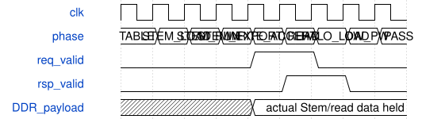

# road_stem_ddr_board_top 模块规范

> RTL: `road_stem_ddr_board_top.v`

## 1. 模块目的

十六个实际Stem tile经DDR实读后装载down2，末端1536字节逐项核对的一次性诊断。

## 2. 参数

| 参数 | 默认值 | 说明 |
| --- | --- | --- |
| — | — | 本模块没有可配置参数。 |

## 3. 时钟与复位

- 时钟：`{"domains": "CNN100MHz; DDR133.33MHz; HDMI75/375MHz"}`
- 复位：`{"assertion": "Entire DDR and arithmetic jointly asserted asynchronously", "release": "Two-flop release in each domain, reload all 1024 SiLU entries before start"}`

## 4. 接口信号规范

| 信号 | 方向 | 位宽 | 时钟域 | 语义角色 | 描述 |
| --- | --- | --- | --- | --- | --- |
| `i_sys_clk` | input | 1 | 未声明 | C4板载50MHz | C4板载50MHz |
| `i_rstn` | input | 1 | 未声明 | C7按键同时复位DDR和测试器 | C7按键同时复位DDR和测试器 |
| `o_tmds_blue_p` | output | 1 | 未声明 | HDMI1蓝色正端 | HDMI1蓝色正端 |
| `o_tmds_green_p` | output | 1 | 未声明 | HDMI1绿色正端 | HDMI1绿色正端 |
| `o_tmds_red_p` | output | 1 | 未声明 | HDMI1红色正端 | HDMI1红色正端 |
| `o_tmds_clock_p` | output | 1 | 未声明 | HDMI1时钟正端 | HDMI1时钟正端 |
| `ddr_ck_p` | output | 1 | 未声明 | 原厂IP封装内DDR专用端口 | 原厂IP封装内DDR专用端口 |
| `ddr_ck_n` | output | 1 | 未声明 | 沿原厂IP固定物理位置 | 沿原厂IP固定物理位置 |
| `ddr_cke` | output | 1 | 未声明 | DDR时钟使能 | DDR时钟使能 |
| `ddr_odt` | output | 1 | 未声明 | DDR终端控制 | DDR终端控制 |
| `ddr_cs_n` | output | 1 | 未声明 | DDR片选 | DDR片选 |
| `ddr_ras_n` | output | 1 | 未声明 | DDR行命令 | DDR行命令 |
| `ddr_cas_n` | output | 1 | 未声明 | DDR列命令 | DDR列命令 |
| `ddr_we_n` | output | 1 | 未声明 | DDR写命令 | DDR写命令 |
| `ddr_ba` | output | 2 | 未声明 | DDR bank地址 | DDR bank地址 |
| `ddr_addr` | output | 13 | 未声明 | DDR行列复用地址 | DDR行列复用地址 |
| `ddr_dqs_p` | inout | 2 | 未声明 | DDR双向差分选通 | DDR双向差分选通 |
| `ddr_dqs_n` | inout | 2 | 未声明 | DDR双向差分选通负端 | DDR双向差分选通负端 |
| `ddr_dq` | inout | 16 | 未声明 | DDR物理数据总线 | DDR物理数据总线 |
| `ddr_dm` | inout | 2 | 未声明 | DDR数据掩码物理端口 | DDR数据掩码物理端口 |

## 5. 周期行为与延迟

- 固定程序，16个Stem tile、256个唯一写字、289个真实读字、35次补零像素、1536输出字节。
- Stem从原缓存读口导出并先比黄金，实际载荷写DDR；实读先比较，再逐字节装入1296字节halo。
- 写响应只表示AW/W接受；一次运行不复用地址或生产槽，不发布READY或通用提交。
- 端点周期分十项互斥统计；忙活动可并行，不能相加。
- 任何故障终止本轮，首错保持直到整个DDR共同复位。

## 6. WaveDrom 时序图

### 一次性交接顺序

阶段顺序示意；不表示固定DDR返回延迟或写提交。

- WaveJSON：[road_stem_ddr_board_top_exclusive-once.json5](waveforms/road_stem_ddr_board_top_exclusive-once.json5)

## 7. 边界、反压与错误

- Request/response stalls, wrong data, missing response, failure after PASS, reset in every phase.

## 8. CDC 与综合约束

- Read-only ROM initialization is checked separately from board readback.
- No new timing exceptions for mailbox; existing bounded display CDC retained.
- TEST_ONLY coefficients, no deployed-model precision or full CNN FPS claim.

## 9. 验证与验收

- Independent controlled endpoint, actual frozen arithmetic, distinct PAXI mailbox regression, real integrated TD.

## 10. 可追溯性

- 规格模块：`road_stem_ddr_board_top`
- RTL 路径：`road_stem_ddr_board_top.v`
- 交付要求：本文档、WaveJSON 和 SVG 必须与同一版本规格一同发布。
