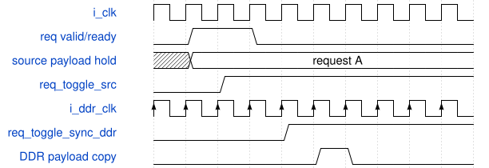
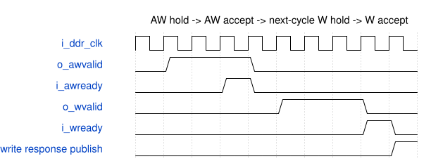
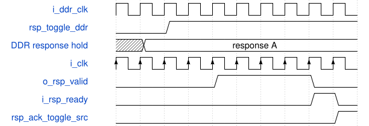

# road_paxi_mailbox 模块规范

> RTL: `road_paxi_mailbox.v`

## 1. 模块目的

100MHz到约133.33MHz的单槽冻结请求响应邮箱与真实原生PAXI有限端点。

## 2. 参数

| 参数 | 默认值 | 说明 |
| --- | --- | --- |
| — | — | 本模块没有可配置参数。 |

## 3. 时钟与复位

- 时钟：`{"domains": "i_clk=100MHz source; i_ddr_clk approximately 133.33MHz DDR user; clocks are asynchronous in verification"}`
- 复位：`{"assertion": "Both local resets derive from one common raw reset and assert asynchronously", "release": "Each domain releases synchronously; one-sided restart is forbidden"}`

## 4. 接口信号规范

| 信号 | 方向 | 位宽 | 时钟域 | 语义角色 | 描述 |
| --- | --- | --- | --- | --- | --- |
| `i_clk` | input | 1 | 未声明 | source_clock | 100MHz源域时钟 |
| `i_rstn` | input | 1 | 未声明 | source_reset | 源域异步断言同步释放复位 |
| `i_ddr_clk` | input | 1 | 未声明 | ddr_clock | 约133.33MHz DDR用户时钟 |
| `i_ddr_rstn` | input | 1 | 未声明 | ddr_reset | DDR域异步断言同步释放复位 |
| `i_phy_ready` | input | 1 | 未声明 | phy_status | DDR PHY持续可用状态 |
| `i_req_valid` | input | 1 | 未声明 | request_valid | 源请求有效 |
| `i_req_write` | input | 1 | 未声明 | request_write | 高电平写低电平读 |
| `i_req_addr` | input | 25 | 未声明 | request_address | 原生PAXI请求地址 |
| `i_req_data` | input | 128 | 未声明 | request_data | 完整写载荷 |
| `o_req_ready` | output | 1 | 未声明 | request_ready | 唯一槽可接受请求 |
| `o_rsp_valid` | output | 1 | 未声明 | response_valid | 源响应已经完整复制 |
| `o_rsp_data` | output | 128 | 未声明 | response_data | 冻结读响应数据 |
| `o_rsp_error` | output | 4 | 未声明 | response_error | 四类响应错误位 |
| `i_rsp_ready` | input | 1 | 未声明 | response_ready | 源端消费确认 |
| `o_fault` | output | 1 | 未声明 | sticky_fault | 同步到源域的粘滞故障 |
| `i_awready` | input | 1 | 未声明 | paxi_awready | 写地址接受条件 |
| `o_awaddr` | output | 25 | 未声明 | paxi_awaddr | 冻结原生写地址 |
| `o_awvalid` | output | 1 | 未声明 | paxi_awvalid | 写地址保持有效 |
| `i_wready` | input | 1 | 未声明 | paxi_wready | 写数据接受条件 |
| `o_wdata` | output | 128 | 未声明 | paxi_wdata | 冻结写数据 |
| `o_wstrb` | output | 16 | 未声明 | paxi_wstrb | 全零高有效掩码 |
| `o_wvalid` | output | 1 | 未声明 | paxi_wvalid | AW接受后下一拍开始保持写数据 |
| `o_wlast` | output | 1 | 未声明 | paxi_wlast | 唯一写数据拍末拍 |
| `i_arready` | input | 1 | 未声明 | paxi_arready | 读地址接受条件 |
| `o_araddr` | output | 25 | 未声明 | paxi_araddr | 冻结原生读地址 |
| `o_arvalid` | output | 1 | 未声明 | paxi_arvalid | 读地址保持有效 |
| `i_rvalid` | input | 1 | 未声明 | paxi_rvalid | 读返回有效 |
| `i_rlast` | input | 1 | 未声明 | paxi_rlast | 单拍读返回末拍 |
| `i_rdata` | input | 128 | 未声明 | paxi_rdata | 完整读返回载荷 |
| `o_rready` | output | 1 | 未声明 | paxi_rready | 已为唯一读预留返回槽 |

## 5. 周期行为与延迟

- Accept exactly one source request and freeze its type, address and data until the matching response is consumed.
- Cross request and response ownership with two-stage synchronized toggles; copy only a payload that the sending domain keeps frozen.
- Hold AW until accepted, then present W on the immediately following DDR cycle and hold it until accepted; a write response is not a commit response.
- Reserve one read slot before AR acceptance and accept an R beat on the same edge as AR when RLAST is asserted.
- Hold source response data and error unchanged under arbitrary response backpressure.

## 6. WaveDrom 时序图

### Frozen request crosses to DDR domain

The source payload is frozen before req_toggle_src changes and remains frozen through the whole transaction.

- WaveJSON：[road_paxi_mailbox_asynchronous-request-publication.json5](waveforms/road_paxi_mailbox_asynchronous-request-publication.json5)

### AW followed immediately by W

W is forbidden before AW acceptance; its first valid cycle is the immediately following DDR cycle.

- WaveJSON：[road_paxi_mailbox_independent-write-backpressure.json5](waveforms/road_paxi_mailbox_independent-write-backpressure.json5)

### Frozen response and consume acknowledgement

DDR response payload remains frozen until source valid/ready consumption returns its acknowledged toggle.

- WaveJSON：[road_paxi_mailbox_long-source-backpressure.json5](waveforms/road_paxi_mailbox_long-source-backpressure.json5)

## 7. 边界、反压与错误

- Independent AW and W backpressure without allowing W before AW acceptance.
- AR and R accepted on the same edge, delayed R, missing RLAST and unsolicited R.
- PHY loss, endpoint timeout, long source response backpressure and common reset in each active stage.

## 8. CDC 与综合约束

- Native address is in [0x1a00000,0x2000000) and aligned to stride 8.
- WSTRB is 16'h0000 and WLAST follows WVALID.
- C_TIMEOUT defaults to 27'h7ffffff; the testbench alone overrides it with 8.
- No asynchronous FIFO, commit input, retry, slot reuse or timing exception is introduced.

## 9. 验证与验收

- normal, split_aw_w, random_stalls, long_response_backpressure, ar_same_edge, bad_rlast, unsolicited_r, phy_lost, timeout, common_reset_positions, no_stale_response, asynchronous_clock_conservation

## 10. 可追溯性

- 规格模块：`road_paxi_mailbox`
- RTL 路径：`road_paxi_mailbox.v`
- 交付要求：本文档、WaveJSON 和 SVG 必须与同一版本规格一同发布。
