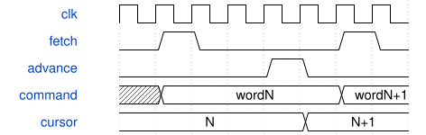

# road_frontend_load_sequence 模块规范

> RTL: `road_frontend_load_sequence.v`

## 1. 模块目的

固定阶段与计数器产生原命令头，窄ROM保存数值。

## 2. 参数

| 参数 | 默认值 | 说明 |
| --- | --- | --- |
| — | — | 本模块没有可配置参数。 |

## 3. 时钟与复位

- 时钟：`{"domains": "CNN100MHz"}`
- 复位：`{"assertion": "异步低有效复位清零阶段、计数和命令输出", "release": "上游同步释放；重新从1024项装表开始"}`

## 4. 接口信号规范

| 信号 | 方向 | 位宽 | 时钟域 | 语义角色 | 描述 |
| --- | --- | --- | --- | --- | --- |
| `i_clk` | input | 1 | 未声明 | 100MHz计算时钟 | 100MHz计算时钟 |
| `i_rstn` | input | 1 | 未声明 | 低有效异步复位 | 低有效异步复位 |
| `i_fetch` | input | 1 | 未声明 | 锁存当前命令 | 锁存当前命令 |
| `i_advance` | input | 1 | 未声明 | 已完成命令推进 | 已完成命令推进 |
| `o_command` | output | 64 | 未声明 | 稳定命令返回 | 稳定命令返回 |

## 5. 周期行为与延迟

- i_fetch上升沿锁存当前命令；i_advance上升沿推进一项；两者不得同拍。
- 输出在非FETCH期间保持，推进阶段不修改已经返回的命令。
- 固定十六个Stem tile和四个down2 tile；6092条命令顺序与原程序逐位一致。
- RGB零扩展，参数32位原样；SiLU符号扩展；像素第九位保留padding kind。

## 6. WaveDrom 时序图

### 同步取数与命令完成推进

FETCH沿返回当前命令；等待期间保持；ADVANCE只推进游标，下一FETCH才换返回。

- WaveJSON：[road_frontend_load_sequence_advance-hold.json5](waveforms/road_frontend_load_sequence_advance-hold.json5)

## 7. 边界、反压与错误

- 阶段边界、ROM首末项、512拍停顿、参数中途复位、最终END保持

## 8. CDC 与综合约束

- Read-only ROM initialization is checked separately from board readback.
- No new timing exceptions for mailbox; existing bounded display CDC retained.
- TEST_ONLY coefficients, no deployed-model precision or full CNN FPS claim.

## 9. 验证与验收

- 原程序逐字比较17704次、13例数值及故障周期一致、双时钟集成一致

## 10. 可追溯性

- 规格模块：`road_frontend_load_sequence`
- RTL 路径：`road_frontend_load_sequence.v`
- 交付要求：本文档、WaveJSON 和 SVG 必须与同一版本规格一同发布。
