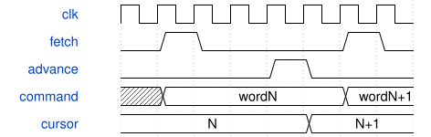

# road_stem_ddr_sequence 模块规范

> RTL: `road_stem_ddr_sequence.v`

## 1. 模块目的

十六个实际Stem tile经DDR实读后装载down2，末端1536字节逐项核对的一次性诊断。

## 2. 参数

| 参数 | 默认值 | 说明 |
| --- | --- | --- |
| — | — | 本模块没有可配置参数。 |

## 3. 时钟与复位

- 时钟：`{"domains": "CNN100MHz; DDR133.33MHz; HDMI75/375MHz"}`
- 复位：`{"assertion": "Entire DDR and arithmetic jointly asserted asynchronously", "release": "Two-flop release in each domain, reload all 1024 SiLU entries before start"}`

## 4. 接口信号规范

| 信号 | 方向 | 位宽 | 时钟域 | 语义角色 | 描述 |
| --- | --- | --- | --- | --- | --- |
| `i_clk` | input | 1 | 未声明 | 100MHz计算时钟 | 100MHz计算时钟 |
| `i_rstn` | input | 1 | 未声明 | 与整个DDR共同断言并在本域同步释放 | 与整个DDR共同断言并在本域同步释放 |
| `i_phy_ready` | input | 1 | 未声明 | 已同步到本域的初始化许可 | 已同步到本域的初始化许可 |
| `i_ddr_fault` | input | 1 | 未声明 | 邮箱的本域粘滞故障 | 邮箱的本域粘滞故障 |
| `i_req_ready` | input | 1 | 未声明 | 邮箱可保管唯一请求 | 邮箱可保管唯一请求 |
| `i_rsp_valid` | input | 1 | 未声明 | 完整响应已跨域冻结 | 完整响应已跨域冻结 |
| `i_rsp_data` | input | 128 | 未声明 | 实际DDR返回字 | 实际DDR返回字 |
| `i_rsp_error` | input | 4 | 未声明 | 写接受或读请求错误 | 写接受或读请求错误 |
| `o_req_valid` | output | 1 | 未声明 | 载荷保持到本域接受 | 载荷保持到本域接受 |
| `o_req_write` | output | 1 | 未声明 | 写接受与读返回分型 | 写接受与读返回分型 |
| `o_req_addr` | output | 25 | 未声明 | 按冻结布局转换的native地址 | 按冻结布局转换的native地址 |
| `o_req_data` | output | 128 | 未声明 | 实际核导出打包的128位字 | 实际核导出打包的128位字 |
| `o_rsp_ready` | output | 1 | 未声明 | 完整响应只消费一次 | 完整响应只消费一次 |
| `o_status` | output | 2 | 未声明 | 零等待、一通过、二失败 | 零等待、一通过、二失败 |
| `o_error` | output | 4 | 未声明 | 首个失败类型 | 首个失败类型 |
| `o_phase` | output | 5 | 未声明 | 可观测调度状态 | 可观测调度状态 |
| `o_writes` | output | 9 | 未声明 | 已收到接受回执的唯一写字数 | 已收到接受回执的唯一写字数 |
| `o_reads` | output | 9 | 未声明 | 实际已消费的读响应数 | 实际已消费的读响应数 |
| `o_output_bytes` | output | 11 | 未声明 | 已核对的最终PW字节数 | 已核对的最终PW字节数 |
| `o_cycles` | output | 32 | 未声明 | 含初始化的端点总周期 | 含初始化的端点总周期 |
| `o_cycle_bins` | output | 320 | 未声明 | 十项互斥分类，低32位为初始化 | 十项互斥分类，低32位为初始化 |
| `o_address` | output | 25 | 未声明 | 当前读写的完整native地址 | 当前读写的完整native地址 |
| `o_expected` | output | 128 | 未声明 | 最近比较的完整期望字 | 最近比较的完整期望字 |
| `o_actual` | output | 128 | 未声明 | 最近比较的完整实读或导出字 | 最近比较的完整实读或导出字 |

## 5. 周期行为与延迟

- 固定程序，16个Stem tile、256个唯一写字、289个真实读字、35次补零像素、1536输出字节。
- Stem从原缓存读口导出并先比黄金，实际载荷写DDR；实读先比较，再逐字节装入1296字节halo。
- 写响应只表示AW/W接受；一次运行不复用地址或生产槽，不发布READY或通用提交。
- 端点周期分十项互斥统计；忙活动可并行，不能相加。
- 任何故障终止本轮，首错保持直到整个DDR共同复位。
- 64位命令由有界循环加载器返回；与冻结6092条逐位一致，原FSM和所有案例周期保持。

## 6. WaveDrom 时序图

### 同步取数与命令完成推进

FETCH沿返回当前命令；等待期间保持；ADVANCE只推进游标，下一FETCH才换返回。

- WaveJSON：[road_stem_ddr_sequence_advance-hold.json5](waveforms/road_stem_ddr_sequence_advance-hold.json5)

## 7. 边界、反压与错误

- Request/response stalls, wrong data, missing response, failure after PASS, reset in every phase.

## 8. CDC 与综合约束

- Read-only ROM initialization is checked separately from board readback.
- No new timing exceptions for mailbox; existing bounded display CDC retained.
- TEST_ONLY coefficients, no deployed-model precision or full CNN FPS claim.

## 9. 验证与验收

- Independent controlled endpoint, actual frozen arithmetic, distinct PAXI mailbox regression, real integrated TD.

## 10. 可追溯性

- 规格模块：`road_stem_ddr_sequence`
- RTL 路径：`road_stem_ddr_sequence.v`
- 交付要求：本文档、WaveJSON 和 SVG 必须与同一版本规格一同发布。
