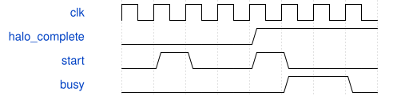

# road_stem_tile_scheduler 模块规范

> RTL: `road_stem_tile_scheduler.v`

## 1. 模块目的

固定3×3 stride2 Stem tile调度，算子外置；功能优先，单batch顺序执行。

## 2. 参数

| 参数 | 默认值 | 说明 |
| --- | --- | --- |
| — | — | 本模块没有可配置参数。 |

## 3. 时钟与复位

- 时钟：`{"name": "i_clk", "edge": "posedge", "frequency_hz": 100000000}`
- 复位：`{"name": "i_rstn", "active": "low", "synchronous": false, "values": "立即取消状态、所有loaded标志、输出有效性；缓存不清零；完整重装表和参数后再启动。"}`

## 4. 接口信号规范

| 信号 | 方向 | 位宽 | 时钟域 | 语义角色 | 描述 |
| --- | --- | --- | --- | --- | --- |
| `i_clk` | input | 1 | i_clk | i_clk | 单同步时钟域；100MHz仅为功能仿真时钟，不是物理签核。 |
| `i_rstn` | input | 1 | i_clk | i_rstn | 异步低有效取消全部有效性；算术模块必须同复位，释放后重新装载1024项表和参数。 |
| `i_table_loaded` | input | 1 | i_clk | i_table_loaded | 仅 IDLE 接受的顺序装载；kind0 原始 RGB 中心化一次，kind1 为 padding 零，kind2至6为参数。 |
| `i_load_valid` | input | 1 | i_clk | i_load_valid | 仅 IDLE 接受的顺序装载；kind0 原始 RGB 中心化一次，kind1 为 padding 零，kind2至6为参数。 |
| `i_load_kind` | input | 3 | i_clk | i_load_kind | 仅 IDLE 接受的顺序装载；kind0 原始 RGB 中心化一次，kind1 为 padding 零，kind2至6为参数。 |
| `i_load_addr` | input | 9 | i_clk | i_load_addr | 仅 IDLE 接受的顺序装载；kind0 原始 RGB 中心化一次，kind1 为 padding 零，kind2至6为参数。 |
| `i_load_data` | input | 32 | i_clk | i_load_data | 仅 IDLE 接受的顺序装载；kind0 原始 RGB 中心化一次，kind1 为 padding 零，kind2至6为参数。 |
| `o_load_ready` | output | 1 | i_clk | o_load_ready | 仅 IDLE 接受的顺序装载；kind0 原始 RGB 中心化一次，kind1 为 padding 零，kind2至6为参数。 |
| `i_start` | input | 1 | i_clk | i_start | 仅表及六类装载完整且无故障才能启动；busy核心窗口，done单拍，fault粘滞。 |
| `o_busy` | output | 1 | i_clk | o_busy | 仅表及六类装载完整且无故障才能启动；busy核心窗口，done单拍，fault粘滞。 |
| `o_done` | output | 1 | i_clk | o_done | 仅表及六类装载完整且无故障才能启动；busy核心窗口，done单拍，fault粘滞。 |
| `o_fault` | output | 1 | i_clk | o_fault | 仅表及六类装载完整且无故障才能启动；busy核心窗口，done单拍，fault粘滞。 |
| `o_core_cycles` | output | 32 | i_clk | o_core_cycles | 仅表及六类装载完整且无故障才能启动；busy核心窗口，done单拍，fault粘滞。 |
| `o_mac_valid` | output | 1 | i_clk | o_mac_valid | 连接冻结 8输入乘3输出 MAC；每 batch 四组，末输入掩码07，尾输出通道仅一路有效。 |
| `i_mac_ready` | input | 1 | i_clk | i_mac_ready | 连接冻结 8输入乘3输出 MAC；每 batch 四组，末输入掩码07，尾输出通道仅一路有效。 |
| `o_mac_first` | output | 1 | i_clk | o_mac_first | 连接冻结 8输入乘3输出 MAC；每 batch 四组，末输入掩码07，尾输出通道仅一路有效。 |
| `o_mac_last` | output | 1 | i_clk | o_mac_last | 连接冻结 8输入乘3输出 MAC；每 batch 四组，末输入掩码07，尾输出通道仅一路有效。 |
| `o_mac_mask` | output | 8 | i_clk | o_mac_mask | 连接冻结 8输入乘3输出 MAC；每 batch 四组，末输入掩码07，尾输出通道仅一路有效。 |
| `o_mac_activation` | output | 64 | i_clk | o_mac_activation | 连接冻结 8输入乘3输出 MAC；每 batch 四组，末输入掩码07，尾输出通道仅一路有效。 |
| `o_mac_weight` | output | 192 | i_clk | o_mac_weight | 连接冻结 8输入乘3输出 MAC；每 batch 四组，末输入掩码07，尾输出通道仅一路有效。 |
| `o_mac_bias` | output | 96 | i_clk | o_mac_bias | 连接冻结 8输入乘3输出 MAC；每 batch 四组，末输入掩码07，尾输出通道仅一路有效。 |
| `i_mac_result_valid` | input | 1 | i_clk | i_mac_result_valid | 连接冻结 8输入乘3输出 MAC；每 batch 四组，末输入掩码07，尾输出通道仅一路有效。 |
| `o_mac_result_ready` | output | 1 | i_clk | o_mac_result_ready | 连接冻结 8输入乘3输出 MAC；每 batch 四组，末输入掩码07，尾输出通道仅一路有效。 |
| `i_mac_result` | input | 96 | i_clk | i_mac_result | 连接冻结 8输入乘3输出 MAC；每 batch 四组，末输入掩码07，尾输出通道仅一路有效。 |
| `i_mac_fault` | input | 1 | i_clk | i_mac_fault | 连接冻结 8输入乘3输出 MAC；每 batch 四组，末输入掩码07，尾输出通道仅一路有效。 |
| `o_pp_valid` | output | 1 | i_clk | o_pp_valid | 连接冻结后处理；tag低8位为像素乘16加通道；保持有效负载直至握手。 |
| `i_pp_ready` | input | 1 | i_clk | i_pp_ready | 连接冻结后处理；tag低8位为像素乘16加通道；保持有效负载直至握手。 |
| `o_pp_acc` | output | 96 | i_clk | o_pp_acc | 连接冻结后处理；tag低8位为像素乘16加通道；保持有效负载直至握手。 |
| `o_pp_multipliers` | output | 96 | i_clk | o_pp_multipliers | 连接冻结后处理；tag低8位为像素乘16加通道；保持有效负载直至握手。 |
| `o_pp_shifts` | output | 18 | i_clk | o_pp_shifts | 连接冻结后处理；tag低8位为像素乘16加通道；保持有效负载直至握手。 |
| `o_pp_post_multiplier` | output | 32 | i_clk | o_pp_post_multiplier | 连接冻结后处理；tag低8位为像素乘16加通道；保持有效负载直至握手。 |
| `o_pp_post_shift` | output | 6 | i_clk | o_pp_post_shift | 连接冻结后处理；tag低8位为像素乘16加通道；保持有效负载直至握手。 |
| `o_pp_mask` | output | 3 | i_clk | o_pp_mask | 连接冻结后处理；tag低8位为像素乘16加通道；保持有效负载直至握手。 |
| `o_pp_tags` | output | 48 | i_clk | o_pp_tags | 连接冻结后处理；tag低8位为像素乘16加通道；保持有效负载直至握手。 |
| `i_pp_valid` | input | 1 | i_clk | i_pp_valid | 连接冻结后处理；tag低8位为像素乘16加通道；保持有效负载直至握手。 |
| `o_pp_ready` | output | 1 | i_clk | o_pp_ready | 连接冻结后处理；tag低8位为像素乘16加通道；保持有效负载直至握手。 |
| `i_pp_data` | input | 16 | i_clk | i_pp_data | 连接冻结后处理；tag低8位为像素乘16加通道；保持有效负载直至握手。 |
| `i_pp_tag` | input | 16 | i_clk | i_pp_tag | 连接冻结后处理；tag低8位为像素乘16加通道；保持有效负载直至握手。 |
| `i_pp_int16` | input | 1 | i_clk | i_pp_int16 | 连接冻结后处理；tag低8位为像素乘16加通道；保持有效负载直至握手。 |
| `i_pp_fault` | input | 1 | i_clk | i_pp_fault | 连接冻结后处理；tag低8位为像素乘16加通道；保持有效负载直至握手。 |
| `i_commit_ready` | input | 1 | i_clk | i_commit_ready | 仅表及六类装载完整且无故障才能启动；busy核心窗口，done单拍，fault粘滞。 |
| `i_export_start` | input | 1 | i_clk | i_export_start | 完整 tile 才可在 IDLE 请求导出；256个缓存元素按索引输出，反压期间保持。 |
| `o_output_valid` | output | 1 | i_clk | o_output_valid | 完整 tile 才可在 IDLE 请求导出；256个缓存元素按索引输出，反压期间保持。 |
| `i_output_ready` | input | 1 | i_clk | i_output_ready | 完整 tile 才可在 IDLE 请求导出；256个缓存元素按索引输出，反压期间保持。 |
| `o_output_data` | output | 8 | i_clk | o_output_data | 完整 tile 才可在 IDLE 请求导出；256个缓存元素按索引输出，反压期间保持。 |
| `o_output_index` | output | 8 | i_clk | o_output_index | 完整 tile 才可在 IDLE 请求导出；256个缓存元素按索引输出，反压期间保持。 |
| `o_export_done` | output | 1 | i_clk | o_export_done | 完整 tile 才可在 IDLE 请求导出；256个缓存元素按索引输出，反压期间保持。 |

## 5. 周期行为与延迟

- 加载243项halo，432权重、16偏置、16乘数、16移位、2项post；依序加载各类，重新从地址0加载即撤销完整标志。
- 4×4×16输出；每像素六个输出batch，前三路并行，最后仅一路；每路27项四组归约。
- PREPARE注册操作数，SEND保持到MAC接受，末组转MAC_WAIT；结果握手进入POST_WAIT；真实提交完成后ADVANCE。
- 输入与输出保持到ready；done不能视为export接受；必须IDLE发起导出。
- 核心周期按busy计数，不含load、done和export；无跨batch重叠。

## 6. WaveDrom 时序图

### 完整性准入

压缩示意，不表示真实核心延迟；第一次start被拒绝，完整后接受。

- WaveJSON：[road_stem_tile_scheduler_partial.json5](waveforms/road_stem_tile_scheduler_partial.json5)

## 7. 边界、反压与错误

- 部分halo、尾输出mask001、末输入mask07、边界operator-zero、反压和复位取消。

## 8. CDC 与综合约束

- 外部MAC、后处理及本调度器同复位；单batch最多27有效乘积，未扩大192上限。
- TEST_ONLY系数；不代表QAT模型精度，无物理时序或DDR保证。

## 9. 验证与验收

- 2304个Stem tile全阶段及完整589824字节输出，再输入真实576个down2 tile。

## 10. 可追溯性

- 规格模块：`road_stem_tile_scheduler`
- RTL 路径：`road_stem_tile_scheduler.v`
- 交付要求：本文档、WaveJSON 和 SVG 必须与同一版本规格一同发布。
