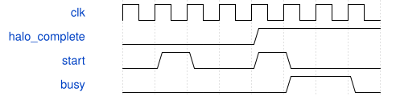

# tb_stem_down2 接口和验证范围

无端口仿真顶层，`stem_driver.vh` 是模块内验证驱动，不是可综合模块。100 MHz 仿真时钟。

1. 原始288×512 RGB→新Stem调度器→冻结MAC/重定标/SiLU→实际缓存导出。
2. 实际导出589824字节填充下游testbench存储；期望Stem文件仅用于比较，绝不写输入。
3. 按全图坐标从该存储取9×9×16 halo→冻结down2→实际221184字节导出。
4. 逐项检查MAC/pre/SiLU/post、真实提交、导出索引、重复和漏写。2304+576次部分装载启动被拒绝。
5. normal无停顿；stalls在提交和导出端施加随机气泡及96/64拍长反压。检查负载保持。

Stem与down2在TB中分别实例化算术链，先后运行，属于功能验证安排，不是最终硬件顶层或资源证据。未来部署必须互斥复用；本次不声称已经完成算子共享接线。

复位同时取消Stem调度、MAC与后处理；运行前全装1024项表。新调度器的处理中复位/故障注入专项回归仍需补，不由本完整正常/反压测试替代。

周期分为预装载、busy核心、导出。核心8类按优先级互斥：提交反压、入口阻塞、提交接受、MAC组接受、操作数准备、MAC等待、后处理等待、状态周转。等待项可能包含正在忙的流水级，不能将其另作忙周期相加。

压缩准入时序（不代表核心真实延迟）：

Canonical write-spec不支持空端口TB，失败保留在specifications目录；此处没有添加伪端口。真实量化参数、DDR、综合资源与物理时序、板测均不包含在本测试内。
