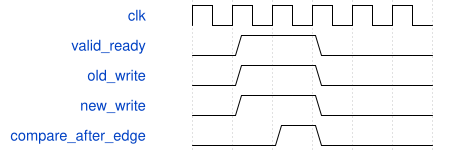

# tb_scheduler_storage 模块规范

> RTL: `tb_scheduler_storage.v`

## 1. 模块目的

独立银行物理视图适配：测试按显式逻辑地址映射观察；不在硬件中增加镜像或别名。

## 2. 参数

| 参数 | 默认值 | 说明 |
| --- | --- | --- |
| — | — | 本模块没有可配置参数。 |

## 3. 时钟与复位

- 时钟：`{"name": "clk", "frequency_hz": 100000000, "edge": "posedge", "internal": true}`
- 复位：`{"name": "rstn", "active": "low", "synchronous": false, "internal": true}`

## 4. 接口信号规范

| 信号 | 方向 | 位宽 | 时钟域 | 语义角色 | 描述 |
| --- | --- | --- | --- | --- | --- |
| `o_test_done` | output | 1 | clk | test_complete | 全部断言通过后置1并结束仿真。 |

## 5. 周期行为与延迟

- 原存储/ready枚举测试不变，仅Stem权重观察改为middle64和remaining368的双射。
- DW 18432次选权重比较、Stem725笔完整加载、最后加载到start无气泡及故障复位。

## 6. WaveDrom 时序图

### 接受沿后对比存储

同输入分别作用于原源和候选，NBA后比较，不允许新增写入拍。

- WaveJSON：[tb_scheduler_storage_lockstep.json5](waveforms/tb_scheduler_storage_lockstep.json5)

## 7. 边界、反压与错误

- 63/64、127/128、639/640、703/704、431/432、1295/1296及地址0重启。

## 8. CDC 与综合约束

- 测试专用，不综合，不属于数值精度或完整CNN FPS证据。

## 9. 验证与验收

- TB_PASS_SCHEDULER_STORAGE；原测试覆盖保持。

## 10. 可追溯性

- 规格模块：`tb_scheduler_storage`
- RTL 路径：`tb_scheduler_storage.v`
- 交付要求：本文档、WaveJSON 和 SVG 必须与同一版本规格一同发布。
