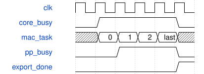

# tb_stem_profile 模块规范

> RTL: `tb_stem_profile.v`

## 1. 模块目的

与原黄金值TB共同展开的被动周期观察器，不驱动设计。

## 2. 参数

| 参数 | 默认值 | 说明 |
| --- | --- | --- |
| — | — | 本模块没有可配置参数。 |

## 3. 时钟与复位

- 时钟：`{"name": "clk", "frequency_hz": 100000000, "edge": "posedge", "internal": true}`
- 复位：`{"name": "rstn", "active": "low", "synchronous": false, "internal": true}`

## 4. 接口信号规范

| 信号 | 方向 | 位宽 | 时钟域 | 语义角色 | 描述 |
| --- | --- | --- | --- | --- | --- |
| `o_test_done` | output | 1 | clk | test_complete | 全部断言通过后置1并结束仿真。 |

## 5. 周期行为与延迟

- 只统计原TB首个Stem小块；原逐阶段及导出对拍继续执行。
- FSM五类状态计数互斥且相加等于core；pre/SiLU/post忙计数允许重叠，禁止相加代表耗时。
- 完成256次提交及导出后验证core一致并结束；不测故障退出的加速。

## 6. WaveDrom 时序图

### 计算与后处理重叠计时

一个时钟周期可同时属于MAC状态和PP忙；总耗时只统计一次。

- WaveJSON：[tb_stem_profile_overlap.json5](waveforms/tb_stem_profile_overlap.json5)

## 7. 边界、反压与错误

- 观察器仅用于无停顿首tile；其他位置与反压由完整数值回归覆盖。

## 8. CDC 与综合约束

- 测试专用，不综合，不属于数值精度或完整CNN FPS证据。

## 9. 验证与验收

- TB_PASS_STEM_PROFILE core=1566；五类FSM计数相加1566，commits=256。

## 10. 可追溯性

- 规格模块：`tb_stem_profile`
- RTL 路径：`tb_stem_profile.v`
- 交付要求：本文档、WaveJSON 和 SVG 必须与同一版本规格一同发布。
