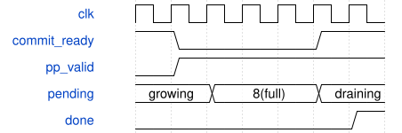

# tb_stem_overlap_protocol 模块规范

> RTL: `tb_stem_overlap_protocol.v`

## 1. 模块目的

真实共享算术链的重叠、满队列反压、错误tag、末任务故障与五个阶段复位专项。

## 2. 参数

| 参数 | 默认值 | 说明 |
| --- | --- | --- |
| — | — | 本模块没有可配置参数。 |

## 3. 时钟与复位

- 时钟：`{"name": "clk", "frequency_hz": 100000000, "edge": "posedge", "internal": true}`
- 复位：`{"name": "rstn", "active": "low", "synchronous": false, "internal": true}`

## 4. 接口信号规范

| 信号 | 方向 | 位宽 | 时钟域 | 语义角色 | 描述 |
| --- | --- | --- | --- | --- | --- |
| `o_test_done` | output | 1 | clk | test_complete | 全部断言通过后置1并结束仿真。 |

## 5. 周期行为与延迟

- 实际PP pending满8项时阻止新结果准入，保持已出现的输出载荷512拍。
- MAC在旧PP结果在途时继续接受；96个batch的256输出按tag0..255完整提交和导出。
- 分别在MAC/pre/SiLU/post/提交反压位置复位，整表及参数重装后恢复。
- 强制非法/重复tag与最后任务MAC故障，只作负向验证，不计入加速周期。

## 6. WaveDrom 时序图

### 满队列与长反压保持

只在真实握手时推进；恢复ready后完整排空，不能提前done。

- WaveJSON：[tb_stem_overlap_protocol_stall.json5](waveforms/tb_stem_overlap_protocol_stall.json5)

## 7. 边界、反压与错误

- 63/64、127/128、639/640、703/704、431/432、1295/1296及地址0重启。

## 8. CDC 与综合约束

- 测试专用，不综合，不属于数值精度或完整CNN FPS证据。

## 9. 验证与验收

- TB_PASS_STEM_OVERLAP_PROTOCOL；队列满、380次实际MAC接受重叠、512拍长反压、五个复位点和故障恢复。

## 10. 可追溯性

- 规格模块：`tb_stem_overlap_protocol`
- RTL 路径：`tb_stem_overlap_protocol.v`
- 交付要求：本文档、WaveJSON 和 SVG 必须与同一版本规格一同发布。
