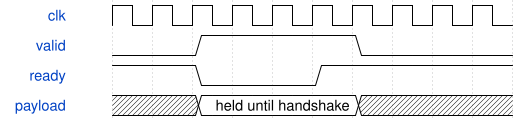

# road_driven_probe 模块规范

> RTL: `road_driven_probe.v`

## 1. 模块目的

Independent evidence probe; no production change.

## 2. 参数

| 参数 | 默认值 | 说明 |
| --- | --- | --- |
| — | — | 本模块没有可配置参数。 |

## 3. 时钟与复位

- 时钟：`{"name": "i_clk", "edge": "posedge", "frequency_hz": 100000000}`
- 复位：`{"name": "i_rstn", "active": "low", "synchronous": false, "values": "Cancel old transactions; reload table before calculation."}`

## 4. 接口信号规范

| 信号 | 方向 | 位宽 | 时钟域 | 语义角色 | 描述 |
| --- | --- | --- | --- | --- | --- |
| `i_clk` | input | 1 | i_clk | i_clk | i_clk |
| `i_rstn` | input | 1 | i_clk | i_rstn | i_rstn |
| `i_data` | input | 1 | i_clk | i_data | i_data |
| `o_data` | output | 1 | i_clk | o_data | o_data |

## 5. 周期行为与延迟

- Verify runtime operands against frozen integer results; do not change the DUT.

## 6. WaveDrom 时序图

### Payload ownership

Handshake protocol schematic, not measured pipeline latency.

- WaveJSON：[road_driven_probe_ready-valid.json5](waveforms/road_driven_probe_ready-valid.json5)

## 7. 边界、反压与错误

- Output must remain stable during backpressure; reset cancels pending work.

## 8. CDC 与综合约束

- Diagnostic only; no bitgen, new timing exceptions or board claim.

## 9. 验证与验收

- Use actual installed vendor models and retained logs.

## 10. 可追溯性

- 规格模块：`road_driven_probe`
- RTL 路径：`road_driven_probe.v`
- 交付要求：本文档、WaveJSON 和 SVG 必须与同一版本规格一同发布。
