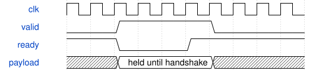

# 动态后处理窄口对拍测试规格

测试对象是冻结 A 的 `road_dynamic_chain_low_io_top`。测试台无外部端口，内部生成100 MHz时钟和复位，通过原16位协议装载运行时数据。分别编译原RTL和TD实际综合网表，使用同一份向量及实际PH1P和TD通用模型。

## 输入输出和顺序

1. 复位保持到厂商GSR结束后，释放后等待4拍。
2. A000命令及1024个表项，随后330个B000描述符，每个19个16位字。
3. 按有效lane顺序读取tag、signed16数据、状态；共604项。无SiLU输出的状态为2，激活输出为0。
4. ready拉低0至8拍，期间valid和数据不得变化。
5. C000返回接受数330、结果数604、装表状态2。
6. 装入半包后复位，计数及装表状态必须归零；重新装满1024项表后状态恢复为2，无旧事务泄漏。

逐字比较，不使用checksum替代；watchdog为500000拍。测试壳的串行接收和导出周期不代表核心吞吐。

## 周期图

图描述协议保持规则，不是测得的算术延迟。仿真实际总窗口为32014拍，RTL与综合网表一致；本次不加载SDF，不替代物理时序检查。

## 规格工具限制

已调用规范的 `workflow.write-spec` 入口，因测试台没有外部端口，被`interfaces.ports must be non-empty`拒绝。保留原失败日志，不增加伪端口或修改全局技能。此同名伴随规格是人工补充，周期图由规定的WaveDrom运行时生成；不能标记为规范入口通过。

严格门禁：34条注释位置项尚未闭合；compile与AST静态检查通过，实际仿真另有独立日志。
