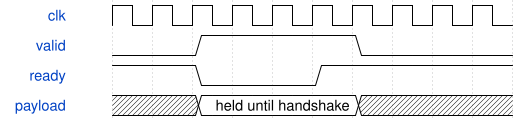

# 代表层动态参数算子链测试规格

测试台不改变冻结MAC、RNE、SiLU或后处理源码。MAC终态直接经原ready/valid接口进入动态后处理，测试驱动保持一项任务的系数与元数据，直到全部有效输出完成；不新增内部端口或跨任务MAC重叠。

## 数值与接口

激活INT8、权重INT8、偏置INT32，最多24组及每路192个有效乘积；MAC内部signed33契约不变。每次MAC结果先逐路比较INT32黄金值，最终signed16数据、tag、INT16模式分别比较。前重定标按通道变化，使用非二次幂系数；预测头关闭SiLU。所有参数为种子42的测试数据，不是QAT部署参数。

测试形状均来自冻结网络：Stem 3→16、16通道3×3 stride2 DW、16→24 PW、192→96 PW、48→2分类头及48→5回归objectness头。输出tile为4×4。3×3使用padding1，黄金卷积直接复用`cnn/integer.py`，展开的每个归约任务与该卷积结果再次核对。

DW在本测试台按单输出归约，不替换原A三空间点调度；原调度另用14项回归验证。六种形状共1040任务、2544项输出，尾输出组屏蔽无效lane；任务间保持串行，输出加入0至4拍停顿。

## 时序与计数

逐任务记录起点、MAC终态被接收点和最后输出点。计时包括测试驱动的输入气泡及输出停顿，不等于硬件层调度吞吐；不得用其与原3331拍直接比较加速率。预装表1024项不计入逐任务窗口。

watchdog为200000拍；有效输出在反压时必须稳定；意外故障、MAC或后处理不一致均立即失败。故障和8处复位的完整语义另复跑原冻结核心测试，而不是宣称本测试台覆盖了所有复位位置。

## 规格及门禁限制

规范`workflow.write-spec`不接受无外部端口测试台，失败已保留；本同名规格是人工补充，周期图由规定运行时生成。严格门禁38条注释位置项仍未闭合，不能声明交付门通过。
