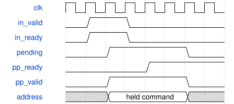

# road_frontend_shared_core 模块规范

> RTL: `road_frontend_shared_core.v`

## 1. 模块目的

共享前端以单项暂存隔离装表准入和后处理推进；其余调度与数值链冻结。

## 2. 参数

| 参数 | 默认值 | 说明 |
| --- | --- | --- |
| — | — | 本模块没有可配置参数。 |

## 3. 时钟与复位

- 时钟：`{"name": "i_clk", "edge": "posedge", "frequency_hz": 100000000}`
- 复位：`{"name": "i_rstn", "active": "low", "synchronous": false, "values": "立即取消暂存命令和旧事务；同步释放后重新装满1024项表。"}`

## 4. 接口信号规范

| 信号 | 方向 | 位宽 | 时钟域 | 语义角色 | 描述 |
| --- | --- | --- | --- | --- | --- |
| `i_clk` | input | 1 | i_clk | i_clk | 沿用冻结142位顶层接口；valid保持到ready，复位立即取消。 |
| `i_rstn` | input | 1 | i_clk | i_rstn | 沿用冻结142位顶层接口；valid保持到ready，复位立即取消。 |
| `i_select_valid` | input | 1 | i_clk | i_select_valid | 沿用冻结142位顶层接口；valid保持到ready，复位立即取消。 |
| `i_select_down2` | input | 1 | i_clk | i_select_down2 | 沿用冻结142位顶层接口；valid保持到ready，复位立即取消。 |
| `o_select_ready` | output | 1 | i_clk | o_select_ready | 沿用冻结142位顶层接口；valid保持到ready，复位立即取消。 |
| `o_selected_down2` | output | 1 | i_clk | o_selected_down2 | 沿用冻结142位顶层接口；valid保持到ready，复位立即取消。 |
| `i_table_valid` | input | 1 | i_clk | i_table_valid | 沿用冻结142位顶层接口；valid保持到ready，复位立即取消。 |
| `i_table_addr` | input | 10 | i_clk | i_table_addr | 沿用冻结142位顶层接口；valid保持到ready，复位立即取消。 |
| `i_table_data` | input | 16 | i_clk | i_table_data | 沿用冻结142位顶层接口；valid保持到ready，复位立即取消。 |
| `o_table_ready` | output | 1 | i_clk | o_table_ready | 沿用冻结142位顶层接口；valid保持到ready，复位立即取消。 |
| `o_table_loaded` | output | 1 | i_clk | o_table_loaded | 沿用冻结142位顶层接口；valid保持到ready，复位立即取消。 |
| `o_table_fault` | output | 1 | i_clk | o_table_fault | 沿用冻结142位顶层接口；valid保持到ready，复位立即取消。 |
| `i_load_valid` | input | 1 | i_clk | i_load_valid | 沿用冻结142位顶层接口；valid保持到ready，复位立即取消。 |
| `i_load_kind` | input | 3 | i_clk | i_load_kind | 沿用冻结142位顶层接口；valid保持到ready，复位立即取消。 |
| `i_load_addr` | input | 11 | i_clk | i_load_addr | 沿用冻结142位顶层接口；valid保持到ready，复位立即取消。 |
| `i_load_data` | input | 32 | i_clk | i_load_data | 沿用冻结142位顶层接口；valid保持到ready，复位立即取消。 |
| `o_load_ready` | output | 1 | i_clk | o_load_ready | 沿用冻结142位顶层接口；valid保持到ready，复位立即取消。 |
| `i_start` | input | 1 | i_clk | i_start | 沿用冻结142位顶层接口；valid保持到ready，复位立即取消。 |
| `i_commit_ready` | input | 1 | i_clk | i_commit_ready | 沿用冻结142位顶层接口；valid保持到ready，复位立即取消。 |
| `o_busy` | output | 1 | i_clk | o_busy | 沿用冻结142位顶层接口；valid保持到ready，复位立即取消。 |
| `o_done` | output | 1 | i_clk | o_done | 沿用冻结142位顶层接口；valid保持到ready，复位立即取消。 |
| `o_fault` | output | 1 | i_clk | o_fault | 沿用冻结142位顶层接口；valid保持到ready，复位立即取消。 |
| `o_core_cycles` | output | 32 | i_clk | o_core_cycles | 沿用冻结142位顶层接口；valid保持到ready，复位立即取消。 |
| `i_export_start` | input | 1 | i_clk | i_export_start | 沿用冻结142位顶层接口；valid保持到ready，复位立即取消。 |
| `i_output_ready` | input | 1 | i_clk | i_output_ready | 沿用冻结142位顶层接口；valid保持到ready，复位立即取消。 |
| `o_output_valid` | output | 1 | i_clk | o_output_valid | 沿用冻结142位顶层接口；valid保持到ready，复位立即取消。 |
| `o_output_data` | output | 8 | i_clk | o_output_data | 沿用冻结142位顶层接口；valid保持到ready，复位立即取消。 |
| `o_output_index` | output | 9 | i_clk | o_output_index | 沿用冻结142位顶层接口；valid保持到ready，复位立即取消。 |
| `o_export_done` | output | 1 | i_clk | o_export_done | 沿用冻结142位顶层接口；valid保持到ready，复位立即取消。 |

## 5. 周期行为与延迟

- 外部table valid&&ready表示wrapper已保管地址和数据；后续时钟才向PP实际提交。
- 暂存valid、地址和数据在PP未接收时保持；运行期未接受的table_valid不阻断旧事务排空。
- 允许同拍提交前项并接收后项；末项提交时拒绝不能执行的非零后继项。
- 完整装表后仅地址0可开始重装；o_table_loaded只反映PP真实状态。
- 装表命令待提交期间禁止start、load、export和select；数值、II和调度器接口不变。

## 6. WaveDrom 时序图

### 装表命令暂存与提交

接收发生于T0，T1起向PP提交；反压时暂存负载保持。

- WaveJSON：[road_frontend_shared_core_table-buffer.json5](waveforms/road_frontend_shared_core_table-buffer.json5)

## 7. 边界、反压与错误

- 连续1024项、push/pop同拍、PP反压、输入气泡、运行中提前装表、
- 末项后继、已加载后非法非零、待处理时命令封锁、复位取消。

## 8. CDC 与综合约束

- 仅修复共享wrapper，不改Stem/down2、算术核、约束、生产工程或位流流程。
- 动态系数仍为TEST_ONLY；不代表部署QAT、DDR闭环或整网性能。

## 9. 验证与验收

- Python逐拍协议参考；专用装表TB；冻结control/normal/stalls；Stem地址TB。

## 10. 可追溯性

- 规格模块：`road_frontend_shared_core`
- RTL 路径：`road_frontend_shared_core.v`
- 交付要求：本文档、WaveJSON 和 SVG 必须与同一版本规格一同发布。
