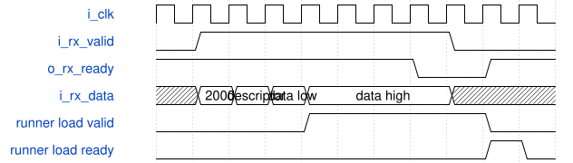

# road_postprocess_low_io_top 模块规范

> RTL: `road_postprocess_low_io_top.v`

## 1. 模块目的

A 38-bit diagnostic top that runtime-loads the complete overlap-runner state, starts the real DW/PW runner, and exports indexed result-cache values.

## 2. 参数

| 参数 | 默认值 | 说明 |
| --- | --- | --- |
| — | — | 本模块没有可配置参数。 |

## 3. 时钟与复位

- 时钟：`{"name": "i_clk", "edge": "posedge", "frequency_hz": 100000000}`
- 复位：`{"name": "i_rstn", "active": "low", "synchronous": false, "values": "Asynchronous assertion, two-stage synchronous release; cancels partial framing and requires complete dynamic reload."}`

## 4. 接口信号规范

| 信号 | 方向 | 位宽 | 时钟域 | 语义角色 | 描述 |
| --- | --- | --- | --- | --- | --- |
| `i_clk` | input | 1 | i_clk | clock | 100 MHz diagnostic clock. |
| `i_rstn` | input | 1 | i_clk | reset | Asynchronous active-low assertion with two-stage synchronous release. |
| `i_rx_valid` | input | 1 | i_clk | receive_valid | Holds a command or payload word until accepted. |
| `i_rx_data` | input | 16 | i_clk | receive_payload | Command-framed little-endian runtime data. |
| `o_rx_ready` | output | 1 | i_clk | receive_ready | Accepts one RX word on a valid-ready edge. |
| `o_tx_valid` | output | 1 | i_clk | transmit_valid | Holds one response word until accepted. |
| `o_tx_data` | output | 16 | i_clk | transmit_payload | Indexed result framing or completion response. |
| `i_tx_ready` | input | 1 | i_clk | transmit_ready | Consumes one held response word. |

## 5. 周期行为与延迟

- TABLE_BEGIN 0x1000 is followed by exactly 1024 signed 16-bit table words with implicit addresses zero through 1023.
- LOAD_BEGIN 0x2000 is followed by a descriptor containing kind[15:13], zero reserved[12:11], address[10:0], then signed 32-bit data low word first.
- START 0x3000 runs DW then PW; 0x3001 runs PW only. The command is accepted only after complete runtime preload and table activation.
- EXPORT 0x4000 starts the runner cache export. Each held runner result produces metadata 0x8000|index then data 0x9000|unsigned_byte; the runner advances only when the data word transfers.
- COMMIT_CONTROL 0x6000 or 0x6001 drives a retained runner commit-ready register low or high so writeback backpressure and queue-full behavior stay runtime-controllable.
- The shell contains no arithmetic constants or test operands. All halo, activation, weight, bias, table, and result values cross real runtime ports.

## 6. WaveDrom 时序图

### Runtime 32-bit load under runner backpressure

Header, descriptor, low word, and high word transfer on RX handshakes. The assembled runner load remains valid until runner ready.

- WaveJSON：[road_postprocess_low_io_top_runtime-load.json5](waveforms/road_postprocess_low_io_top_runtime-load.json5)

## 7. 边界、反压与错误

- Reserved descriptor bits, unknown commands, premature start, and overlapping export requests latch a protocol fault until reset.
- RX backpressure cannot drop an assembled load or table item.
- TX backpressure cannot change result metadata or data, and reset cancels either held word.
- A runner fault prevents a successful completion claim and is visible in the completion response.

## 8. CDC 与综合约束

- The external interface is exactly 38 bits and uses only ready-valid framing.
- The top instantiates down2_overlap_tile_runner and the approved unchanged arithmetic cores in its source closure.
- No timing exception, bit generation, board programming, Flash write, or training is permitted.
- Zero diagnostic I/O delay is retained and is not external timing signoff.

## 9. 验证与验收

- Python framing self-check covers signed load reconstruction, PW-only start, export, result encoding, and all 1024 implicit table addresses.
- Simulator regression performs real runtime table and full PW-tile loading, then compares every indexed exported result bit-exactly.
- Simulator regression toggles commit-ready while queues fill and drain, and injects RX/TX backpressure and reset at every parser and export holding state.
- Routed audit proves 24 MAC DSPs plus dynamically discovered round, SiLU, storage, metadata, and result-cache structures.

## 10. 可追溯性

- 规格模块：`road_postprocess_low_io_top`
- RTL 路径：`road_postprocess_low_io_top.v`
- 交付要求：本文档、WaveJSON 和 SVG 必须与同一版本规格一同发布。
