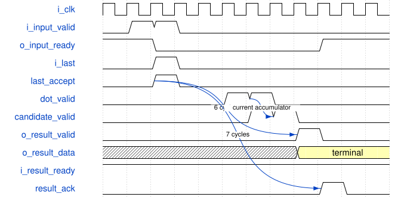

# road_mac_probe 模块规范

> RTL: `road_mac_probe.v`

## 1. 模块目的

Three-output signed INT8 MAC with one streaming reduction context, signed 33-bit feedback, and terminal INT32 faulting.

## 2. 参数

| 参数 | 默认值 | 说明 |
| --- | --- | --- |
| — | — | 本模块没有可配置参数。 |

## 3. 时钟与复位

- 时钟：`{"name": "i_clk", "edge": "posedge", "frequency_hz": 100000000}`
- 复位：`{"name": "i_rstn", "active": "low", "synchronous": false, "values": "Pipeline and result valid clear, accumulators clear, and input ready becomes one."}`

## 4. 接口信号规范

| 信号 | 方向 | 位宽 | 时钟域 | 语义角色 | 描述 |
| --- | --- | --- | --- | --- | --- |
| `i_clk` | input | 1 | i_clk | clock | 100 MHz work clock. |
| `i_rstn` | input | 1 | i_clk | reset | Asynchronous active-low reset. |
| `i_input_valid` | input | 1 | i_clk | input_valid | Qualifies the complete input payload. |
| `i_first` | input | 1 | i_clk | sequence_first | Selects aligned bias instead of retained accumulator. |
| `i_last` | input | 1 | i_clk | sequence_last | Ends the active reduction sequence. |
| `i_lane_mask` | input | 8 | i_clk | lane_enable | Shared enable for eight activation lanes. |
| `i_activation_data` | input | 64 | i_clk | activation_payload | Eight little-endian signed INT8 activations. |
| `i_weight_data` | input | 192 | i_clk | weight_payload | Three groups of eight signed INT8 weights. |
| `i_bias_data` | input | 96 | i_clk | bias_payload | Three little-endian signed INT32 biases. |
| `i_result_ready` | input | 1 | i_clk | output_ready | Accepts the held terminal payload. |
| `o_input_ready` | output | 1 | i_clk | input_ready | Allows input groups until last is accepted. |
| `o_result_valid` | output | 1 | i_clk | output_valid | Qualifies a held result or fault terminal. |
| `o_result_data` | output | 96 | i_clk | result_payload | Three signed INT32 results or atomic zeros. |
| `o_fault` | output | 1 | i_clk | overflow_fault | Marks terminal signed INT32 overflow. |

## 5. 周期行为与延迟

- An input transfers only when input valid and input ready are high on a rising edge.
- A0 captures input, A1 registers 24 signed INT8 products, A2 reduces pairs to signed17, A3 reduces quads to signed18, A4 registers three signed19 dot products, and A5 performs signed34 accumulation.
- At A5 first selects the aligned sign-extended bias; otherwise the current signed33 accumulator is selected.
- Consecutive non-terminal groups may transfer every clock and their A5 commits retain order.
- A last transfer closes input until its held terminal is accepted.
- Only a last candidate is checked against signed INT32; any channel overflow forces all three result words to zero and suppresses that commit.
- The terminal becomes visible exactly six rising-edge intervals after last acceptance and remains stable under backpressure; its earliest handshake is seven intervals after last.

## 6. WaveDrom 时序图

### II one reduction and six-cycle held terminal

Consecutive groups enter each cycle; last at c2 closes input, safe terminal at c7, held output at c8 and earliest ACK at c9. Diagram is a contract illustration, not a captured waveform.

- WaveJSON：[road_mac_probe_stream-terminal.json5](waveforms/road_mac_probe_stream-terminal.json5)

## 7. 边界、反压与错误

- A zero lane mask adds zero while preserving first and last behavior.
- First replaces retained history with bias; first zero continues retained history, including reset history zero.
- A terminal positive or negative INT32 overflow produces one held fault terminal with all-zero data.
- Reset during any stage cancels all pending work and leaves input ready high.

## 8. CDC 与综合约束

- Synthesizable Verilog-2001 only.
- Only one reduction sequence may be active; no result queue or multiple context is implemented.
- From one first/bias establishment through last, the caller keeps every legal prefix within signed33 and simultaneously limits the reduction to at most 24 groups and at most 192 enabled products per output.
- Group initiation interval remains one; A0 through A5 arithmetic is unchanged and only three terminal alignment stages are removed.
- The block contains no requantization, activation, shell, constraint, bitstream, or board behavior.

## 9. 验证与验收

- Compare product, pair, quad, dot, candidate, and accumulator values for signed and masked vectors.
- Drive 24 groups on consecutive cycles and require every input handshake.
- Require output valid exactly six cycles after last acceptance and earliest result acknowledgement at seven cycles.
- Hold result ready low and require stable valid, data, and fault.
- Assert asynchronous reset during active reduction and require no late terminal.

## 10. 可追溯性

- 规格模块：`road_mac_probe`
- RTL 路径：`road_mac_probe.v`
- 交付要求：本文档、WaveJSON 和 SVG 必须与同一版本规格一同发布。
