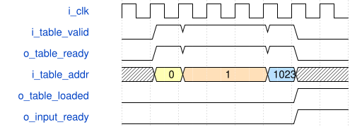
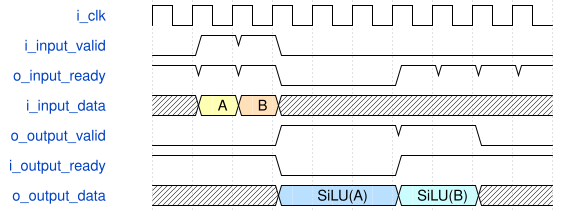

# silu_shared_unit 模块规范

> RTL: `silu_shared_unit.v`

## 1. 模块目的

Runtime-loaded shared signed Q7.8 SiLU lookup unit with fail-closed table validity and a globally stalled ready-valid pipeline.

## 2. 参数

| 参数 | 默认值 | 说明 |
| --- | --- | --- |
| — | — | 本模块没有可配置参数。 |

## 3. 时钟与复位

- 时钟：`{"name": "i_clk", "edge": "posedge"}`
- 复位：`{"name": "i_rstn", "active": "low", "synchronous": false, "memory_effect": "Table bits are not reset; metadata is reset and a complete reload is required."}`

## 4. 接口信号规范

| 信号 | 方向 | 位宽 | 时钟域 | 语义角色 | 描述 |
| --- | --- | --- | --- | --- | --- |
| `i_clk` | input | 1 | 未声明 | clock | Single pipeline and table clock. |
| `i_rstn` | input | 1 | 未声明 | reset | Asynchronous active-low metadata and pipeline reset. |
| `i_table_valid` | input | 1 | 未声明 | valid | Runtime table word is presented. |
| `o_table_ready` | output | 1 | 未声明 | ready | Runtime table word can be accepted. |
| `i_table_addr` | input | 10 | 未声明 | address | Strictly ascending table word address. |
| `i_table_data` | input | 16 | 未声明 | data | Signed Q7.8 table word. |
| `i_input_valid` | input | 1 | 未声明 | valid | Signed Q7.8 input sample is presented. |
| `o_input_ready` | output | 1 | 未声明 | ready | Input sample can be accepted. |
| `i_input_data` | input | 16 | 未声明 | data | Signed Q7.8 input sample. |
| `o_output_valid` | output | 1 | 未声明 | valid | Signed Q7.8 result is available. |
| `i_output_ready` | input | 1 | 未声明 | ready | Consumer can accept the result. |
| `o_output_data` | output | 16 | 未声明 | data | Signed Q7.8 SiLU result. |
| `o_table_loaded` | output | 1 | 未声明 | status | A complete ordered table image is active. |
| `o_table_fault` | output | 1 | 未声明 | status | The current image violated load order. |

## 5. 周期行为与延迟

- Accept a runtime table only as addresses 0 through 1023 in order; address 0 explicitly starts or restarts the image when the result pipeline is empty.
- Keep inference fail-closed until the final legal word is accepted and block inference whenever load valid is presented.
- Return zero for raw <= -2048, identity for raw >= 2048, otherwise use signed RNE raw/4 plus 512.
- Use hardwired signed value 2047 when the rounded middle-domain address is 1024.
- Advance all sample pipeline registers under one common enable and hold output during backpressure.
- Accept one sample per cycle when unstalled; the measured no-stall input-to-output latency is five cycles.
- Reset cancels samples and invalidates load metadata without clearing the array.

## 6. WaveDrom 时序图

### Ordered runtime table load and activation

Address zero starts the image and the edge accepting address 1023 activates inference; table bits are never reset.

- WaveJSON：[silu_shared_unit_load.json5](waveforms/silu_shared_unit_load.json5)

### Global pipeline clock enable under backpressure

Output stall freezes every sample stage and holds the visible result until ready returns.

- WaveJSON：[silu_shared_unit_inference.json5](waveforms/silu_shared_unit_inference.json5)

## 7. 边界、反压与错误

- Modulo-four tie chooses an even signed quotient.
- Raw 2046 and 2047 address the hardwired upper endpoint.
- Unexpected load address is not written and requires restart at zero.
- Reset leaves table bits but revokes loaded state and pending results.
- A restart waits for a visible result to drain.

## 8. CDC 与综合约束

- Synthesizable Verilog-2001; no DUT initial block or initialization file.
- One PH1P_LOGIC_ERAM instance in SP mode with a 1024 by 20 A port and disabled B port.
- Runtime writes sign-extend each 16-bit word to 20 bits; no primitive initialization or table reset is used.
- The exact-interface Icarus primitive model is not TD mapping, timing, or silicon evidence.
- Every ready-valid transfer consumer tests valid and ready.

## 9. 验证与验收

- Compare all 65536 signed codes with cnn.integer.silu.
- Check stable output across multi-cycle backpressure.
- Inject load-order fault and complete a clean restart.
- Reset with samples in flight and prove cancellation.
- Prove inference ready stays low until complete reload.

## 10. 可追溯性

- 规格模块：`silu_shared_unit`
- RTL 路径：`silu_shared_unit.v`
- 交付要求：本文档、WaveJSON 和 SVG 必须与同一版本规格一同发布。
