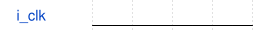

# tb_zero_port_parentheses 模块规范

> RTL: `rtl/tb_zero_port_parentheses.v`

## 1. 模块目的

验证零端口测试台 schema，不代表 SiLU 功能或物理验证。

## 2. 参数

| 参数 | 默认值 | 说明 |
| --- | --- | --- |
| — | — | 本模块没有可配置参数。 |

## 3. 时钟与复位

- 时钟：`{"signal": "i_clk", "source": "internal stimulus"}`
- 复位：`{"policy": "not used by this schema fixture"}`

## 4. 接口信号规范

| 信号 | 方向 | 位宽 | 时钟域 | 语义角色 | 描述 |
| --- | --- | --- | --- | --- | --- |

## 5. 周期行为与延迟

- 测试台内部产生刺激，顶层没有外部端口。

## 6. WaveDrom 时序图

### 内部刺激说明

契约示意图，不是实测波形。

- WaveJSON：[tb_zero_port_parentheses_schema-contract.json5](waveforms/tb_zero_port_parentheses_schema-contract.json5)

## 7. 边界、反压与错误

- 接口缺失、真实多出端口及非法源码必须失败。

## 8. CDC 与综合约束

- 仅供仿真；不属于可综合生产模块。

## 9. 验证与验收

- 显式测试台零端口通过；默认设计零端口拒绝。

## 10. 可追溯性

- 规格模块：`tb_zero_port_parentheses`
- RTL 路径：`rtl/tb_zero_port_parentheses.v`
- 交付要求：本文档、WaveJSON 和 SVG 必须与同一版本规格一同发布。
