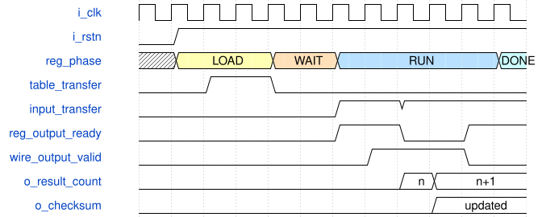

# silu_internal_probe 模块规范

> RTL: `rtl/silu_internal_probe.v`

## 1. 模块目的

Registered autonomous source and sink around the frozen SiLU candidate for isolated PH1P35 mapping and timing diagnosis.

## 2. 参数

| 参数 | 默认值 | 说明 |
| --- | --- | --- |
| — | — | 本模块没有可配置参数。 |

## 3. 时钟与复位

- 时钟：`{"name": "i_clk", "edge": "posedge", "frequency_hz": 100000000}`
- 复位：`{"name": "i_rstn", "active": "low", "synchronous": false, "values": "All probe state and frozen DUT transaction state clear asynchronously; no timing exception is assumed."}`

## 4. 接口信号规范

| 信号 | 方向 | 位宽 | 时钟域 | 语义角色 | 描述 |
| --- | --- | --- | --- | --- | --- |
| `i_clk` | input | 1 | i_clk | clock | Probe and SiLU clock |
| `i_rstn` | input | 1 | i_clk | reset | External asynchronous active-low reset |
| `o_done` | output | 1 | i_clk | done | All eighteen results captured |
| `o_error` | output | 1 | i_clk | error | Sticky result or table-state mismatch |
| `o_phase` | output | 3 | i_clk | phase | Load, wait, run, or done phase |
| `o_result_count` | output | 6 | i_clk | result_count | Captured result count |
| `o_checksum` | output | 32 | i_clk | checksum | XOR summary of data and result index |

## 5. 周期行为与延迟

- Registered controls load all 1024 table addresses in strict order with signed table value address minus 512.
- After o_table_loaded, the probe sends eighteen registered samples covering both bypass regions and central table lookup.
- The source holds valid and data until input handshake; a registered output-ready pattern creates real backpressure.
- Every output handshake is compared with the Python contract and folded into observable count and checksum registers.
- The frozen silu_shared_unit remains the only owner of the PH1P_LOGIC_ERAM instance and its CEA connection.

## 6. WaveDrom 时序图

### Registered table load, lookup stream, and backpressure

The probe completes table loading, starts consecutive samples, then holds a valid result during a registered ready-low interval.

- WaveJSON：[silu_internal_probe_load-run-stall.json5](waveforms/silu_internal_probe_load-run-stall.json5)

## 7. 边界、反压与错误

- Address zero restarts loading and address 1023 completes the table.
- Inputs at and beyond negative 2048 return zero; inputs at and beyond positive 2048 bypass with the original value.
- Input 2047 reaches the special rounded address 1024 result without reading beyond the table.
- Backpressure freezes the entire sample pipeline and RAM CEA through the frozen candidate connection.

## 8. CDC 与综合约束

- Target PH1P35MDG324 speed grade 3 at a diagnostic 10.000 ns period.
- Only i_clk and i_rstn are external inputs; outputs are observation registers and no board pins are assigned.
- No false path, multicycle path, min-delay padding, generated bitstream, programming, training, or Flash action is allowed.
- The frozen silu_shared_unit source hash must remain 5F357B493C7B3F941D9FA954A0CE5EC09091E466B641474360D2F64D0E42C938.
- This component probe is not whole-CNN throughput, board, or silicon acceptance evidence.

## 9. 验证与验收

- Python fixes all eighteen expected results and checksum 0x00001E01.
- RTL simulation checks 1024 table writes, eighteen input handshakes, eighteen outputs, at least one stalled valid result, and the checksum.
- Strict gate diagnostics are retained without waivers.
- TD elaboration, routed database, ERAM mapping, CEA connectivity, resources, and all timing classes are retained as raw evidence.

## 10. 可追溯性

- 规格模块：`silu_internal_probe`
- RTL 路径：`rtl/silu_internal_probe.v`
- 交付要求：本文档、WaveJSON 和 SVG 必须与同一版本规格一同发布。
