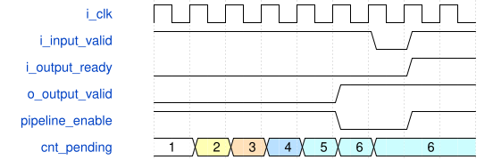

# tb_silu_semantic_assertions 模块规范

> RTL: `tb_silu_semantic_assertions.v`

## 1. 模块目的

只读绑定冻结 SiLU CEA DUT 的定向语义断言测试台，验证四项 VG122 范围，不修改 DUT。

## 2. 参数

| 参数 | 默认值 | 说明 |
| --- | --- | --- |
| — | — | 本模块没有可配置参数。 |

## 3. 时钟与复位

- 时钟：`{"name": "i_clk", "edge": "posedge", "frequency_mhz": 100}`
- 复位：`{"name": "i_rstn", "active": "low", "synchronous": false}`

## 4. 接口信号规范

| 信号 | 方向 | 位宽 | 时钟域 | 语义角色 | 描述 |
| --- | --- | --- | --- | --- | --- |
| `o_test_done` | output | 1 | i_clk | test completion | 测试台完成全部定向检查后置位 |

## 5. 周期行为与延迟

- 每个上升沿核对 cnt_pending 等于六个真实 valid 级之和，并核对 accepted-consumed 守恒。
- 顺序装载 0..1023，核对 cnt_table_expected 不到达 1024；错序地址 2 必须故障且不得写 RAM。
- 定向输入覆盖 lookup -7680、0、1024、8704，其中 1024 仅走特殊输出端点。
- 输出反压时控制与官方 RAM 输出保持，同拍输入输出保持 pending 不变，复位取消在途事务。

## 6. WaveDrom 时序图

### 六级在途填满、停顿与同拍进出

第六个样本使六级 valid 全满；ready 拉低保持，恢复时输入与输出同拍握手，pending 仍为 6。

- WaveJSON：[tb_silu_semantic_assertions_pending-stall-resume.json5](waveforms/tb_silu_semantic_assertions_pending-stall-resume.json5)

## 7. 边界、反压与错误

- 六级流水填满后 pending 必须为 6，编码值 7 不可达。
- 中央域 raw=-2047/-2046 映射地址 0，raw=2046/2047 映射特殊端点 1024。
- 表写地址只有 10 位 0..1023；lookup 1024 不得解释成合法写地址。
- 异步复位取消在途事务并清除已装表状态。

## 8. CDC 与综合约束

- 这是仿真专用 testbench，不可综合，不修改冻结 DUT、官方 RAM 模型或生产 RTL。
- ModelSim 必须同时加载官方 PH1P_LOGIC_ERAM 与 PH1P_PHY_GSR 模型。

## 9. 验证与验收

- Python 穷举全部 INT16 lookup 值并给出完整与中央域范围。
- 官方 ModelSim 定向断言仿真出现 TB_PASS_SEMANTIC 且无 ASSERT_FAIL。
- 复跑固定 v5 官方模型用例，保留原版单拍停顿预期失败及 CEA 候选通过证据。

## 10. 可追溯性

- 规格模块：`tb_silu_semantic_assertions`
- RTL 路径：`tb_silu_semantic_assertions.v`
- 交付要求：本文档、WaveJSON 和 SVG 必须与同一版本规格一同发布。
