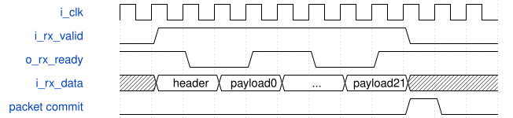
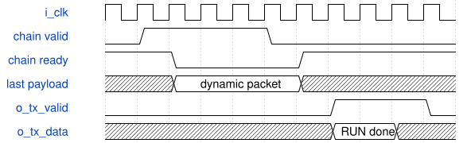
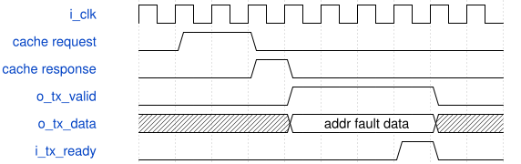

# road_low_io_physical_shell 模块规范

> RTL: `road_low_io_physical_shell.v`

## 1. 模块目的

A 38-pin diagnostic wrapper that runtime-loads a frozen SiLU table and up to 96 complete dynamic compute packets over one 16-bit ready-valid input, runs the unmodified RoadYOLO minimum chain once per reset, and returns real cache values over one 16-bit ready-valid output.

## 2. 参数

| 参数 | 默认值 | 说明 |
| --- | --- | --- |
| — | — | 本模块没有可配置参数。 |

## 3. 时钟与复位

- 时钟：`{"name": "i_clk", "edge": "posedge", "frequency_hz": 100000000}`
- 复位：`{"name": "i_rstn", "active": "low", "synchronous": false, "values": "Cancels partial table and packet frames, run and export transactions, held TX output, counters, table validity, packet validity, and the frozen compute chain."}`

## 4. 接口信号规范

| 信号 | 方向 | 位宽 | 时钟域 | 语义角色 | 描述 |
| --- | --- | --- | --- | --- | --- |
| `i_clk` | input | 1 | i_clk | clock | 100 MHz diagnostic clock. |
| `i_rstn` | input | 1 | i_clk | reset | Asynchronous active-low cancellation reset; the table and packets must be reloaded. |
| `i_rx_valid` | input | 1 | i_clk | receive_valid | Holds one command or payload word until accepted. |
| `i_rx_data` | input | 16 | i_clk | receive_payload | Command-framed low-word-first table and compute data. |
| `o_rx_ready` | output | 1 | i_clk | receive_ready | Accepts exactly one receive word on a valid-ready edge. |
| `o_tx_valid` | output | 1 | i_clk | transmit_valid | Holds one result, completion, or status word until accepted. |
| `o_tx_data` | output | 16 | i_clk | transmit_payload | Framed real-cache result, command completion, or stable status snapshot word. |
| `i_tx_ready` | input | 1 | i_clk | transmit_ready | Consumes one held transmit word. |

## 5. 周期行为与延迟

- The top-level expansion is 38 I/O bits: two global pins, eighteen receive-channel bits, and eighteen transmit-channel bits.
- TABLE_BEGIN is 0x1000 and is followed by exactly 1024 signed table words. A one-word skid register holds each word while the frozen SiLU table port is backpressured; computation remains blocked until the frozen chain asserts table loaded.
- PACKET_BEGIN uses opcode 0x2 with first at bit 11, last at bit 10, lane mask at bits 9 through 2, and zero reserved bits. It is followed by four activation, twelve weight, and six bias words, all least-significant word first.
- Up to 96 complete 362-bit packets are buffered as dynamic operands. Each of one through four positions has one through 24 groups and no more than 192 enabled terms.
- RUN uses opcode 0x3 and an exact seven-bit packet count. Only one run is accepted per reset. Completion requires the last parallel input handshake, a later observation of frozen-chain input-ready low, and a later return to ready after normal commit or atomic fault handling.
- EXPORT uses 0x4000 and reads exactly positions times three values through the original cache request-response port. Each result word carries address, cache fault, and actual INT8 data; an explicit 0x6 address command exposes uncommitted and out-of-range cache fault behavior.
- STATUS uses 0x5000 and returns eighteen words from one frozen snapshot. The preload, core, and export cycle fields are endpoint differences for TABLE_BEGIN to RUN, first parallel input accept to full-position completion, and EXPORT accept to final result consumption.
- The output checksum is auxiliary. Verification compares each result word and fault bit independently.

## 6. WaveDrom 时序图

### Narrow packet load and atomic buffer commit

A packet header and 22 payload words transfer only on RX valid-ready edges. The packet count changes after the final payload has been checked and committed.

- WaveJSON：[road_low_io_physical_shell_narrow-load.json5](waveforms/road_low_io_physical_shell_narrow-load.json5)

### RUN completion after frozen-chain busy interval

The last buffered packet is held to the parallel ready-valid port. RUN done is emitted only after input-ready is observed low and later returns high.

- WaveJSON：[road_low_io_physical_shell_run-completion.json5](waveforms/road_low_io_physical_shell_run-completion.json5)

### Real cache result exported under TX backpressure

One original cache response is captured into the transmit holding register. Result address, fault, and data remain unchanged until TX ready consumes the word.

- WaveJSON：[road_low_io_physical_shell_cache-tx-backpressure.json5](waveforms/road_low_io_physical_shell_cache-tx-backpressure.json5)

## 7. 边界、反压与错误

- A partial table or partial 22-word packet never starts a run and is discarded by reset.
- A twenty-fifth group is rejected without storing the packet or issuing a run; four positions of 24 groups exactly fill the 96-packet buffer.
- RX words, buffered parallel operands, RUN completion, cache results, and status words remain stable under their respective backpressure intervals.
- Reset during core work, cache response holding, or status response holding cancels the old transaction and requires a complete table reload.
- An atomic MAC fault completes the run but exports three zero values with cache-fault bits because the position was not committed.
- A second RUN before reset is rejected to prevent stale valid bits from a previous use of the frozen cache.

## 8. CDC 与综合约束

- The frozen signed33 MAC, round, SiLU, and road_onchip_chain sources and interfaces are not modified.
- Fixed requantization coefficients remain inside the frozen chain; this physical result must not be generalized to arbitrary runtime multiplier cost.
- The finite reduction contract is at most 24 groups and 192 active products per position, never an unbounded accumulator stream.
- No UART, AXI, DDR, video, board pin assignment, production bitstream, Flash write, or new timing exception is part of this wrapper.
- Automatic pins and diagnostic I/O delays are only for isolated PH1P physical validation.

## 9. 验证与验收

- The existing 16-channel, 13-channel tail, saturation, and terminal atomic-fault vectors are transmitted over the narrow protocol and compared item by item.
- Frozen signed33 positive and negative temporary-excursion recovery cases are transmitted and compared after the full quantization chain.
- Frozen maximum 24-group, 192-term legal and final-overflow cases verify the finite arithmetic boundary through the shell.
- Four 24-group positions exercise all 96 packet slots and return twelve cache values.
- Partial table, partial packet, duplicate run, uncommitted address, address 15, core reset, held export reset, held status reset, RX count, TX hold, and parallel payload hold are checked.
- A cycle trace assigns each core interval to exactly one MAC, pre-requantization, SiLU, post-requantization, commit, or fault bucket without overlap.

## 10. 可追溯性

- 规格模块：`road_low_io_physical_shell`
- RTL 路径：`road_low_io_physical_shell.v`
- 交付要求：本文档、WaveJSON 和 SVG 必须与同一版本规格一同发布。
