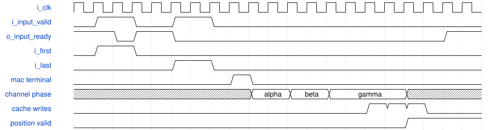
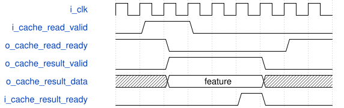

# road_onchip_chain 模块规范

> RTL: `road_onchip_chain.v`

## 1. 模块目的

Single-context diagnostic chain for two eight-lane MAC beats, three serialized requantization and SiLU channels, atomic three-channel cache publication, and independent ready-valid cache readback.

## 2. 参数

| 参数 | 默认值 | 说明 |
| --- | --- | --- |
| — | — | 本模块没有可配置参数。 |

## 3. 时钟与复位

- 时钟：`{"name": "i_clk", "edge": "posedge", "frequency_hz": 100000000}`
- 复位：`{"name": "i_rstn", "active": "low", "synchronous": false, "values": "Cancels MAC, round, SiLU, controller, cache validity, and held cache responses; SiLU table content must be reloaded."}`

## 4. 接口信号规范

| 信号 | 方向 | 位宽 | 时钟域 | 语义角色 | 描述 |
| --- | --- | --- | --- | --- | --- |
| `i_clk` | input | 1 | i_clk | clock | 100 MHz diagnostic chain clock. |
| `i_rstn` | input | 1 | i_clk | reset | Asynchronous active-low transaction cancellation reset. |
| `i_input_valid` | input | 1 | i_clk | input_valid | Holds one complete MAC beat payload until accepted. |
| `i_first` | input | 1 | i_clk | sequence_first | Selects bias for the first channel group of a position. |
| `i_last` | input | 1 | i_clk | sequence_last | Marks the last channel group for the current position. |
| `i_lane_mask` | input | 8 | i_clk | lane_enable | Enables the same eight activation lanes for all three outputs. |
| `i_activation_data` | input | 64 | i_clk | activation_payload | Eight signed INT8 activations with lane zero in the least-significant byte. |
| `i_weight_data` | input | 192 | i_clk | weight_payload | Three consecutive groups of eight signed INT8 weights. |
| `i_bias_data` | input | 96 | i_clk | bias_payload | Three signed INT32 biases with output zero in the least-significant word. |
| `o_input_ready` | output | 1 | i_clk | input_ready | Allows a MAC beat only while the real SiLU table is healthy and the controller is in the MAC phase. |
| `o_fault` | output | 1 | i_clk | chain_fault | Sticky diagnostic fault for MAC, round tag, round input, or SiLU table failure. |
| `i_table_valid` | input | 1 | i_clk | table_valid | Holds one real SiLU table entry until accepted. |
| `i_table_addr` | input | 10 | i_clk | table_address | Strictly increasing runtime SiLU table address. |
| `i_table_data` | input | 16 | i_clk | table_payload | Signed Q7.8 runtime SiLU table entry. |
| `o_table_ready` | output | 1 | i_clk | table_ready | Accepts a table entry only when no MAC beat is in flight. |
| `o_table_loaded` | output | 1 | i_clk | table_loaded | Indicates that all 1024 real SiLU entries have been accepted. |
| `o_table_fault` | output | 1 | i_clk | table_fault | Sticky strictly increasing table-load protocol failure. |
| `i_cache_read_valid` | input | 1 | i_clk | cache_request_valid | Holds one cache read request until accepted. |
| `i_cache_read_addr` | input | 4 | i_clk | cache_request_address | Addresses one of twelve committed INT8 features. |
| `o_cache_read_ready` | output | 1 | i_clk | cache_request_ready | Accepts a request when the one-entry response slot is free or consumed. |
| `o_cache_result_valid` | output | 1 | i_clk | cache_result_valid | Holds cache response data and fault until consumed. |
| `o_cache_result_data` | output | 8 | i_clk | cache_result_payload | Signed INT8 feature returned from actual cache storage. |
| `o_cache_result_fault` | output | 1 | i_clk | cache_result_fault | Marks an address outside zero through eleven or a not-yet-committed entry. |
| `i_cache_result_ready` | input | 1 | i_clk | cache_result_ready | Consumes the held cache response. |

## 5. 周期行为与延迟

- The real 1024-entry SiLU table must be loaded through table ready-valid before MAC input opens.
- Each 2x2x16 position uses two accepted eight-lane MAC beats and each 2x2x13 tail position uses masks 0xff and 0x1f.
- A normal MAC terminal captures three signed INT32 accumulators and serializes alpha, beta, and gamma through one signed multiplication point, one shared road_round_shift, the unmodified real silu_shared_unit, the same multiplication point, and the same road_round_shift.
- The fixed diagnostic factors are pre M values 1, 3, and 5 with shifts 0, 2, and 4; post M is 1 with shift 4. Each factor is a nonnegative 31-bit magnitude carried in signed32 with a zero sign bit; multiplying it by a signed INT32 accumulator or sign-extended SiLU result produces the full signed64 product.
- The round tag carries position, output channel, and pre or post phase. SiLU has no tag; the single-context controller keeps position and channel metadata unchanged around the SiLU transfer.
- Post-round INT16 is saturated directly to INT8, which is equivalent to INT16 saturation followed by INT8 saturation on the same rounded integer.
- All three temporary features must finish successfully before any cache-valid bit for the position is published. Physical entries write on three consecutive commit clocks, and all three valid bits become visible only with the gamma commit.
- A MAC terminal fault cancels the position, publishes no cache-valid bits, advances to the next position, and sets the sticky chain fault.
- A cache read request captures one actual array entry into a held response. Invalid or uncommitted addresses return zero with response fault high.

## 6. WaveDrom 时序图

### Serialized position with atomic cache publication

Two MAC beats produce one three-channel terminal. Alpha, beta, and gamma traverse the shared pre-round, real SiLU, and post-round stages one at a time. Cache validity remains low during alpha and beta writes and all three bits publish with gamma.

- WaveJSON：[road_onchip_chain_serial-position.json5](waveforms/road_onchip_chain_serial-position.json5)

### Independent cache response backpressure

A committed cache request creates one held response. Data and fault remain stable while result ready is low and the slot reopens after consumption.

- WaveJSON：[road_onchip_chain_cache-backpressure.json5](waveforms/road_onchip_chain_cache-backpressure.json5)

## 7. 边界、反压与错误

- A thirteen-channel tail masks lanes five through seven even though their activation and weight payload bytes are deliberately nonzero.
- Short and long cache response backpressure hold valid, data, and fault stable.
- Reset is injected during MAC in-flight, PRE_WAIT, SILU_WAIT, POST_WAIT, between COMMIT_ALPHA and COMMIT_BETA, and between COMMIT_BETA and COMMIT_GAMMA; every case cancels valid and metadata state, clears cache-valid bits, prevents ghost writes, and requires reloading the real SiLU table before recovery.
- Reset during a held cache response cancels the response and requires reloading the real SiLU table.
- Reading an uncommitted fault-position address returns zero with cache-result fault.
- Same-address cache read and commit is read-before-write because the request captures the pre-edge array value; normal verification reads only after atomic publication.

## 8. CDC 与综合约束

- Synthesizable Verilog-2001 only and one clock domain.
- The MAC, round, and SiLU module interfaces are frozen and unmodified.
- This first implementation is completely serialized and makes no five-frame-per-second claim.
- Physical TD, board I/O wrapping, training, production integration, bitstream generation, and Flash programming are outside this functional artifact.
- Resource evidence for the fixed factors cannot be generalized to an arbitrary runtime 31-bit deployment multiplier.
- The wide diagnostic ports exceed the intended package I/O budget; any later physical run needs a separately approved narrow wrapper without changing this numerical chain.

## 9. 验证与验收

- The base 2x2x16 case checks four MAC terminals, twelve pre products and round results, twelve real SiLU outputs, twelve post products and round results, and all twelve cache values against the frozen stage vectors.
- The 2x2x13 tail case repeats the same checkpoints with mask 0x1f on each tail beat.
- One reference-generated all-zero-product position with biases 100000, -100000, and 8 checks positive and negative pre-INT16 saturation, positive post-INT8 saturation, and 2.5-to-2 nearest-even rounding through the full RTL chain; negative post-INT8 saturation is unreachable with this fixed SiLU and post-scale chain and remains covered only by the frozen standalone round/saturation reference.
- Sixteen alpha or beta commit observations prove that no position valid bit is externally visible before the gamma commit.
- Cache response stalls of three and twenty cycles prove stable ready-valid payload holding.
- Six stage-targeted reset cases plus a held cache-response reset prove cancellation without late publication; every stage case reloads the table and verifies recovery independently.
- A terminal three-channel MAC fault proves all three position addresses remain uncommitted and return fault through the external read port.
- Cycle tracing uses the first accepted MAC beat as the start and the twelfth cache response consumption as the end; 1024 table-load transfers are reported separately.

## 10. 可追溯性

- 规格模块：`road_onchip_chain`
- RTL 路径：`road_onchip_chain.v`
- 交付要求：本文档、WaveJSON 和 SVG 必须与同一版本规格一同发布。
