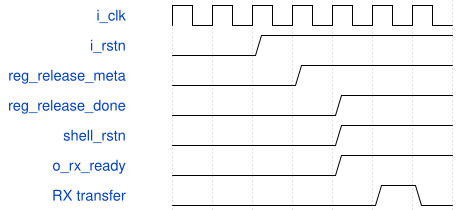
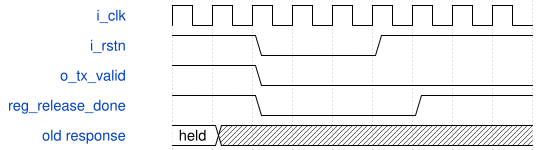

# road_low_io_reset_shell 模块规范

> RTL: `road_low_io_reset_shell.v`

## 1. 模块目的

Two-stage asynchronous-assertion and synchronous-release reset wrapper around the frozen 38-bit low-I/O physical shell.

## 2. 参数

| 参数 | 默认值 | 说明 |
| --- | --- | --- |
| — | — | 本模块没有可配置参数。 |

## 3. 时钟与复位

- 时钟：`{"name": "i_clk", "edge": "posedge", "frequency_hz": 100000000}`
- 复位：`{"name": "i_rstn", "active": "low", "synchronous": false, "values": "Both release registers clear asynchronously. The frozen shell receives only the second-stage register as its reset, so deassertion reaches the shell synchronously."}`

## 4. 接口信号规范

| 信号 | 方向 | 位宽 | 时钟域 | 语义角色 | 描述 |
| --- | --- | --- | --- | --- | --- |
| `i_clk` | input | 1 | i_clk | clock | 100 MHz diagnostic clock. |
| `i_rstn` | input | 1 | i_clk | reset | Asynchronous active-low external reset source. |
| `i_rx_valid` | input | 1 | i_clk | receive_valid | New-session receive word valid; the source discards any interrupted frame at reset. |
| `i_rx_data` | input | 16 | i_clk | receive_payload | Unmodified command and payload data for the frozen shell. |
| `o_rx_ready` | output | 1 | i_clk | receive_ready | Forced low during reset and release waiting, then mirrors the frozen shell. |
| `o_tx_valid` | output | 1 | i_clk | transmit_valid | Forced low during reset and release waiting, then mirrors the frozen shell. |
| `o_tx_data` | output | 16 | i_clk | transmit_payload | Unmodified frozen-shell response payload; ignored while transmit valid is low. |
| `i_tx_ready` | input | 1 | i_clk | transmit_ready | Consumer permission, blocked from the frozen shell until release completes. |

## 5. 周期行为与延迟

- An external low level asynchronously clears reg_release_meta and reg_release_done. shell_rstn is exactly reg_release_done and has no combinational AND path from i_rstn.
- After i_rstn rises, the first sampled rising edge sets only reg_release_meta. The second sampled rising edge sets reg_release_done, while the frozen shell still samples its previous low reset value on that edge.
- The first edge that can consume a new external receive transfer is the third sampled rising edge, which is the first rising edge after shell_rstn becomes high.
- o_rx_ready and o_tx_valid are forced low while raw reset is low or reg_release_done is low. i_rx_valid and i_tx_ready are also blocked from the frozen shell in the same interval.
- Reset cancels the current table, packet, run, export, and held response through the unchanged frozen shell. Recovery requires a new TABLE_BEGIN followed by all 1024 table entries.
- Normal arithmetic, fixed multipliers, interfaces, run initiation interval, immediate cancellation semantics, and result behavior are unchanged after release. Table reload time is a separate recovery window rather than part of the normal run interval.

## 6. WaveDrom 时序图

### Two-stage reset release and first legal transfer

The first edge samples external release into the first stage. The second edge raises the second stage after the frozen shell has sampled reset low. A new transfer is first legal on the third edge.

- WaveJSON：[road_low_io_reset_shell_two-stage-release.json5](waveforms/road_low_io_reset_shell_two-stage-release.json5)

### Asynchronous cancellation of a stalled response

Raw reset assertion clears the release stages and forces the external handshake outputs low without waiting for a clock. No held response returns after synchronous release.

- WaveJSON：[road_low_io_reset_shell_asynchronous-cancel.json5](waveforms/road_low_io_reset_shell_asynchronous-cancel.json5)

## 7. 边界、反压与错误

- Reset assertion between clocks immediately blocks external ready and valid and asynchronously resets both release stages.
- Reset release 0.1 ns before or after a rising edge follows the same first-sampled-edge rule in digital simulation; this does not model analog metastability.
- Reset during a partial table load invalidates the table and restarts the implicit table address at zero.
- Reset during a held transmit response removes external valid and no old response reappears after release.
- New computation remains blocked until the complete 1024-entry table is reloaded after every reset.

## 8. CDC 与综合约束

- The referenced road_low_io_physical_shell and road_onchip_chain files are immutable and retain their recorded SHA-256 hashes.
- The external producer and consumer discard an interrupted protocol frame when reset asserts. The producer removes any old valid and starts the recovered session with a new TABLE_BEGIN.
- The wrapper does not identify an old epoch if an external producer keeps a pre-reset valid asserted across reset; no epoch port is added.
- Two synchronizer stages are an architecture choice, not proof that metastability is eliminated. New physical timing must separately sign off reset recovery/removal, fanout, and delay.
- No new timing exception, behavioral RAM substitute, training, production bitstream, board Flash operation, or production top replacement is permitted.

## 9. 验证与验收

- Run the unchanged fourteen-case numerical, range, backpressure, partial-frame, core-reset, held-export-reset, and held-status-reset regression through this wrapper hierarchy.
- Check raw asynchronous assertion, ordinary two-edge release, release 0.1 ns before a rising edge, and release 0.1 ns after a rising edge.
- Reset a partial table load, confirm pending valid and table count clear, then reload all 1024 entries with the vendor PH1P ERAM model.
- Reset a stalled STATUS response and confirm recovery exposes no old transmit transaction or receive count.

## 10. 可追溯性

- 规格模块：`road_low_io_reset_shell`
- RTL 路径：`road_low_io_reset_shell.v`
- 交付要求：本文档、WaveJSON 和 SVG 必须与同一版本规格一同发布。
