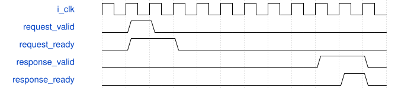

# road_numeric_rom_reader 模块规范

> RTL: `rtl/road_numeric_rom_reader.v`

## 1. 模块目的

未提供模块目的。

## 2. 参数

| 参数 | 默认值 | 说明 |
| --- | --- | --- |
| — | — | 本模块没有可配置参数。 |

## 3. 时钟与复位

- 时钟：`{"name": "i_clk", "frequency_hz": 100000000}`
- 复位：`{"name": "i_rstn", "assert": "async_low", "release": "Unchanged reader input reset; requester service waits for its own two-stage release"}`

## 4. 接口信号规范

| 信号 | 方向 | 位宽 | 时钟域 | 语义角色 | 描述 |
| --- | --- | --- | --- | --- | --- |
| `i_clk` | input | 1 | i_clk | clk | 统一100MHz上升沿时钟 |
| `i_rstn` | input | 1 | i_clk | rstn | 共同低有效异步复位，本地两级同步释放 |
| `i_request_valid` | input | 1 | i_clk | request_valid | request_valid：按requirements中对应事务/计数合同使用 |
| `i_request_addr` | input | 13 | i_clk | request_addr | request_addr：按requirements中对应事务/计数合同使用 |
| `i_response_ready` | input | 1 | i_clk | response_ready | response_ready：按requirements中对应事务/计数合同使用 |
| `o_request_ready` | output | 1 | i_clk | request_ready | request_ready：按requirements中对应事务/计数合同使用 |
| `o_response_valid` | output | 1 | i_clk | response_valid | response_valid：按requirements中对应事务/计数合同使用 |
| `o_response_data` | output | 160 | i_clk | response_data | response_data：按requirements中对应事务/计数合同使用 |
| `o_fault` | output | 1 | i_clk | fault | 本组件故障状态，不得发布为成功表 |

## 5. 周期行为与延迟

- 冻结reader源码完全相同；一个未决13位词号，地址0..7167，非法地址粘滞故障。
- 接受时锁定地址，原WAIT计数0..7后注册完整160位；响应保持至ready，不缩短等待。
- 共同i_rstn清valid/state；取消排空由外部LUT服务处理，不增加reader cancel端口。

## 6. WaveDrom 时序图

### 请求所有权与停顿

协议示意：省略内部变长计算，用空白间隔表示；不是固定总时延。仅valid与ready同拍消费。

- WaveJSON：[road_numeric_rom_reader_request-hold-response.json5](waveforms/road_numeric_rom_reader_request-hold-response.json5)

## 7. 边界、反压与错误

- 复位、取消、背压、非法身份和边界地址；取消不能当成无标签外设已排空

## 8. CDC 与综合约束

- Verilog-2001；一个未决事务；ready/valid握手；无TD/物理时序签核
- 不改变冻结算术核/数值，不复制公共存储

## 9. 验证与验收

- 11数值向量、protocol、phase_reset，逐项DECODED160对拍

## 10. 可追溯性

- 规格模块：`road_numeric_rom_reader`
- RTL 路径：`rtl/road_numeric_rom_reader.v`
- 交付要求：本文档、WaveJSON 和 SVG 必须与同一版本规格一同发布。
